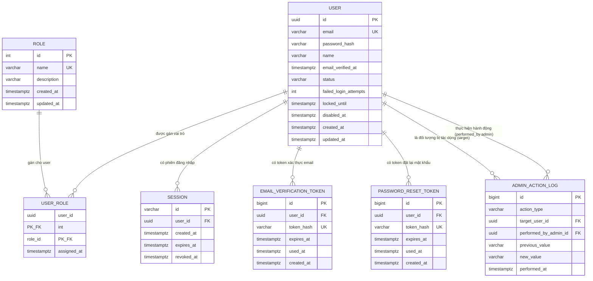

# Thiết kế dữ liệu: Module nền tảng Auth + RBAC (Multi-User System — Giai đoạn 1)

> Tài liệu này là **bản thiết kế/ERD ở mức ý tưởng**, dùng làm input cho bước
> viết `schema.prisma` thật sau này. Đây KHÔNG phải migration file Prisma có
> thể chạy được.
>
> **Cập nhật (2026-10-18, theo LLD Phase 2 —
> `docs/design/lld-phase2-rbac-account-admin.md`)**: (1) đồng bộ lại thuật
> ngữ trạng thái tài khoản — `DEACTIVATED` (không dùng `DISABLED`) và bổ
> sung `PENDING_VERIFICATION` vào enum `users.status`, khớp đúng
> implementation Phase 1 **đã migrate thật**
> (`backend/prisma/migrations/20261018000000_init/migration.sql`) và
> `api-spec-multi-user-system.md`; tài liệu này trước đó lạc hậu so với code
> thật, nay chỉnh lại cho khớp — **không cần ALTER migration mới cho phần
> này** vì DB thật đã đúng từ đầu. (2) Chính thức hóa bảng mới
> `admin_action_log` (actor-tracking, C-15/T9) đã được quyết định ở LLD
> Phase 2. Xem chi tiết ở mục "Quyết định thiết kế đáng chú ý" và "Giả định
> đã đưa ra".

## Yêu cầu nghiệp vụ

Nguồn: `docs/requirements/srs-multi-user-system.md` (SRS v1.0) và
`docs/architecture/adr/0001-session-management-strategy.md` (ADR-0001, Accepted).

- **Entity chính**: người dùng (User), vai trò (Role), phiên đăng nhập
  (Session), token xác thực email, token đặt lại mật khẩu.
- **Quan hệ dự kiến**: User – Role (phân quyền RBAC, mở rộng được theo
  NFR-005), User – Session (1 user có nhiều phiên tuần tự theo thời gian,
  dù C-4 nói không cần *hiển thị/quản lý* đa phiên cho người dùng — hệ
  thống vẫn cần lưu nhiều session record vì mỗi lần đăng nhập tạo 1 session
  mới), User – EmailVerificationToken, User – PasswordResetToken (1-nhiều).
- **Truy vấn chính dự kiến**:
  - Đăng nhập: tìm user theo email (REQ-AUTH-003).
  - Mỗi request có session: tìm session theo session_id + kiểm tra trạng
    thái user (ADR-0001, REQ-SESSION-001 AC3).
  - Khóa tài khoản: revoke toàn bộ session theo user_id (REQ-ADMIN-002 AC1).
  - Xác thực email / đặt lại mật khẩu: tìm token theo giá trị token (hash)
    (REQ-AUTH-002, REQ-AUTH-004).
  - Admin: tìm/lọc danh sách user theo email, trạng thái, vai trò
    (REQ-ADMIN-001).
  - Last-admin rule: đếm số user đang có role ADMIN và đang ACTIVE (C-3,
    REQ-ACCOUNT-003 AC3, REQ-ADMIN-002 AC3, REQ-ADMIN-003 AC2/AC3).
- **Quyết định kiến trúc đã chốt, không tự ý đổi** (theo đề bài + ADR-0001):
  PostgreSQL + Prisma; session server-side lưu Postgres (không JWT); role
  lưu bảng dữ liệu (không enum); token xác thực email/reset mật khẩu lưu
  hash, hết hạn 24h, dùng một lần; last-admin rule enforce ở tầng ứng
  dụng/transaction; soft-delete khi user tự vô hiệu hóa.

## Bối cảnh schema hiện có (đã khảo sát)

Đã dùng `Glob` quét toàn bộ repo (`**/*.prisma`, `**/migrations/**`,
`**/*.sql`, toàn bộ cây thư mục) — **repo hiện không có bất kỳ migration,
model ORM, hay file schema nào**. Chỉ có `CLAUDE.md` và 2 tài liệu
requirements/ADR đã đọc ở trên. Đây đúng là thiết kế MỚI hoàn toàn (không
phải review schema đã có).

Vì không có schema nào để tham chiếu naming convention, tài liệu này áp
dụng convention mặc định phổ biến cho PostgreSQL + Prisma và **ghi rõ để
team xác nhận lại** trước khi viết `schema.prisma` thật (xem mục "Giả định
đã đưa ra"):

- Tên bảng: `snake_case`, số nhiều (ví dụ `users`, `roles`, `sessions`).
- Tên cột: `snake_case` (ví dụ `password_hash`, `created_at`).
- Khi viết `schema.prisma` thật: model Prisma đặt `PascalCase` số ít (`User`,
  `Role`, `Session`...), field `camelCase` (`passwordHash`, `createdAt`...),
  ánh xạ sang tên bảng/cột `snake_case` ở trên qua `@@map("users")` /
  `@map("password_hash")` — đây là pattern phổ biến và nhất quán với
  CLAUDE.md (camelCase cho code JS/TS, trong khi tầng DB theo chuẩn
  PostgreSQL truyền thống).

## ERD



## Chi tiết từng bảng

### users (MỚI)

| Cột | Kiểu | Null? | Default | Ghi chú |
|---|---|---|---|---|
| id | UUID | NOT NULL | `gen_random_uuid()` | PRIMARY KEY. UUID để tránh lộ thông tin qua ID tuần tự (vd đoán được admin đầu tiên là id=1) |
| email | VARCHAR(255) | NOT NULL | | Giá trị gốc do người dùng nhập (giữ nguyên hoa/thường để hiển thị) |
| password_hash | VARCHAR(255) | NOT NULL | | Hash bcrypt/argon2id ở tầng ứng dụng — KHÔNG BAO GIỜ lưu plaintext (NFR-001) |
| name | VARCHAR(255) | NULL | NULL | Tên hiển thị — nullable vì REQ-AUTH-001 chỉ thu thập email/mật khẩu lúc đăng ký, tên set sau qua REQ-ACCOUNT-001 (giả định, xem mục Giả định) |
| email_verified_at | TIMESTAMPTZ | NULL | NULL | NULL = chưa xác thực (C-1); có giá trị = đã xác thực, lưu thời điểm xác thực |
| status | VARCHAR(20) | NOT NULL | `'ACTIVE'` | `PENDING_VERIFICATION` (mới đăng ký, chưa xác thực email) \| `ACTIVE` \| `LOCKED` (admin khóa, vô thời hạn) \| `DEACTIVATED` (tự soft-delete, C-2) — 4 giá trị này khớp đúng `USER_STATUS` ở code thật (`backend/src/auth/repositories/user-record.interface.ts`) và CHECK constraint đã migrate (xem DDL) |
| failed_login_attempts | INTEGER | NOT NULL | `0` | Đếm số lần sai liên tiếp, reset về 0 khi đăng nhập thành công (C-5) |
| locked_until | TIMESTAMPTZ | NULL | NULL | Khóa tạm do brute-force (C-5), tự hết hạn — **khác** `status='LOCKED'` (admin khóa thủ công, không tự hết hạn) |
| disabled_at | TIMESTAMPTZ | NULL | NULL | Thời điểm user tự vô hiệu hóa (set cùng lúc `status='DEACTIVATED'`), phục vụ soft-delete (C-2). **Tên cột giữ nguyên `disabled_at`** (không đổi thành `deactivated_at`) — xem giải thích ở mục "Quyết định thiết kế đáng chú ý" |
| created_at | TIMESTAMPTZ | NOT NULL | `now()` | |
| updated_at | TIMESTAMPTZ | NOT NULL | `now()` | Tầng ứng dụng/ORM chịu trách nhiệm cập nhật mỗi lần UPDATE |

- PRIMARY KEY: `id`.
- UNIQUE: `LOWER(email)` (functional unique index) — đảm bảo không trùng
  tài khoản qua biến thể hoa/thường của cùng email (REQ-AUTH-001 AC2); dùng
  functional index thay vì extension `citext` để tối giản phụ thuộc
  extension.
- CHECK: `status IN ('ACTIVE','LOCKED','PENDING_VERIFICATION','DEACTIVATED')` — đã
  đúng ở DB thật (migration `20261018000000_init`); bản nháp trước đây của
  tài liệu này thiếu `PENDING_VERIFICATION` và dùng sai `DISABLED`, nay đồng
  bộ lại.
- CHECK: `failed_login_attempts >= 0`.
- Index đề xuất:
  - `UNIQUE INDEX ON users (LOWER(email))` — phục vụ đăng nhập (tìm theo
    email, REQ-AUTH-003) và check trùng khi đăng ký (REQ-AUTH-001 AC2).
  - `INDEX ON users (status)` — phục vụ lọc danh sách admin theo trạng thái
    (REQ-ADMIN-001).
  - `INDEX ON users (created_at DESC)` — phục vụ sắp xếp danh sách admin
    (REQ-ADMIN-001 AC1).

### roles (MỚI)

| Cột | Kiểu | Null? | Default | Ghi chú |
|---|---|---|---|---|
| id | INTEGER (IDENTITY) | NOT NULL | auto-increment | PRIMARY KEY. Bảng lookup nhỏ, không cần UUID (không có rủi ro enumeration vì không phải entity bảo mật nhạy cảm) |
| name | VARCHAR(50) | NOT NULL | | Giá trị nghiệp vụ, vd `USER`, `ADMIN`, (tương lai) `MODERATOR` |
| description | VARCHAR(255) | NULL | NULL | Mô tả hiển thị cho admin UI |
| created_at | TIMESTAMPTZ | NOT NULL | `now()` | |
| updated_at | TIMESTAMPTZ | NOT NULL | `now()` | |

- PRIMARY KEY: `id`.
- UNIQUE: `name` — không cho 2 role trùng tên.
- Index đề xuất: PK/UNIQUE trên đã đủ cho bảng nhỏ (dự kiến chỉ vài chục
  dòng tối đa), không cần thêm index khác.
- Đây là bảng dữ liệu thay cho enum cố định — xem lý do ở mục "Quyết định
  thiết kế đáng chú ý" bên dưới (phục vụ NFR-005).

### user_roles (MỚI — bảng trung gian)

| Cột | Kiểu | Null? | Default | Ghi chú |
|---|---|---|---|---|
| user_id | UUID | NOT NULL | | Một phần PK, FK → `users.id` |
| role_id | INTEGER | NOT NULL | | Một phần PK, FK → `roles.id` |
| assigned_at | TIMESTAMPTZ | NOT NULL | `now()` | Thời điểm gán vai trò này |

- PRIMARY KEY: composite `(user_id, role_id)`.
- FOREIGN KEY: `user_id` → `users.id` — `ON DELETE CASCADE` — user trong hệ
  thống này không bao giờ bị hard-delete (C-2 soft-delete), CASCADE chỉ là
  phòng hộ nếu sau này có tác vụ purge dữ liệu thật.
- FOREIGN KEY: `role_id` → `roles.id` — `ON DELETE RESTRICT` — chặn admin
  xóa một role (vd `ADMIN`) khi vẫn còn user đang gán role đó, bảo vệ toàn
  vẹn dữ liệu.
- Index đề xuất:
  - PK `(user_id, role_id)` phục vụ tra "role của user X" (JOIN từ user).
  - `INDEX ON user_roles (role_id)` — phục vụ truy vấn ngược "danh sách
    user có role ADMIN" (REQ-ADMIN-001 lọc theo role; cũng là truy vấn lõi
    của last-admin rule — đếm số user có role ADMIN).
- **Lưu ý về ràng buộc "mỗi user đúng 1 role tại một thời điểm"**: KHÔNG đặt
  `UNIQUE(user_id)` cứng ở DB — xem giải thích ở mục Giả định/Quyết định
  thiết kế đáng chú ý bên dưới.

### sessions (MỚI)

| Cột | Kiểu | Null? | Default | Ghi chú |
|---|---|---|---|---|
| id | VARCHAR(64) | NOT NULL | (sinh ở app) | PRIMARY KEY. Chính là `session_id` gửi cho client qua cookie httpOnly+Secure (theo ADR-0001) — sinh ở tầng ứng dụng bằng giá trị ngẫu nhiên đủ entropy (vd UUID v4 hoặc random 256-bit base64url), KHÔNG dùng DB sequence |
| user_id | UUID | NOT NULL | | FK → `users.id` |
| role_snapshot | VARCHAR(50) | NOT NULL | | Tên role (vd `USER`/`ADMIN`) của user tại ĐÚNG thời điểm tạo session, sao chép từ `user_roles`/`roles` lúc login — KHÔNG join real-time `user_roles` mỗi request. Phục vụ C-11: khi Admin đổi vai trò một user, thay đổi chỉ có hiệu lực ở phiên đăng nhập TIẾP THEO, phiên đang hoạt động vẫn dùng role cũ cho tới khi hết hạn/đăng xuất/đăng nhập lại. `RolesGuard` đọc quyền từ cột này, không phải từ bảng `user_roles` |
| created_at | TIMESTAMPTZ | NOT NULL | `now()` | |
| expires_at | TIMESTAMPTZ | NOT NULL | | `created_at + 7 ngày` (C-7), tính ở tầng ứng dụng khi tạo |
| revoked_at | TIMESTAMPTZ | NULL | NULL | NULL = chưa bị thu hồi; có giá trị = đã logout (REQ-SESSION-002) hoặc bị admin revoke hàng loạt (REQ-ADMIN-002 AC1) hoặc user tự vô hiệu hóa tài khoản (REQ-ACCOUNT-003 AC1) |

- PRIMARY KEY: `id`.
- FOREIGN KEY: `user_id` → `users.id` — `ON DELETE CASCADE`.
- Session được coi là "đang hoạt động" khi: `revoked_at IS NULL AND
  expires_at > now()` AND user tương ứng có `status = 'ACTIVE'` (check này
  là tầng ứng dụng mỗi request, theo ADR-0001).
- Index đề xuất:
  - PK `id` — phục vụ trực tiếp "tìm session theo session_id" mỗi request
    (truy vấn nóng nhất của cả hệ thống, theo ADR-0001).
  - `INDEX ON sessions (user_id) WHERE revoked_at IS NULL` (partial index)
    — phục vụ "revoke hàng loạt session theo user_id" khi khóa tài khoản
    (REQ-ADMIN-002 AC1) và kiểm tra nhanh session đang active của 1 user.
  - `INDEX ON sessions (expires_at)` — phục vụ job dọn dẹp session hết hạn
    định kỳ (không bắt buộc nghiệp vụ nhưng cần cho vận hành/dọn bảng).
- **Không** thêm cột `ip_address`/`user_agent` — C-4 nêu rõ giai đoạn 1
  không cần xem/quản lý đa phiên/đa thiết bị, nên không thiết kế metadata
  phục vụ tính năng đó để tránh lan man ngoài phạm vi (nguyên tắc #8).

### email_verification_tokens (MỚI)

| Cột | Kiểu | Null? | Default | Ghi chú |
|---|---|---|---|---|
| id | BIGINT (IDENTITY) | NOT NULL | auto-increment | PRIMARY KEY nội bộ, không bao giờ expose ra ngoài (client chỉ gửi token thô qua link, không gửi id) |
| user_id | UUID | NOT NULL | | FK → `users.id` |
| token_hash | VARCHAR(255) | NOT NULL | | SHA-256 (hoặc tương đương) của token thô gửi trong email — KHÔNG lưu token thô (xem lý do ở mục Quyết định thiết kế đáng chú ý) |
| expires_at | TIMESTAMPTZ | NOT NULL | | `created_at + 24 giờ` (C-7) |
| used_at | TIMESTAMPTZ | NULL | NULL | NULL = chưa dùng; có giá trị = đã dùng (dùng một lần — REQ-AUTH-002 AC3) |
| created_at | TIMESTAMPTZ | NOT NULL | `now()` | |

- PRIMARY KEY: `id`.
- FOREIGN KEY: `user_id` → `users.id` — `ON DELETE CASCADE`.
- UNIQUE: `token_hash` — đảm bảo không đụng hash (xác suất cực thấp nhưng
  vẫn nên ràng buộc), đồng thời chính là index phục vụ "tìm token theo giá
  trị" khi user bấm link (REQ-AUTH-002 AC1/AC2/AC3).
- Index đề xuất: `INDEX ON email_verification_tokens (user_id)` — phục vụ
  "tìm token hiện có của user" khi cần gửi lại link mới (REQ-AUTH-002 AC2) —
  khuyến nghị tầng ứng dụng vô hiệu hóa (set `used_at = now()`) các token
  cũ của cùng user khi phát hành token mới, để tránh nhiều link cùng hợp lệ.

### password_reset_tokens (MỚI)

Cấu trúc tương tự `email_verification_tokens`, phục vụ REQ-AUTH-004:

| Cột | Kiểu | Null? | Default | Ghi chú |
|---|---|---|---|---|
| id | BIGINT (IDENTITY) | NOT NULL | auto-increment | PRIMARY KEY nội bộ |
| user_id | UUID | NOT NULL | | FK → `users.id` |
| token_hash | VARCHAR(255) | NOT NULL | | Hash của token reset gửi qua email — không lưu thô |
| expires_at | TIMESTAMPTZ | NOT NULL | | `created_at + 24 giờ` (C-7) |
| used_at | TIMESTAMPTZ | NULL | NULL | Dùng một lần (REQ-AUTH-004 AC3/AC4) |
| created_at | TIMESTAMPTZ | NOT NULL | `now()` | |

- PRIMARY KEY: `id`.
- FOREIGN KEY: `user_id` → `users.id` — `ON DELETE CASCADE`.
- UNIQUE: `token_hash`.
- Index đề xuất: `INDEX ON password_reset_tokens (user_id)` — tương tự lý
  do ở bảng email_verification_tokens; khuyến nghị vô hiệu hóa token reset
  cũ khi phát hành token mới cho cùng user.

### admin_action_log (MỚI — Giai đoạn 2)

Chính thức hóa từ `lld-phase2-rbac-account-admin.md`, mục "Điểm hở 2". Bảng
append-only, tối giản, phục vụ actor-tracking (C-15, threat T9): ghi
nhận admin nào thực hiện hành động lock/unlock/role-change trên user nào,
khi nào — **không phải** "audit log hành động Admin" đầy đủ (có UI xem,
filter, export) mà SRS mục 5.2 liệt kê là ngoài phạm vi (xem phân biệt rõ ở
mục Giả định).

| Cột | Kiểu | Null? | Default | Ghi chú |
|---|---|---|---|---|
| id | BIGINT (IDENTITY) | NOT NULL | auto-increment | PRIMARY KEY nội bộ, không bao giờ expose ra ngoài qua API |
| action_type | VARCHAR(30) | NOT NULL | | `LOCK` \| `UNLOCK` \| `ROLE_CHANGE` |
| target_user_id | UUID | NOT NULL | | FK → `users.id` — user bị tác động |
| performed_by_admin_id | UUID | NOT NULL | | FK → `users.id` — admin thực hiện hành động. **Luôn lấy từ `authContext.userId` của request, không bao giờ nhận từ client** (chống admin "đổ lỗi" cho admin khác — đúng mục đích chống chối bỏ của C-15) |
| previous_value | VARCHAR(50) | NULL | NULL | Giá trị status/role cũ trước khi đổi (tối giản, optional) |
| new_value | VARCHAR(50) | NULL | NULL | Giá trị status/role mới sau khi đổi |
| performed_at | TIMESTAMPTZ | NOT NULL | `now()` | Thời điểm thực hiện — **phải ghi trong CÙNG transaction** với hành động chính (lock/unlock/role-change), nếu transaction rollback thì log cũng không được ghi (atomic) |

- PRIMARY KEY: `id`.
- FOREIGN KEY: `target_user_id` → `users.id` — `ON DELETE RESTRICT` — không
  hard-delete user trong hệ thống này (C-2, soft-delete), nên không có tình
  huống cần cascade; `RESTRICT` là phòng hộ giữ toàn vẹn lịch sử actor-
  tracking nếu sau này có tác vụ purge dữ liệu.
- FOREIGN KEY: `performed_by_admin_id` → `users.id` — `ON DELETE RESTRICT` —
  cùng lý do, không được mất dấu "ai đã thực hiện" dù admin đó sau này bị
  đổi trạng thái.
- CHECK: `action_type IN ('LOCK','UNLOCK','ROLE_CHANGE')` — giá trị cố định,
  dùng CHECK thay VARCHAR tự do (nguyên tắc #6).
- Index đề xuất:
  - `INDEX ON admin_action_log (target_user_id)` — phục vụ tra "lịch sử bị
    tác động của user X" (forensic theo target).
  - `INDEX ON admin_action_log (performed_by_admin_id)` — phục vụ tra "lịch
    sử hành động của admin Y" (forensic theo actor).
  - `INDEX ON admin_action_log (performed_at DESC)` — phục vụ sắp xếp/tra
    cứu theo thời gian gần nhất.
- **Append-only**: không có `updated_at`, không update/soft-delete dòng đã
  ghi — mỗi hành động là 1 dòng mới, giữ được lịch sử đầy đủ (vd lock→unlock→
  lock nhiều lần không bị ghi đè, khác phương án cột trên `users`).

### Quyết định thiết kế đáng chú ý (giải thích ngắn gọn)

- **Vì sao `roles` là bảng dữ liệu, không phải ENUM**: ENUM của Postgres
  đòi hỏi `ALTER TYPE ... ADD VALUE` mỗi khi thêm vai trò mới (vd
  `MODERATOR` sau này) — đây là thay đổi schema cần migration + coordinate
  deploy, và trước PG12 còn không chạy được trong cùng transaction với câu
  lệnh dùng giá trị mới. Với bảng `roles`, thêm vai trò mới chỉ là
  `INSERT INTO roles (name) VALUES ('MODERATOR')` — không cần migration,
  đáp ứng trực tiếp NFR-005.
- **Vì sao `user_roles` là bảng nhiều-nhiều thay vì FK `role_id` thẳng trên
  `users`**: dù nghiệp vụ Giai đoạn 1 chỉ gán đúng 1 role/user tại một thời
  điểm (không có user story nào mô tả user có nhiều role đồng thời), dùng
  mô hình many-to-many chuẩn của RBAC giúp nếu tương lai cần gán nhiều role
  cho 1 user (vd vừa `USER` vừa `MODERATOR`) thì không cần migration phá vỡ
  (chỉ cần ngừng ràng buộc 1-role-per-user ở tầng service, schema không
  đổi). Đánh đổi: ràng buộc "đúng 1 role/user" hiện enforce ở tầng
  service/transaction (xóa role cũ + gán role mới trong cùng transaction
  khi REQ-ADMIN-003 thay đổi vai trò), KHÔNG đặt `UNIQUE(user_id)` cứng ở
  DB. Nếu team ưu tiên đơn giản/an toàn hơn là khả năng mở rộng multi-role,
  có thể thêm `UNIQUE(user_id)` ngay — cần xác nhận lựa chọn này.
- **Vì sao token xác thực email/reset mật khẩu lưu hash, không lưu thô**:
  nếu DB bị lộ (backup rò rỉ, SQL injection đọc dữ liệu, log lỡ ghi lại
  query...), kẻ tấn công cầm được giá trị thô sẽ chiếm được quyền xác thực
  email hoặc đặt lại mật khẩu của nạn nhân ngay lập tức mà không cần gì
  thêm — tương tự lý do không lưu mật khẩu plaintext (NFR-001). Lưu hash
  (SHA-256) khiến dữ liệu rò rỉ từ DB vô dụng với kẻ tấn công vì không suy
  ngược lại được token gốc.
- **Vì sao `session.id` KHÔNG hash, trong khi token email/reset PHẢI
  hash**: đây là quyết định đã chốt ở ADR-0001 — session_id được backend
  tạo ra, trả thẳng cho client qua cookie **httpOnly + Secure**, và chính
  giá trị đó được dùng để tra cứu DB mỗi request. ADR không yêu cầu hash
  session_id, nên tài liệu này tuân theo nguyên trạng, không tự ý đổi
  (nguyên tắc "không tự ý đổi quyết định kiến trúc đã chốt"). Khác biệt
  rủi ro: cookie httpOnly không bị JS đọc (giảm rủi ro XSS-exfiltration),
  trong khi token email/reset đi qua đường link email (dễ bị lưu log,
  forward nhầm, cache proxy...) nên cần lớp bảo vệ bổ sung (hash) tại DB.
- **Cách enforce last-admin rule (C-3) ở mức dữ liệu/transaction**: đây
  **không thể** enforce thuần bằng DB CHECK constraint (CHECK constraint
  trong Postgres chỉ xét trong phạm vi 1 dòng, không xét được aggregate
  COUNT qua các dòng khác). Đề xuất 2 lớp:
  1. **Bắt buộc — tầng ứng dụng, trong transaction**: mọi thao tác có khả
     năng làm mất ADMIN cuối cùng (tự vô hiệu hóa — REQ-ACCOUNT-003 AC3; tự
     khóa — REQ-ADMIN-002 AC3; hạ cấp role — REQ-ADMIN-003 AC2/AC3) phải
     chạy trong 1 transaction: `SELECT COUNT(*) FROM user_roles ur JOIN
     users u ON u.id = ur.user_id WHERE ur.role_id = <id ADMIN> AND
     u.status = 'ACTIVE' FOR UPDATE` để khóa pessimistic các dòng liên
     quan, tính số ADMIN còn lại SAU khi áp dụng thay đổi giả định, nếu kết
     quả < 1 thì `ROLLBACK` và trả lỗi nghiệp vụ, nếu >= 1 thì `COMMIT`.
     `FOR UPDATE` giúp tránh race condition khi 2 admin cuối cùng cùng lúc
     tự hạ cấp/khóa nhau.
  2. **Khuyến nghị thêm (phòng hộ ở tầng DB, không bắt buộc)**: một DB
     trigger `BEFORE DELETE/UPDATE` trên `user_roles`/`users` kiểm tra lại
     bất biến "còn ít nhất 1 user ACTIVE có role ADMIN" và `RAISE
     EXCEPTION` nếu vi phạm, như lớp phòng hộ thứ 2 phòng trường hợp có
     code path nào quên áp dụng rule ở tầng service. Lưu ý: trigger loại
     này có thể phức tạp hóa việc debug và tăng rủi ro deadlock nếu kết hợp
     không cẩn thận với khóa `FOR UPDATE` ở tầng ứng dụng — nên coi tầng
     ứng dụng là nguồn enforce chính, trigger chỉ là safety net tùy chọn.
- **Vì sao actor-tracking (C-15/T9) là bảng `admin_action_log` riêng, không
  phải cột trên `users`** (quyết định đã chốt ở
  `lld-phase2-rbac-account-admin.md`, chính thức hóa lại ở đây): phương án
  cột (vd `locked_by_admin_id`, `last_role_changed_by_admin_id` + timestamp)
  chỉ giữ được hành động **gần nhất** của mỗi loại — bị ghi đè nếu admin
  lock→unlock→lock nhiều lần, mất khả năng truy vết lịch sử (ngược lại đúng
  mục đích chống chối bỏ mà T9 cần). Phương án cột cũng phải thêm cột mới
  mỗi khi có loại hành động quản trị mới trong tương lai — vi phạm tinh
  thần NFR-005 (mở rộng không cần migration phá vỡ) mà tài liệu này đã áp
  dụng nhất quán cho `roles`/`user_roles`. Đánh đổi: tốn 1 bảng mới + 1
  INSERT phụ mỗi hành động — chi phí nhỏ, chấp nhận được vì tần suất hành
  động Admin thấp.
- **Vì sao `admin_action_log` KHÔNG phải "audit log đầy đủ"**: SRS mục 5.2
  liệt kê "Audit log hành động Admin" (có UI xem, filter, export...) là
  ngoài phạm vi giai đoạn này. `admin_action_log` chỉ là audit **tối giản
  cho bảo mật** (ai/khi nào, phục vụ forensic nội bộ khi cần — không có API
  đọc/filter/export nào được thiết kế kèm bảng này). Hai khái niệm khác
  nhau về mục đích và mức đầu tư — không vi phạm phạm vi SRS.
- **Vì sao `users.disabled_at` giữ tên cũ, không đổi thành
  `deactivated_at`** dù thuật ngữ trạng thái đã chuẩn hóa thành
  `DEACTIVATED`: cột này thuộc bảng `users` của Phase 1 **đã có migration
  thật được áp dụng** (`backend/prisma/migrations/20261018000000_init/`),
  đổi tên cột tại thời điểm này sẽ là một breaking change không cần thiết
  trên dữ liệu đã tồn tại (đổi tên cột, không phải thêm mới) mà không có
  nhu cầu nghiệp vụ nào đòi hỏi — chỉ là lệch thuật ngữ hiển thị giữa tên
  cột và giá trị enum, không ảnh hưởng tính đúng đắn. Giữ nguyên `disabled_at`
  để tránh phát sinh migration rename không cần thiết trên schema đã chạy
  thật; nếu team vẫn muốn đổi tên cho nhất quán tuyệt đối, áp dụng chiến
  lược expand-contract ở mục "Chiến lược migration" bên dưới.

## Chiến lược migration

### Migration khởi tạo (initial migration) — ĐÃ ÁP DỤNG THẬT, chỉ ghi nhận lại

**Không áp dụng phần "breaking change"** cho phần này — đây là migration
khởi tạo đầu tiên của dự án, không có dữ liệu cũ nào bị ảnh hưởng. Migration
này **đã được viết và áp dụng thật**
(`backend/prisma/migrations/20261018000000_init/migration.sql`), khớp đúng
thiết kế dưới đây (bao gồm cả enum `status` đã đúng
`ACTIVE|LOCKED|PENDING_VERIFICATION|DEACTIVATED` ngay từ đầu — phần "sửa
thuật ngữ" ở bản cập nhật tài liệu này chỉ là đồng bộ lại tài liệu nháp cho
khớp DB thật, **không phát sinh ALTER migration mới** cho `users.status`).

1. Tạo bảng theo đúng thứ tự phụ thuộc khóa ngoại (để tránh lỗi FK khi
   chạy migration tuần tự):
   `roles` → `users` → `user_roles` → `sessions` →
   `email_verification_tokens` → `password_reset_tokens`.
2. Tạo các extension cần thiết trước khi tạo bảng dùng chúng: `pgcrypto`
   (cho `gen_random_uuid()` dùng ở `users.id`, `email_verification_tokens.id`
   nếu chọn UUID — xem lưu ý kiểu dữ liệu ở trên) — hoặc dùng hàm
   `gen_random_uuid()` built-in nếu Postgres ≥ 13 (không cần extension).
3. Seed data ngay trong cùng migration khởi tạo (hoặc migration seed riêng
   chạy ngay sau): `INSERT INTO roles (name, description) VALUES ('USER',
   'Người dùng thông thường'), ('ADMIN', 'Quản trị hệ thống')`. Đây là dữ
   liệu cấu hình hệ thống (reference data), không phải dữ liệu nghiệp vụ,
   nên hợp lý để đưa vào migration/seed script chạy mỗi lần deploy môi
   trường mới.
4. **Không** seed sẵn một user ADMIN cụ thể trong migration — theo
   REQ-RBAC-001 AC3, ADMIN đầu tiên được khởi tạo qua "cơ chế bootstrap kỹ
   thuật/vận hành" riêng (vd script vận hành đọc credential từ biến môi
   trường, chạy một lần thủ công sau khi deploy) — việc này là vấn đề triển
   khai/vận hành, nằm ngoài phạm vi migration schema, và ngoài phạm vi của
   bản thiết kế dữ liệu này.
5. Thứ tự xóa bảng khi rollback (nếu cần) ngược lại thứ tự tạo:
   `password_reset_tokens` → `email_verification_tokens` → `sessions` →
   `user_roles` → `users` → `roles`.

### Migration bổ sung Phase 2 — thêm `admin_action_log` (MỚI, chưa áp dụng)

**Không áp dụng chiến lược expand-contract** cho việc thêm bảng này —
`admin_action_log` là bảng hoàn toàn mới, không sửa đổi cấu trúc/kiểu dữ
liệu của bảng/cột đã tồn tại và đã có dữ liệu (`users`), nên đây là một
**migration thuần cộng thêm (additive), an toàn, không breaking**:

1. **Không sửa lại migration `20261018000000_init` đã áp dụng** — tạo
   **migration mới riêng** (ví dụ `..._add_admin_action_log`) chỉ chứa
   `CREATE TABLE admin_action_log` + index + FK tới `users` đã tồn tại.
   Không bao giờ edit trực tiếp file migration đã chạy trên môi trường nào
   (nguyên tắc chung của Prisma Migrate).
2. Thứ tự tạo: sau `users` (vì có FK tới `users.id` 2 lần — `target_user_id`
   và `performed_by_admin_id`), không phụ thuộc `roles`/`user_roles`/
   `sessions`/`*_tokens` nên có thể đặt ở bất kỳ migration nào sau khi
   `users` đã tồn tại; thiết kế này đặt ngay sau `users` trong DDL minh họa
   bên dưới cho rõ ràng.
3. Không cần backfill dữ liệu (bảng mới, rỗng khi tạo) — log bắt đầu được
   ghi từ thời điểm Phase 2 (lock/unlock/role-change) deploy, không hồi tố
   các hành động admin đã xảy ra trước đó (nếu có, nằm ngoài khả năng của
   thiết kế này vì dữ liệu actor-tracking không tồn tại trước khi có bảng).
4. Rollback (nếu cần): `DROP TABLE admin_action_log` — an toàn, không ảnh
   hưởng bảng khác (không có bảng nào khác FK tới `admin_action_log`).

### (Tùy chọn, không bắt buộc) Rename `users.disabled_at` → `deactivated_at`

Nếu sau này team quyết định đổi tên cột cho nhất quán tuyệt đối với thuật
ngữ `DEACTIVATED` (xem lý do hiện tại chưa làm ở mục "Quyết định thiết kế
đáng chú ý"), đây **là breaking change** trên cột đã có dữ liệu — áp dụng
expand-contract, KHÔNG đổi tên trực tiếp trong 1 bước:
1. Thêm cột mới `deactivated_at` (nullable).
2. Dual-write: mọi code path set `disabled_at` cũng set `deactivated_at`
   cùng giá trị; backfill 1 lần `UPDATE users SET deactivated_at =
   disabled_at WHERE disabled_at IS NOT NULL`.
3. Chuyển toàn bộ code đọc sang `deactivated_at`.
4. Sau khi xác nhận ổn định, xóa cột `disabled_at` ở migration riêng kế
   tiếp.

## DDL minh họa (BẢN NHÁP — chưa qua review)

```sql
-- Bản nháp minh họa, CẦN qua db-schema-reviewer trước khi dùng làm migration thật
-- Giả định: Postgres >= 13 (gen_random_uuid() built-in, không cần pgcrypto)

CREATE TABLE roles (
  id          INTEGER GENERATED ALWAYS AS IDENTITY PRIMARY KEY,
  name        VARCHAR(50) NOT NULL UNIQUE,
  description VARCHAR(255),
  created_at  TIMESTAMPTZ NOT NULL DEFAULT now(),
  updated_at  TIMESTAMPTZ NOT NULL DEFAULT now()
);

CREATE TABLE users (
  id                     UUID NOT NULL DEFAULT gen_random_uuid() PRIMARY KEY,
  email                  VARCHAR(255) NOT NULL,
  password_hash          VARCHAR(255) NOT NULL,
  name                   VARCHAR(255),
  email_verified_at      TIMESTAMPTZ,
  status                 VARCHAR(20) NOT NULL DEFAULT 'ACTIVE'
                            CHECK (status IN ('ACTIVE', 'LOCKED', 'PENDING_VERIFICATION', 'DEACTIVATED')),
  failed_login_attempts  INTEGER NOT NULL DEFAULT 0 CHECK (failed_login_attempts >= 0),
  locked_until           TIMESTAMPTZ,
  disabled_at            TIMESTAMPTZ, -- tên cột giữ nguyên, xem "Quyết định thiết kế đáng chú ý"
  created_at             TIMESTAMPTZ NOT NULL DEFAULT now(),
  updated_at             TIMESTAMPTZ NOT NULL DEFAULT now()
);

CREATE UNIQUE INDEX idx_users_email_lower ON users (LOWER(email));
CREATE INDEX idx_users_status ON users (status);
CREATE INDEX idx_users_created_at ON users (created_at DESC);

-- Giai đoạn 2 (MỚI): actor-tracking cho hành động Admin (C-15/T9) — xem
-- mục "admin_action_log (MỚI — Giai đoạn 2...)" ở trên. Chỉ phụ thuộc
-- `users` nên đặt ngay sau users trong thứ tự tạo bảng.
CREATE TABLE admin_action_log (
  id                    BIGINT GENERATED ALWAYS AS IDENTITY PRIMARY KEY,
  action_type           VARCHAR(30) NOT NULL
                           CHECK (action_type IN ('LOCK', 'UNLOCK', 'ROLE_CHANGE')),
  target_user_id        UUID NOT NULL REFERENCES users (id) ON DELETE RESTRICT,
  performed_by_admin_id UUID NOT NULL REFERENCES users (id) ON DELETE RESTRICT,
  previous_value        VARCHAR(50),
  new_value             VARCHAR(50),
  performed_at          TIMESTAMPTZ NOT NULL DEFAULT now()
);

CREATE INDEX idx_admin_action_log_target_user_id ON admin_action_log (target_user_id);
CREATE INDEX idx_admin_action_log_performed_by_admin_id ON admin_action_log (performed_by_admin_id);
CREATE INDEX idx_admin_action_log_performed_at ON admin_action_log (performed_at DESC);

CREATE TABLE user_roles (
  user_id     UUID NOT NULL REFERENCES users (id) ON DELETE CASCADE,
  role_id     INTEGER NOT NULL REFERENCES roles (id) ON DELETE RESTRICT,
  assigned_at TIMESTAMPTZ NOT NULL DEFAULT now(),
  PRIMARY KEY (user_id, role_id)
);

CREATE INDEX idx_user_roles_role_id ON user_roles (role_id);

CREATE TABLE sessions (
  id            VARCHAR(64) PRIMARY KEY, -- sinh ở tầng ứng dụng, không dùng DB default
  user_id       UUID NOT NULL REFERENCES users (id) ON DELETE CASCADE,
  role_snapshot VARCHAR(50) NOT NULL, -- role tại thời điểm tạo session (C-11), RolesGuard đọc từ đây
  created_at    TIMESTAMPTZ NOT NULL DEFAULT now(),
  expires_at    TIMESTAMPTZ NOT NULL,
  revoked_at    TIMESTAMPTZ
);

CREATE INDEX idx_sessions_user_active ON sessions (user_id) WHERE revoked_at IS NULL;
CREATE INDEX idx_sessions_expires_at ON sessions (expires_at);

CREATE TABLE email_verification_tokens (
  id         BIGINT GENERATED ALWAYS AS IDENTITY PRIMARY KEY,
  user_id    UUID NOT NULL REFERENCES users (id) ON DELETE CASCADE,
  token_hash VARCHAR(255) NOT NULL UNIQUE,
  expires_at TIMESTAMPTZ NOT NULL,
  used_at    TIMESTAMPTZ,
  created_at TIMESTAMPTZ NOT NULL DEFAULT now()
);

CREATE INDEX idx_evt_user_id ON email_verification_tokens (user_id);

CREATE TABLE password_reset_tokens (
  id         BIGINT GENERATED ALWAYS AS IDENTITY PRIMARY KEY,
  user_id    UUID NOT NULL REFERENCES users (id) ON DELETE CASCADE,
  token_hash VARCHAR(255) NOT NULL UNIQUE,
  expires_at TIMESTAMPTZ NOT NULL,
  used_at    TIMESTAMPTZ,
  created_at TIMESTAMPTZ NOT NULL DEFAULT now()
);

CREATE INDEX idx_prt_user_id ON password_reset_tokens (user_id);

-- Seed data (reference data — xem mục Chiến lược migration)
INSERT INTO roles (name, description) VALUES
  ('USER', 'Người dùng thông thường'),
  ('ADMIN', 'Quản trị hệ thống');
```

## Giả định đã đưa ra

- Naming convention DB (`snake_case` số nhiều cho bảng/cột) được chọn làm
  mặc định vì repo chưa có schema nào để tham chiếu — cần team xác nhận
  trước khi viết `schema.prisma` thật (có thể đổi nếu team muốn convention
  khác).
- `users.id`, `sessions.user_id`, `*_tokens.user_id`, FK liên quan dùng
  `UUID`; `roles.id` và `*_tokens.id` dùng số nguyên tự tăng — lựa chọn dựa
  trên mức độ "lộ ra ngoài" của từng ID (user/session-token là đối tượng
  nhạy cảm, không nên đoán được; role id và token internal id không bao giờ
  expose qua API/URL nên dùng số nguyên đơn giản, rẻ hơn về index). Cần xác
  nhận nếu team muốn nhất quán 1 kiểu ID cho toàn bộ bảng.
- `users.name` nullable vì REQ-AUTH-001 chỉ mô tả thu thập email/mật khẩu
  lúc đăng ký, tên được set sau qua REQ-ACCOUNT-001 — SRS không nói rõ tên
  có bắt buộc ngay lúc đăng ký hay không.
- Giả định cần unique theo email không phân biệt hoa/thường (dùng
  `LOWER(email)`) — SRS không nói rõ nhưng đây là rủi ro bảo mật/UX phổ
  biến nếu bỏ qua (REQ-AUTH-001 AC2 "email đã tồn tại" nên hiểu bao gồm cả
  biến thể hoa/thường).
- `user_roles` thiết kế nhiều-nhiều nhưng ràng buộc "đúng 1 role/user" chỉ
  enforce ở tầng service/transaction, không có `UNIQUE(user_id)` cứng ở DB
  — đánh đổi để giữ khả năng mở rộng multi-role sau này theo tinh thần
  NFR-005 (xem giải thích chi tiết ở mục "Quyết định thiết kế đáng chú ý").
  Cần xác nhận nếu team muốn ưu tiên ràng buộc cứng ngay từ đầu.
- `sessions` không lưu `ip_address`/`user_agent` vì C-4 nói rõ không cần
  quản lý đa phiên/đa thiết bị ở giai đoạn 1.
- **(Cập nhật Giai đoạn 2)** Trước đây tài liệu này ghi "không thiết kế
  bảng/cột audit log" — câu đó đã lạc hậu. Thực tế có 2 khái niệm khác
  nhau: (1) **"Audit log hành động Admin" đầy đủ** (có UI xem/filter/export)
  — SRS mục 5.2 liệt kê rõ đây vẫn là "Ngoài phạm vi", **vẫn giữ nguyên
  không thiết kế**; (2) **actor-tracking tối giản** (ai/khi nào thực hiện
  lock/unlock/role-change, phục vụ chống chối bỏ — C-15/T9) — **đã được
  thiết kế** qua bảng `admin_action_log` append-only (chính thức hóa từ
  `lld-phase2-rbac-account-admin.md`). Hai khái niệm này không mâu thuẫn:
  (2) là tiền đề bảo mật tối thiểu, (1) là tính năng nghiệp vụ đầy đủ hơn
  vẫn ngoài phạm vi.
- Bảng `admin_action_log` chọn phương án riêng (không phải cột trên
  `users`) — xem lý giải đầy đủ ở mục "Quyết định thiết kế đáng chú ý". Cần
  xác nhận nếu team muốn đổi hướng.
- `users.disabled_at` **giữ nguyên tên cột** (không đổi thành
  `deactivated_at`) vì cột này đã có migration thật áp dụng
  (`backend/prisma/migrations/20261018000000_init/`) — đổi tên tại thời
  điểm này là breaking change không cần thiết trên dữ liệu đã tồn tại. Chỉ
  giá trị enum (`status`) được chuẩn hóa thành `DEACTIVATED`/
  `PENDING_VERIFICATION`, khớp đúng DB thật đã chạy, không phải thay đổi
  mới. Cần xác nhận nếu team vẫn ưu tiên đổi tên cột cho nhất quán tuyệt
  đối (xem chiến lược expand-contract đề xuất ở mục "Chiến lược migration").

## Ngoài phạm vi thiết kế này

- "Audit log hành động Admin" đầy đủ (UI xem/filter/export) — SRS mục 5.2
  liệt kê rõ ngoài phạm vi; `admin_action_log` ở đây chỉ là actor-tracking
  tối giản phục vụ C-15/T9, không thay thế tính năng đó.
- Mã lỗi `CSRF_TOKEN_INVALID` chưa có trong `api-spec-multi-user-system.md`
  (phát hiện ở LLD Phase 2) — thuộc phạm vi `api-designer`, không thuộc
  phạm vi tài liệu dữ liệu này.
- Rate-limit riêng cho hành động Admin, DB trigger phòng hộ bổ sung cho
  last-admin rule (Phase 3 theo HLD) — không thuộc phạm vi cập nhật này.

## Bước tiếp theo gợi ý

- Migration khởi tạo (`roles`→`users`→...→`password_reset_tokens`) **đã
  được viết và áp dụng thật** — không cần làm lại bước này.
- Viết migration Prisma **mới, riêng** (model `AdminActionLog` trong
  `schema.prisma`, `@@map("admin_action_log")`) chỉ thêm bảng
  `admin_action_log` dựa trên DDL minh họa ở trên — KHÔNG sửa lại migration
  `20261018000000_init` đã áp dụng.
- Sau khi viết migration Prisma thật cho `admin_action_log`, dùng
  `db-schema-reviewer` để review trước khi apply lên bất kỳ môi trường nào
  (kể cả local/dev).
- Dùng `api-designer` để bổ sung mã lỗi `CSRF_TOKEN_INVALID` vào
  `api-spec-multi-user-system.md` (không thuộc phạm vi tài liệu này).
- Khi cần mô hình hóa DTO/object nội bộ cho `AccountModule`/`AdminModule`
  (vd `AdminTargetUserRecord`, `RecordAdminActionData`), dùng
  `low-level-designer` — đã có bản nháp ở
  `lld-phase2-rbac-account-admin.md`, việc đó nằm ngoài phạm vi ERD/schema
  của tài liệu này.
</content>
