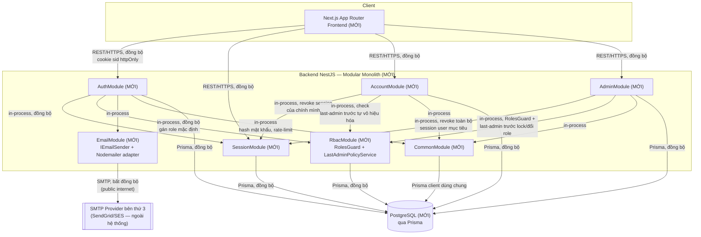

# High-Level Design: Module nền tảng Auth + RBAC — Multi-User System (Giai đoạn 1)

## Phương án kiến trúc đã chốt
- Phương án: Modular Monolith (NestJS, module theo bounded context: AuthModule,
  SessionModule, RbacModule, AccountModule, AdminModule, EmailModule,
  CommonModule); PostgreSQL + Prisma; session server-side lưu Postgres
  (ADR-0001, không dùng JWT); rate-limit brute-force/spam bằng in-memory
  counter (chưa cần Redis, quy mô 1 instance); email qua adapter SMTP bên
  thứ ba (Nodemailer, interface `IEmailSender`); frontend Next.js App Router
  + Tailwind (futuristic/glassmorphism theo CLAUDE.md); monorepo
  `backend/` + `frontend/` qua npm workspaces.
- Nguồn chốt: `system-architect` đề xuất, ghi nhận tại
  `docs/architecture/adr/0001-session-management-strategy.md` (Accepted,
  2026-10-18); các quyết định bổ sung (module boundary, rate-limit in-memory,
  SMTP adapter, monorepo) do người dùng xác nhận trực tiếp trong yêu cầu
  giao việc cho agent này.

## Bối cảnh hệ thống hiện tại (đã khảo sát)
- Module/service liên quan đã tồn tại: **không có** — `Glob **/*` xác nhận
  repo chỉ có `CLAUDE.md` và các tài liệu thiết kế/yêu cầu
  (`docs/requirements/srs-multi-user-system.md`,
  `docs/architecture/adr/0001-session-management-strategy.md`,
  `docs/design/data-model-multi-user-system.md`,
  `docs/design/api-spec-multi-user-system.md`,
  `docs/design/ui-wireframes-multi-user-system.md`). Không có
  `backend/`, `frontend/`, `schema.prisma`, Dockerfile, hay k8s manifest nào.
  Toàn bộ thành phần dưới đây là thành phần **MỚI**, đặt tên theo đúng danh
  sách module đã chốt (AuthModule/SessionModule/RbacModule/AccountModule/
  AdminModule/EmailModule/CommonModule) để khớp trực tiếp với input cho
  `low-level-designer`.
- Pattern giao tiếp hiện có: chưa có code — pattern áp dụng là REST
  qua `/api/v1/*` (đã định nghĩa contract ở `api-spec-multi-user-system.md`),
  cookie session `sid` httpOnly+Secure (ADR-0001), toàn bộ giao tiếp nội bộ
  giữa module backend là in-process call (cùng 1 process Node.js, modular
  monolith — không phải network call giữa service).
- Hạ tầng deployment hiện có: **chưa xác định** — không có Dockerfile/k8s/
  cấu hình cloud nào trong repo. Xem mục "Deployment view" bên dưới.

## Sơ đồ thành phần

## Trách nhiệm từng thành phần

### Frontend — Next.js App Router (MỚI)
- Làm: Hiện thực 9 màn hình theo `ui-wireframes-multi-user-system.md`
  (đăng ký, xác thực email, đăng nhập, quên/đặt lại mật khẩu, hồ sơ cá nhân,
  quản trị người dùng, shell layout); gọi REST API backend; điều hướng dựa
  trên mã lỗi 401/403 trả về (không tự giữ logic phân quyền).
- Không làm: Không lưu/parse token (session là cookie httpOnly, JS không
  đọc được); không tự tính toán last-admin rule hay trạng thái tài khoản —
  luôn tin vào phản hồi backend.
- Biên giới: Giao tiếp duy nhất với backend qua `/api/v1/*` (REST/HTTPS).
  Không gọi trực tiếp Postgres/SMTP.

### CommonModule (MỚI)
- Làm: Cung cấp hạ tầng dùng chung — `PrismaService` (wrapper Prisma
  client), hashing mật khẩu (bcrypt/argon2id — thuật toán cụ thể để lại cho
  LLD), bộ đếm rate-limit in-memory (interface tách riêng để sau này đổi
  sang Redis không ảnh hưởng domain), global exception filter + response
  envelope (theo quy ước ở `api-spec-multi-user-system.md`).
- Không làm: Không chứa logic nghiệp vụ của bất kỳ domain nào (không biết
  "role", "session", "last-admin" là gì).
- Biên giới: Được mọi module khác import; bản thân không phụ thuộc ngược
  vào module nghiệp vụ nào.

### SessionModule (MỚI)
- Làm: Quản lý vòng đời bản ghi `sessions` qua `ISessionRepository`
  (ADR-0001) — tạo session khi login, tra cứu + validate mỗi request
  (`AuthGuard`, kiểm tra `revoked_at IS NULL AND expires_at > now() AND
  user.status = 'ACTIVE'` — **tra cứu real-time**, đáp ứng REQ-SESSION-001
  AC3/REQ-ADMIN-002 AC1), revoke 1 session (logout) hoặc revoke toàn bộ
  session của 1 user (khi admin khóa / user tự vô hiệu hóa).
- Không làm: Không quyết định user có đủ quyền ADMIN hay không (đó là
  RbacModule); không biết nghiệp vụ "last-admin".
- Biên giới: Được `AuthModule` (tạo/xóa session khi login/logout),
  `AccountModule` (revoke session khi tự vô hiệu hóa), `AdminModule`
  (revoke session khi khóa tài khoản) gọi in-process. Là module duy nhất
  thao tác bảng `sessions`.
- **Điểm kỹ thuật cần giải quyết trước LLD**: theo C-11, role dùng cho
  phân quyền (`RolesGuard`) phải là *snapshot tại thời điểm tạo session*,
  khác với `status` (luôn tra real-time). Thiết kế `sessions` hiện tại
  (`data-model-multi-user-system.md`) **chưa có cột lưu snapshot vai trò**
  — cần bổ sung cột (ví dụ `role_snapshot VARCHAR`) trước khi
  `low-level-designer` thiết kế `SessionService.createSession()` (đã được
  bổ sung vào `data-model-multi-user-system.md`, xem mục "Ngoài phạm vi tài
  liệu này" bên dưới).

### RbacModule (MỚI)
- Làm: Định nghĩa `RolesGuard`/decorator `@Roles('ADMIN')` dùng cho mọi
  route ADMIN (đọc role từ snapshot session — xem điểm kỹ thuật ở trên);
  cung cấp `LastAdminPolicyService` — hàm kiểm tra "sau hành động này hệ
  thống còn >= 1 ADMIN đang ACTIVE hay không" chạy trong transaction với
  `SELECT ... FOR UPDATE` (theo cơ chế đã chốt ở `data-model-multi-user-system.md`,
  mục "Cách enforce last-admin rule"); gán role mặc định `USER` khi đăng ký.
- Không làm: Không tự thực hiện hành động nghiệp vụ (khóa tài khoản, đổi
  role) — chỉ cung cấp guard/policy để module khác gọi trước khi commit
  hành động của chính nó.
- Biên giới: Phải sẵn sàng **trước mọi route của AdminModule** (RolesGuard
  là điều kiện tiên quyết để mở route ADMIN). `LastAdminPolicyService` được
  dùng chung bởi `AccountModule` (tự vô hiệu hóa) và `AdminModule` (khóa,
  đổi role) — đây là service dùng chung duy nhất giữa 2 module đó, tránh
  trùng lặp logic đếm ADMIN.

### AuthModule (MỚI)
- Làm: Đăng ký (REQ-AUTH-001), xác thực email (REQ-AUTH-002), đăng nhập
  theo đúng thứ tự kiểm tra 1.7.1 của api-spec (REQ-AUTH-003), quên/đặt lại
  mật khẩu (REQ-AUTH-004), logout (REQ-SESSION-002). Gọi `SessionModule`
  để tạo/hủy session, `RbacModule` để gán role mặc định, `EmailModule` để
  gửi email xác thực/reset, `CommonModule` để hash mật khẩu + rate-limit.
- Không làm: Không tự quản lý bảng `sessions` hay `user_roles` trực tiếp
  (luôn qua SessionModule/RbacModule); không xử lý nghiệp vụ hồ sơ cá nhân
  sau khi đã đăng nhập (đó là AccountModule).
- Biên giới: Public-facing (trừ `logout` cần session hợp lệ).

### AccountModule (MỚI)
- Làm: Xem/sửa thông tin cá nhân (chỉ `name`, REQ-ACCOUNT-001), đổi mật
  khẩu (REQ-ACCOUNT-002), tự vô hiệu hóa tài khoản/soft-delete
  (REQ-ACCOUNT-003) — gọi `LastAdminPolicyService` trước khi cho phép, gọi
  `SessionModule` revoke session hiện tại sau khi vô hiệu hóa thành công.
- Không làm: Không cho đổi email/role qua endpoint này (AC3); không thao
  tác tài khoản của người khác (`id` luôn lấy từ session hiện tại, không
  nhận từ client — chống IDOR theo đúng ghi chú của `api-designer`).
- Biên giới: Phụ thuộc `SessionModule` + `RbacModule` (LastAdminPolicy) đã
  sẵn sàng trước.

### AdminModule (MỚI)
- Làm: Xem/tìm kiếm danh sách người dùng (REQ-ADMIN-001), khóa/mở khóa
  (REQ-ADMIN-002 — trong cùng transaction với revoke toàn bộ session của
  user mục tiêu qua SessionModule), gán/đổi vai trò (REQ-ADMIN-003 — trong
  transaction với LastAdminPolicyService). Mọi route được bảo vệ bởi
  `RbacModule.RolesGuard(ADMIN)`.
- Không làm: Không tự định nghĩa lại rule last-admin (dùng chung
  `LastAdminPolicyService` của RbacModule, không viết logic riêng); không
  xóa cứng dữ liệu người dùng.
- Biên giới: Phụ thuộc `RbacModule` (bắt buộc có trước — guard + policy) và
  `SessionModule` (revoke session khi khóa) đã sẵn sàng trước.

### EmailModule (MỚI)
- Làm: Định nghĩa interface `IEmailSender` (Dependency Inversion) + 1
  implementation `NodemailerSmtpSender` gửi email xác thực/reset qua SMTP
  bên thứ ba (C-8).
- Không làm: Không chứa logic sinh nội dung nghiệp vụ của token (token được
  tạo/hash bởi AuthModule, EmailModule chỉ nhận nội dung đã dựng sẵn để gửi).
- Biên giới: Chỉ được gọi bởi `AuthModule`. Giao tiếp ra ngoài: SMTP provider
  bên thứ ba qua internet công khai (xem mục bảo mật).

## Giao tiếp & luồng dữ liệu

| Từ | Đến | Đồng bộ/Bất đồng bộ | Kênh | Ý nghĩa giao tiếp |
|---|---|---|---|---|
| Frontend | AuthModule | Đồng bộ | REST/HTTPS | Đăng ký, xác thực email, đăng nhập, quên/đặt lại mật khẩu, logout |
| Frontend | AccountModule | Đồng bộ | REST/HTTPS | Xem/sửa hồ sơ, đổi mật khẩu, tự vô hiệu hóa |
| Frontend | AdminModule | Đồng bộ | REST/HTTPS | Danh sách user, khóa/mở khóa, đổi role |
| AuthModule | SessionModule | Đồng bộ | In-process call | Tạo session khi login thành công, hủy session khi logout |
| AuthModule | RbacModule | Đồng bộ | In-process call | Gán role mặc định USER khi tạo user mới |
| AuthModule | EmailModule | Bất đồng bộ (không chặn response chính nếu implement queue/fire-and-forget; chi tiết cơ chế để LLD quyết) | In-process call → SMTP | Gửi email xác thực đăng ký / email đặt lại mật khẩu |
| AccountModule | SessionModule | Đồng bộ | In-process call | Revoke session của chính người dùng khi tự vô hiệu hóa |
| AccountModule | RbacModule | Đồng bộ | In-process call | Kiểm tra last-admin rule trước khi cho tự vô hiệu hóa |
| AdminModule | SessionModule | Đồng bộ | In-process call | Revoke toàn bộ session của user mục tiêu khi khóa tài khoản |
| AdminModule | RbacModule | Đồng bộ | In-process call | RolesGuard chặn truy cập route; kiểm tra last-admin rule trước khi khóa/đổi role |
| SessionModule / Auth / Rbac / Account / Admin | PostgreSQL | Đồng bộ | Prisma ORM | Đọc/ghi dữ liệu persistent (shared database — modular monolith) |
| EmailModule | SMTP Provider | Bất đồng bộ | SMTP (qua internet công khai) | Gửi email transactional xác thực/reset mật khẩu |

### Luồng chính 1: Đăng ký → xác thực email → đăng nhập
1. Frontend → AuthModule: gửi yêu cầu đăng ký (email/mật khẩu).
2. AuthModule → CommonModule: hash mật khẩu, kiểm tra rate-limit theo IP.
3. AuthModule → RbacModule: gán role mặc định `USER` (cùng transaction tạo user).
4. AuthModule → PostgreSQL: lưu `user` (status `PENDING_VERIFICATION`) + `email_verification_token` (hash, hạn 24h).
5. AuthModule → EmailModule → SMTP Provider: gửi email chứa link xác thực.
6. Người dùng bấm link → Frontend → AuthModule: gửi token xác thực.
7. AuthModule → PostgreSQL: đối chiếu token hash, đánh dấu `used_at`, set `email_verified_at`.
8. Frontend → AuthModule: gửi yêu cầu đăng nhập.
9. AuthModule kiểm tra trạng thái tài khoản theo đúng thứ tự đã chốt (tồn tại → không bị khóa → đã xác thực email → đúng mật khẩu).
10. AuthModule → SessionModule: tạo session mới (kèm snapshot role tại thời điểm này).
11. AuthModule → Frontend: trả cookie `sid` httpOnly+Secure.

### Luồng chính 2: Admin khóa tài khoản → revoke toàn bộ session ngay lập tức
1. Frontend (Admin) → AdminModule: yêu cầu khóa tài khoản `{id}`.
2. AdminModule → RbacModule.RolesGuard: xác nhận người gọi đang có role `ADMIN` (đọc từ session snapshot của chính Admin).
3. AdminModule → RbacModule.LastAdminPolicyService: trong 1 transaction, khóa dòng liên quan (`SELECT ... FOR UPDATE`), kiểm tra nếu target đang là ADMIN cuối cùng đang ACTIVE → nếu đúng, rollback, trả lỗi vi phạm last-admin rule (C-10).
4. Nếu không vi phạm: AdminModule → PostgreSQL (cùng transaction): cập nhật `users.status = 'LOCKED'`.
5. AdminModule → SessionModule (cùng transaction): revoke toàn bộ session đang hoạt động của user mục tiêu (`UPDATE sessions SET revoked_at = now() WHERE user_id = ... AND revoked_at IS NULL`).
6. Commit transaction.
7. Ở request tiếp theo của user bị khóa (nếu có), `AuthGuard` của SessionModule tra cứu real-time thấy `revoked_at` đã set hoặc `user.status != ACTIVE` → từ chối ngay lập tức (đáp ứng REQ-ADMIN-002 AC1/REQ-SESSION-001 AC3).

### Luồng chính 3: Admin hạ cấp vai trò một ADMIN khác → kiểm tra last-admin rule an toàn (race condition)
1. Frontend (Admin) → AdminModule: yêu cầu đổi role `{id}` sang `USER`.
2. AdminModule → RbacModule.RolesGuard: xác nhận người gọi là `ADMIN`.
3. AdminModule mở 1 transaction Postgres: `SELECT COUNT(*) FROM user_roles ur JOIN users u ON u.id = ur.user_id WHERE ur.role_id = <ADMIN> AND u.status = 'ACTIVE' FOR UPDATE` — khóa pessimistic các dòng liên quan để tránh 2 request đồng thời (ví dụ 2 ADMIN cuối cùng cùng lúc hạ cấp lẫn nhau) đọc cùng một giá trị đếm cũ.
4. AdminModule tính số ADMIN còn lại SAU khi áp dụng thay đổi giả định (nếu target đang ADMIN+ACTIVE thì trừ 1).
5. Nếu kết quả < 1 → `ROLLBACK`, trả lỗi vi phạm last-admin rule (C-10, áp dụng cho mọi người thực hiện, không chỉ tự-hạ-cấp).
6. Nếu >= 1 → xóa dòng `user_roles(target, ADMIN)`, thêm dòng `user_roles(target, USER)`, `COMMIT`.
7. **Cập nhật sau threat modeling (C-12, thay thế mô tả C-11 gốc cho chiều hạ cấp)**: nếu thao tác là HẠ CẤP một ADMIN xuống USER, AdminModule **PHẢI** gọi `SessionModule.revokeAllSessionsForUser(targetUserId)` trong CÙNG transaction ở bước 6 — giống hệt cơ chế khóa tài khoản (Luồng chính 2). Nếu là THĂNG cấp (USER → ADMIN), giữ nguyên hành vi C-11 gốc: KHÔNG revoke session, có hiệu lực ở phiên tiếp theo. Lý do đổi: threat model (T8) phát hiện nếu không revoke khi hạ cấp, ADMIN vừa bị hạ cấp vẫn dùng được quyền ADMIN cũ tới 7 ngày (kể cả tự gán lại ADMIN cho chính mình) — đi ngược mục đích bảo mật của REQ-ADMIN-003. Xem `docs/security/threat-model-multi-user-system.md` (T8) và SRS C-12.

## Deployment view (tổng quan)

- **Frontend (Next.js)**: chưa xác định — cần người dùng/đội vận hành xác
  nhận host (Vercel, container riêng, hay cùng VM với backend).
- **Backend NestJS (modular monolith: Auth/Session/Rbac/Account/Admin/
  Email/Common)**: giai đoạn 1 chạy **1 instance duy nhất** (phù hợp với
  quyết định dùng rate-limit in-memory — bộ đếm chỉ đúng khi có đúng 1
  instance xử lý request). Hạ tầng cụ thể (container/VM/cloud provider nào)
  — **chưa xác định**, cần xác nhận.
- **PostgreSQL**: giai đoạn 1 chạy **1 instance duy nhất**, backend kết nối
  trực tiếp qua Prisma. Hạ tầng cụ thể (managed DB/self-host) — **chưa xác
  định**.
- **Redis**: **không có** ở giai đoạn 1 (theo quyết định đã chốt). Ranh
  giới mở rộng sau này đã được thiết kế sẵn ở tầng domain, không cần đổi
  kiến trúc:
  - `SessionModule` truy cập session qua `ISessionRepository` (ADR-0001) —
    thêm Redis cache phía trước Postgres chỉ cần implementation mới, không
    đổi `AuthGuard`/API.
  - Rate-limit counter ở `CommonModule` cần tách interface tương tự ngay từ
    Phase 0 — khi scale ngang nhiều instance, đổi sang Redis-backed counter
    mà không đổi chữ ký gọi ở AuthModule.
- **Load balancer / nhiều instance backend**: **không có** ở giai đoạn 1.
  Việc Postgres là shared store (không phải in-memory session store) có
  nghĩa là scale ngang sau này không gặp vấn đề session-affinity (đã ghi
  nhận ở ADR-0001) — nhưng rate-limit in-memory PHẢI chuyển sang Redis
  trước khi scale ngang, nếu không ngưỡng brute-force/spam sẽ bị vô hiệu
  hóa một phần (mỗi instance đếm riêng).
- **SMTP Provider (SendGrid/SES)**: dịch vụ bên thứ ba, luôn qua internet
  công khai, EmailModule kết nối ra ngoài qua SMTP/TLS.

## Phase breakdown (input cho low-level-designer)

### Phase 0: Nền tảng (Foundation)
- Thành phần thuộc phase:
  - Monorepo setup (`backend/`, `frontend/`, npm workspaces).
  - `CommonModule`: `PrismaService`, global exception filter + response
    envelope (theo quy ước `api-spec-multi-user-system.md`), config module
    (.env), password-hashing utility, **interface** rate-limit counter
    (implementation in-memory cho giai đoạn 1).
  - `schema.prisma` khởi tạo theo đúng ERD ở `data-model-multi-user-system.md`
    (6 bảng: roles, users, user_roles, sessions, email_verification_tokens,
    password_reset_tokens) + migration đầu + seed `roles` (USER/ADMIN).
  - `EmailModule`: định nghĩa interface `IEmailSender` (chưa cần
    implementation thật, có thể làm cùng Phase 1).
  - Next.js scaffold + Tailwind config theo bảng "Nguyên tắc thị giác dùng
    chung" trong `ui-wireframes-multi-user-system.md`.
  - ESLint/Prettier theo Google Style Guide (CLAUDE.md).
- Thứ tự phụ thuộc: Không phụ thuộc module nghiệp vụ nào — đây là nền cho
  mọi phase sau.
- Tiêu chí "đủ chi tiết hóa ở mức HLD": `schema.prisma` đã khớp đúng ERD đã
  chốt **và đã có cột snapshot role trong `sessions`** trước khi Phase 1
  bắt đầu code `SessionService.createSession()`; interface
  `IEmailSender`/rate-limit counter đã đủ rõ ranh giới để Phase 1 implement
  dựa vào.

### Phase 1: Auth + Session
- Thành phần thuộc phase: `SessionModule` (ISessionRepository +
  PrismaSessionRepository, SessionService, AuthGuard), `EmailModule`
  (NodemailerSmtpSender implement thật), `AuthModule` (register, verify-email,
  resend-verification, login theo đúng thứ tự kiểm tra 1.7.1, forgot/reset
  password, logout), rate-limit brute-force login (C-5) + spam đăng ký
  theo IP (C-6). FE: màn hình S1–S6.
- **Cập nhật sau threat modeling (C-13, 2026-10-18)**: Rate-limit theo IP
  cho `POST /auth/login` (bổ sung cho per-account C-5, chống credential
  stuffing — T6 Critical) và cho 4 endpoint `verify-email`/
  `resend-verification`/`forgot-password`/`reset-password` (chống
  spam/email-bombing — T3 High) được triển khai **ngay ở Phase 1** bằng
  `IRateLimiter` (đã có sẵn interface ở CommonModule), KHÔNG để tới Phase 3
  như kế hoạch gốc.
- Thứ tự phụ thuộc: `SessionModule` phải xong trước vì `AuthModule.login`
  gọi trực tiếp; `EmailModule` phải có implementation thật trước khi
  `AuthModule.register/forgotPassword` gọi gửi mail.
- Tiêu chí "đủ chi tiết hóa": ranh giới rõ ràng "AuthModule không tự quản lý
  bảng `sessions`" (luôn qua SessionService); đã chốt cơ chế snapshot role
  khi tạo session; không còn câu hỏi mở về thứ tự kiểm tra login (đã có ở
  api-spec 1.7.1); rate-limit IP cho cả 5 endpoint nhạy cảm đã có
  implementation thật, không chỉ interface.

### Phase 2: RBAC + Account + Admin
- Thành phần thuộc phase: `RbacModule` (RolesGuard đọc role từ session
  snapshot, decorator `@Roles`, `LastAdminPolicyService` dùng
  `SELECT...FOR UPDATE` theo cơ chế đã chốt ở data-model), `AccountModule`
  (xem/sửa hồ sơ, đổi mật khẩu, tự vô hiệu hóa — gọi LastAdminPolicyService
  + SessionModule), `AdminModule` (danh sách/tìm kiếm user, khóa/mở khóa —
  transaction với SessionModule, đổi role — transaction với
  LastAdminPolicyService). FE: S7 (hồ sơ cá nhân), S8 (quản trị), S9 (shell
  layout theo role).
- **Cập nhật sau threat modeling (2026-10-18)**:
  - **C-12 (T8, High)**: `AdminModule.changeRole()` khi HẠ CẤP một ADMIN
    xuống USER phải gọi `SessionModule.revokeAllSessionsForUser(targetId)`
    trong cùng transaction với việc cập nhật `user_roles` — giống hệt cơ
    chế khóa tài khoản. THĂNG cấp (USER→ADMIN) vẫn giữ nguyên hành vi C-11
    (áp dụng ở phiên tiếp theo, không revoke).
  - **C-14 (T4, High)**: CSRF protection (double-submit cookie hoặc header
    `X-CSRF-Token`) phải có cho mọi route state-changing của `AdminModule`
    (lock/unlock/role) và `AccountModule` (change-password/deactivate) —
    triển khai ngay ở Phase 2 này, không để tới Phase 3.
  - **C-15 (T9, High)**: `AdminModule` cần ghi nhận tối thiểu actor
    (`performed_by_admin_id`) + timestamp cho mỗi hành động khóa/mở
    khóa/đổi role — cần bổ sung vào `data-model-multi-user-system.md` khi
    `low-level-designer` thiết kế chi tiết Phase 2 (dữ liệu actor không thể
    bổ sung hồi tố, phải có ngay từ khi bảng/thao tác này được tạo).
- Thứ tự phụ thuộc: `RbacModule` (RolesGuard + LastAdminPolicyService) phải
  sẵn sàng **trước mọi route của `AdminModule`**; `SessionModule`/
  `AuthModule` (Phase 1) phải hoạt động trước vì Account/Admin đều cần
  `AuthGuard` + session context.
- Tiêu chí "đủ chi tiết hóa": đã chốt cơ chế transaction/lock cụ thể cho
  `LastAdminPolicyService` (không còn mơ hồ giữa "transaction đơn giản" và
  "SELECT FOR UPDATE"); đã xác nhận `RolesGuard` đọc role từ session
  snapshot (không join real-time `user_roles` mỗi request, đúng C-11, trừ
  ngoại lệ hạ cấp ADMIN theo C-12); ranh giới AccountModule/AdminModule
  dùng chung đúng 1 `LastAdminPolicyService`, không viết logic đếm ADMIN
  trùng lặp ở 2 nơi; CSRF protection và actor-tracking đã có thiết kế cụ
  thể, không còn là mục "khuyến nghị" treo ở Phase 3.

### Phase 3: Hardening + UI polish
- **Cập nhật sau threat modeling (2026-10-18)**: rate-limit cho 5 endpoint
  nhạy cảm (login + 4 endpoint public) và CSRF protection đã được chuyển
  sớm lên Phase 1/Phase 2 (xem C-13, C-14) — KHÔNG còn thuộc Phase 3.
- Thành phần thuộc phase: job dọn session hết hạn định kỳ (dựa trên index
  `sessions.expires_at`); nâng cao rate-limit (CAPTCHA nếu cần) nếu threat
  model Phase 3 review thấy mức hiện tại chưa đủ; rate-limit nhẹ theo phiên
  Admin cho lock/unlock (T10); DB trigger phòng hộ bổ sung cho last-admin
  rule (tùy chọn, T11); test tích hợp tập trung vào 3 luồng rủi ro cao đã
  mô tả ở trên (đặc biệt race-condition last-admin với 2 request đồng
  thời — bắt buộc, không phải tùy chọn); hoàn thiện UI theo đầy đủ checklist
  accessibility và nguyên tắc thị giác futuristic ở
  `ui-wireframes-multi-user-system.md`.
- Thứ tự phụ thuộc: Yêu cầu Phase 1 + Phase 2 đã hoàn chỉnh về mặt chức
  năng (hardening không thêm tính năng nghiệp vụ mới).
- Tiêu chí "đủ chi tiết hóa": mọi điểm rủi ro bảo mật đã nêu ở mục dưới của
  HLD này đều có task cụ thể theo dõi (không còn mục "khuyến nghị" treo lơ
  lửng); test case cho race-condition last-admin đã được viết ra thành
  kịch bản cụ thể (2 ADMIN cuối cùng đồng thời hạ cấp/khóa lẫn nhau).

## Thành phần/kênh giao tiếp nhạy cảm bảo mật (tổng quan)
- **Frontend ↔ AuthModule/AccountModule/AdminModule (REST/HTTPS)** —
  public-facing, dùng cookie session httpOnly+Secure — chuyển từ Bearer
  token sang cookie làm phát sinh rủi ro CSRF (đã được `api-designer` ghi
  nhận); cần `threat-modeler`/`security-auditor` rà soát cơ chế CSRF
  protection ở Phase 3.
- **AuthModule** — xử lý mật khẩu (không bao giờ lưu plaintext, NFR-001) và
  token xác thực email/reset mật khẩu (lưu hash, dùng một lần, hết hạn 24h).
- **EmailModule → SMTP Provider** — kênh đi qua internet công khai; cần bảo
  vệ bí mật thông tin xác thực SMTP (API key/secret) — cơ chế quản lý secret
  cụ thể (biến môi trường/secret manager) **chưa xác định**, cần đội vận
  hành xác nhận.
- **SessionModule** — `session_id` không hash (theo ADR-0001, vì truyền qua
  cookie httpOnly, không qua kênh dễ lộ như link email) — cần đảm bảo
  không log giá trị session_id ra log hệ thống.
- **AdminModule** — chạm dữ liệu người dùng khác (khóa, đổi role); đã được
  bảo vệ bởi `RolesGuard`, nhưng là bề mặt tấn công có giá trị cao nhất của
  hệ thống, cần ưu tiên test kỹ ở Phase 3.
- **Hành vi bảo mật cần lưu ý rõ (hệ quả trực tiếp của quyết định C-11, không
  phải lỗi thiết kế)**: một ADMIN bị hạ cấp vẫn giữ quyền ADMIN trên session
  đang hoạt động của họ cho tới khi session đó hết hạn (tối đa 7 ngày) hoặc
  họ đăng nhập lại — vì role là snapshot tại thời điểm tạo session. Đây là
  đánh đổi đã được chốt ở mức nghiệp vụ (C-11), ghi nhận rõ ở đây để đội vận
  hành/bảo mật không bất ngờ khi phát hiện qua kiểm thử.

## Ngoài phạm vi tài liệu này
- **Thuật toán hash mật khẩu cụ thể** (bcrypt vs argon2id, cost factor):
  chưa chốt ở bất kỳ tài liệu nguồn nào — để `low-level-designer` quyết định
  khi thiết kế `CommonModule`.
- **CSRF protection chi tiết** (double-submit cookie vs header riêng, cách
  implement cụ thể): đánh dấu cần `threat-modeler`/`security-auditor` rà
  soát kỹ ở Phase 3 — không thuộc phạm vi HLD mức tổng quan này.
- **Giả định A-1 (độ mạnh mật khẩu) đã được nâng thành ràng buộc chính thức
  C-9** trong SRS — không còn là vấn đề mở.

## Bước tiếp theo gợi ý
- Dùng `low-level-designer` để chi tiết hóa từng module ở Phase 1
  (`SessionService`, `AuthGuard`, `AuthModule` controllers/services) thành
  class/interface/sequence diagram cấp code, dựa trực tiếp trên HLD này.
- Dùng `threat-modeler` để rà soát STRIDE cho luồng auth/RBAC trước khi
  code (bước kế tiếp trong SDLC đã lên kế hoạch).
- Dùng `security-auditor` ở Phase 3 để rà soát kỹ CSRF protection và
  race-condition last-admin trước khi go-live.
