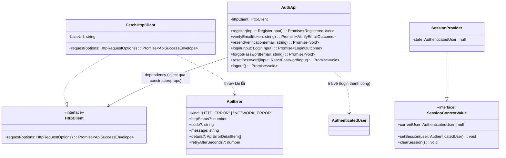
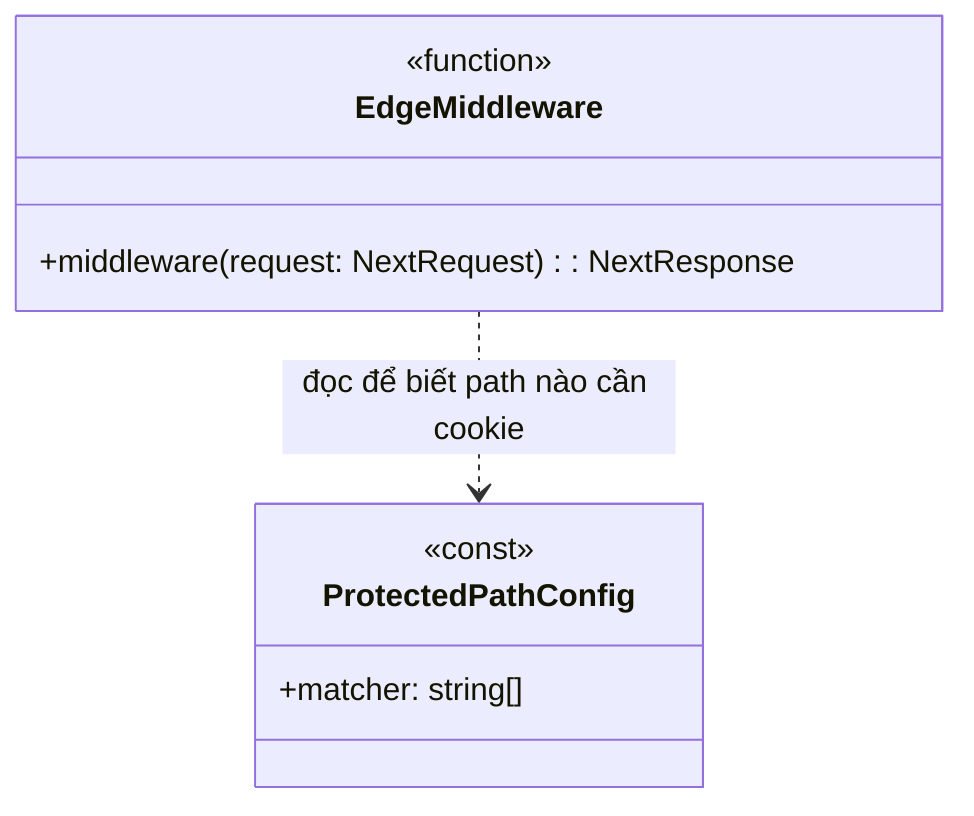
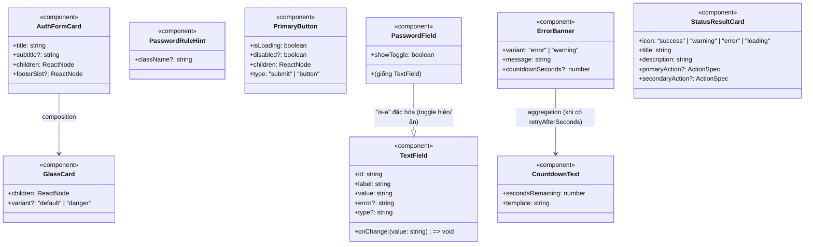
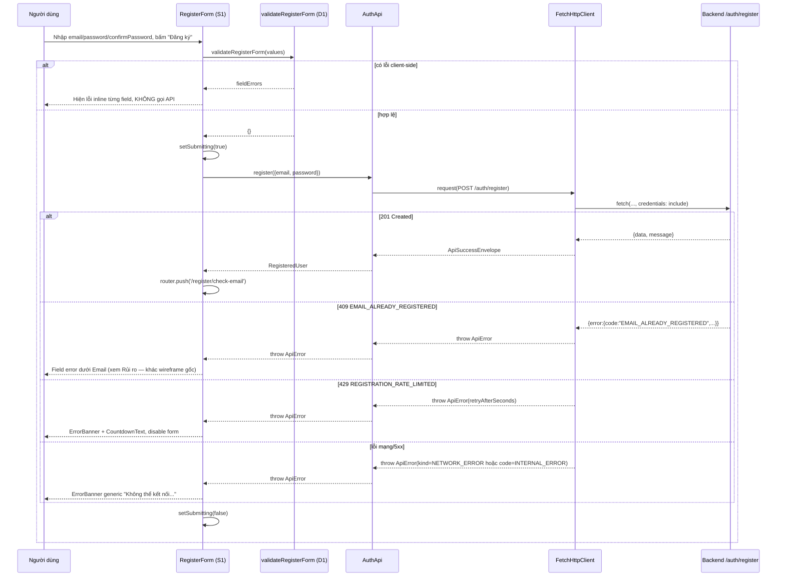
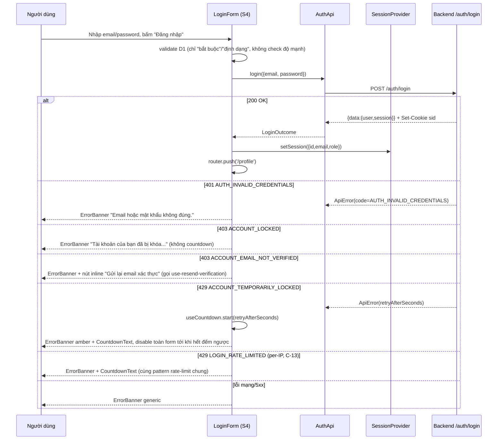

# Low-Level Design: Frontend Phase 0 (Nền tảng) + Phase 1 (Auth + Session, S1–S6) — Multi-User System

## HLD/phương án kiến trúc làm căn cứ
- Next.js **App Router** + Tailwind, futuristic/glassmorphism theo `CLAUDE.md` (HLD, mục "Trách nhiệm từng thành phần — Frontend").
- Session server-side lưu PostgreSQL, cookie `sid` **HttpOnly + Secure + SameSite=Lax**, KHÔNG dùng JWT (ADR-0001). Frontend không bao giờ đọc/lưu token — mọi điều hướng dựa trên kết quả gọi API (401/403), đúng nguyên tắc đã chốt ở `ui-wireframes-multi-user-system.md`.
- Monorepo `backend/` + `frontend/` qua npm workspaces (đã scaffold sẵn ở `package.json` gốc — `"workspaces": ["backend", "frontend"]` — `frontend/` chưa có nội dung).
- CSRF (double-submit cookie HMAC) **KHÔNG áp dụng** cho bất kỳ route Auth/Session nào ở Phase 1 (`api-spec-multi-user-system.md` mục 1.6.1) — chỉ áp dụng từ Phase 2 (Account/Admin). Thiết kế HttpClient ở LLD này phải **mở điểm mở rộng** (Open/Closed) để Phase 2 thêm cơ chế CSRF mà không sửa lại chữ ký của Phase 1.
- Phạm vi màn hình: S1 Đăng ký, S2 Kiểm tra email, S3 Xử lý xác thực email, S4 Đăng nhập, S5 Quên mật khẩu, S6 Đặt lại mật khẩu — theo đúng đặc tả `ui-wireframes-multi-user-system.md`. S7/S8/S9 (Hồ sơ, Quản trị, Shell) thuộc Phase 2, **KHÔNG thiết kế chi tiết ở đây** — chỉ đặt sẵn điểm neo (hook điểm mở rộng) để Phase 2 cắm vào mà không phải thiết kế lại hạ tầng.
- Nguồn: `docs/design/hld-multi-user-system.md`, `docs/design/ui-wireframes-multi-user-system.md`, `docs/design/api-spec-multi-user-system.md`, `docs/design/lld-phase1-auth-session.md`, `CLAUDE.md`.

## Bối cảnh code hiện tại (đã khảo sát)
- `Glob frontend/**` → **không có kết quả**: `frontend/` chưa tồn tại, đúng như mô tả nhiệm vụ. `package.json` gốc đã khai báo `frontend` là workspace member (scaffold Phase 0 một phần đã có ở mức root).
- `Glob backend/src/**/*.ts` → **backend đã code đầy đủ** Phase 0+1+2 (132 file). Đây là nguồn sự thật duy nhất cho contract — LLD này bám theo đúng những gì đã đọc trực tiếp từ code thật, không suy diễn lại từ api-spec khi 2 nguồn lệch nhau (xem mục "Rủi ro" — có 2 điểm lệch phát hiện được).
- **Naming convention backend đã dùng** (áp dụng nhất quán cho FE theo CLAUDE.md — Google TS Style Guide không dùng tiền tố `I` cho interface, và `lld-phase2-rbac-account-admin.md` đã xác nhận code thật backend **không** dùng tiền tố `I`): interface đặt tên thường (`HttpClient`, không phải `IHttpClient`), PascalCase cho class/type, camelCase cho hàm/biến, file `kebab-case.ts` cho module/utility, `PascalCase.tsx` cho component — đúng theo CLAUDE.md mục "File & Folder Naming Conventions".
- **Response envelope thật** (`backend/src/common/filters/all-exceptions.filter.ts`): lỗi luôn trả `{ error: { code, message, details?, retryAfterSeconds? } }`; thành công luôn `{ data, message? }` (không có field `meta` ở bất kỳ endpoint Phase 1 nào vì không có list endpoint trong phạm vi này).
- **Phát hiện kỹ thuật quan trọng cho thiết kế error-mapping ở FE**: `AllExceptionsFilter.extractValidationDetails()` dựng `details` cho `VALIDATION_ERROR` bằng cách `String(issue).split(' ')[0]` trên message lỗi của `class-validator` — đây là heuristic thô, **không đảm bảo** `details[].field` luôn là tên field chính xác dùng để gắn lỗi inline đúng field trên UI. → Quyết định thiết kế: FE **không dựa vào `error.details` để định vị field lỗi cho `VALIDATION_ERROR` từ server**; chỉ hiển thị banner chung. Việc gắn lỗi đúng từng field dựa hoàn toàn vào **validate client-side trước khi gửi** (D1/D6) — xem mục Xử lý lỗi.
- **CORS/cookie**: `main.ts` đã `app.enableCors({ origin: CORS_ORIGIN, credentials: true })` + `cookie-parser` — xác nhận FE phải gọi `fetch(..., { credentials: 'include' })` để cookie `sid` được gửi/nhận đúng (same-site khác port vẫn cần `credentials: 'include'` ở mọi request).
- **URL email thật do backend build** (`AuthService.buildFrontendUrl`): `${APP_BASE_URL}/verify-email?token=...` và `${APP_BASE_URL}/reset-password?token=...` — xác nhận 2 route FE phải tồn tại chính xác tại path `/verify-email` và `/reset-password` (route group Next.js dạng `(public)` không ảnh hưởng URL thật, dùng được).
- Message lỗi nghiệp vụ backend đã trả **sẵn tiếng Việt khớp đúng** với wording trong wireframe cho đa số trường hợp (ví dụ `AUTH_INVALID_CREDENTIALS` → "Email hoặc mật khẩu không đúng.") — quyết định thiết kế: FE ưu tiên hiển thị trực tiếp `error.message` từ backend cho các code đã xác nhận khớp, chỉ override bằng message tĩnh ở FE cho các trường hợp cần bổ sung ngữ cảnh UI (countdown, hành động kèm theo) hoặc có xung đột đã phát hiện (xem Rủi ro).

---

## Cấu trúc thư mục `frontend/` (Next.js App Router)

```
frontend/
├── package.json                      # workspace member, "frontend"
├── next.config.ts
├── tailwind.config.ts                 # Nguyên tắc thị giác dùng chung (màu/glow) — Phase 0
├── tsconfig.json
├── eslint.config.js                   # ESLint + Prettier theo Google Style Guide (CLAUDE.md)
├── public/
└── src/
    ├── middleware.ts                  # Vị trí DUY NHẤT xử lý redirect theo session ở edge/server
    ├── config/
    │   └── public-env.ts              # Đọc biến env public (NEXT_PUBLIC_API_BASE_URL, NEXT_PUBLIC_SESSION_COOKIE_NAME)
    ├── app/
    │   ├── layout.tsx                 # Root layout: <SessionProvider>, <ToastProvider>, font/theme
    │   ├── globals.css                # Design token (gradient nền, màu neon, glass)
    │   ├── (public)/                  # Route group — không ảnh hưởng URL thật
    │   │   ├── register/
    │   │   │   ├── page.tsx                     # S1
    │   │   │   └── check-email/page.tsx         # S2 — URL: /register/check-email
    │   │   ├── verify-email/page.tsx             # S3 — URL: /verify-email?token=...
    │   │   ├── login/page.tsx                    # S4
    │   │   ├── forgot-password/page.tsx          # S5
    │   │   └── reset-password/page.tsx           # S6 — URL: /reset-password?token=...
    │   └── (authenticated)/           # PLACEHOLDER Phase 2 — chỉ scaffold, KHÔNG có page.tsx thật
    │       └── layout.tsx             # Stub tối giản (xem mục "Ngoài phạm vi")
    ├── components/
    │   ├── ui/                        # Design-system component, KHÔNG biết nghiệp vụ auth
    │   │   ├── GlassCard.tsx
    │   │   ├── PrimaryButton.tsx
    │   │   ├── SecondaryButton.tsx
    │   │   ├── TextField.tsx
    │   │   ├── PasswordField.tsx
    │   │   ├── FieldErrorText.tsx
    │   │   ├── RingSpinner.tsx
    │   │   ├── ErrorBanner.tsx
    │   │   ├── CountdownText.tsx
    │   │   ├── StatusResultCard.tsx
    │   │   └── toast/
    │   │       ├── ToastProvider.tsx
    │   │       └── use-toast.ts
    │   └── auth/                      # Component tái sử dụng riêng cho vùng Auth (S1–S6)
    │       ├── AuthFormCard.tsx
    │       └── PasswordRuleHint.tsx
    ├── features/
    │   └── auth/
    │       ├── components/
    │       │   ├── RegisterForm.tsx
    │       │   ├── CheckEmailPanel.tsx
    │       │   ├── VerifyEmailHandler.tsx
    │       │   ├── LoginForm.tsx
    │       │   ├── ForgotPasswordForm.tsx
    │       │   └── ResetPasswordForm.tsx
    │       └── hooks/
    │           ├── use-register-form.ts
    │           ├── use-login-form.ts
    │           ├── use-resend-verification.ts
    │           ├── use-verify-email-token.ts
    │           └── use-reset-password-form.ts
    └── lib/
        ├── http/
        │   ├── http-client.interface.ts
        │   ├── fetch-http-client.ts
        │   ├── api-envelope.types.ts
        │   └── api-error.ts
        ├── auth/
        │   ├── auth-api.ts
        │   └── auth-error-display.ts
        ├── session/
        │   ├── session-context.tsx
        │   ├── use-session.ts
        │   └── authenticated-user.types.ts
        ├── validation/
        │   ├── password-rules.ts
        │   └── email-rule.ts
        └── utils/
            └── use-countdown.ts
```

**Ghi chú ranh giới (Single Responsibility theo tầng)**:
- `components/ui/*`: không import gì từ `lib/auth`, `features/auth` — là design system thuần, tái dùng được cho cả Phase 2.
- `components/auth/*`: biết khái niệm "form xác thực" ở mức bố cục (card/quy tắc mật khẩu), KHÔNG gọi API.
- `features/auth/*`: nơi DUY NHẤT chứa state + logic gọi API cho từng màn hình (Controller-ở-client, theo đúng layering `Page → Feature component/hook → lib/api → lib/http` tương tự layering `Controller → Service → Repository` backend đã dùng).
- `lib/http/*`: hạ tầng gọi HTTP thuần, không biết "auth" là gì (Dependency Inversion — `AuthApi` phụ thuộc `HttpClient` qua interface).
- `lib/session/*`: state phiên đăng nhập ở client, không gọi API trực tiếp (được `features/auth` gọi `setSession`/`clearSession` sau khi có kết quả từ `AuthApi`).

---

## Thiết kế class/module

### Sơ đồ tổng quan — `lib/http` + `lib/auth` + `lib/session`



#### `HttpClient` (interface) / `FetchHttpClient`
- File: `src/lib/http/http-client.interface.ts`, `src/lib/http/fetch-http-client.ts`.
- Trách nhiệm (`HttpClient`): Trừu tượng hóa cơ chế gọi HTTP để `AuthApi` (và `AccountApi`/`AdminApi` ở Phase 2) không phụ thuộc trực tiếp `fetch` — cho phép thay bằng mock trong test, hoặc đổi sang client khác (Dependency Inversion, CLAUDE.md).
- Method: `request<TData>(options: HttpRequestOptions): Promise<ApiSuccessEnvelope<TData>>` — trả `data`/`message` khi `2xx`; **ném `ApiError`** khi không phải `2xx` hoặc network thất bại (không bao giờ trả `null`/`undefined` âm thầm).
- `FetchHttpClient`: thuộc tính `baseUrl: string` (từ `config/public-env.ts`, ví dụ `NEXT_PUBLIC_API_BASE_URL + '/api/v1'`). Luôn gọi `fetch(url, { credentials: 'include', headers: {...}, ... })` — `credentials: 'include'` là điểm **bắt buộc duy nhất** để cookie `sid` (và sau này `csrfToken` ở Phase 2) được gửi kèm.
- Quan hệ: `AuthApi` (Phase 1) và `AccountApi`/`AdminApi` (Phase 2, chưa thiết kế) đều dependency qua interface này — đúng Open/Closed: Phase 2 thêm header `X-CSRF-Token` bằng cách **mở rộng `HttpRequestOptions`** (thêm field optional) hoặc **tạo decorator mới implement `HttpClient`** (ví dụ `CsrfAwareHttpClient` bọc `FetchHttpClient`) — không sửa lại `FetchHttpClient` hiện có của Phase 1.

#### `ApiError`
- File: `src/lib/http/api-error.ts`.
- Trách nhiệm: Đại diện DUY NHẤT cho mọi lỗi gọi API ở tầng FE (business error từ backend HOẶC lỗi mạng/parse) để mọi nơi gọi `AuthApi` xử lý lỗi theo CÙNG MỘT loại exception, không phải `try/catch` nhiều kiểu khác nhau.
- Thuộc tính: `kind` (`'HTTP_ERROR'` khi có response nhưng status lỗi, `'NETWORK_ERROR'` khi `fetch` tự throw/parse JSON thất bại), `httpStatus?`, `code?` (map trực tiếp `error.code` backend, `undefined` nếu `NETWORK_ERROR`), `message`, `details?`, `retryAfterSeconds?`.
- Quan hệ: `FetchHttpClient` là nơi DUY NHẤT khởi tạo/throw `ApiError` — tương tự vai trò `AllExceptionsFilter` ở backend (1 nơi chuẩn hóa lỗi).

#### `AuthApi`
- File: `src/lib/auth/auth-api.ts`.
- Trách nhiệm: Map 1-1 từng method nghiệp vụ Auth (register/verifyEmail/resendVerification/login/forgotPassword/resetPassword/logout) sang đúng path/method/body theo `api-spec` + code thật `AuthController`. Là lớp DUY NHẤT trong FE biết path `/auth/*`.
- Dependency (constructor/props): `HttpClient`.
- Method (khớp đúng path/HTTP method/body thật đã đọc từ `AuthController`):

  | Method | HTTP | Path | Body |
  |---|---|---|---|
  | `register(input)` | POST | `/auth/register` | `{ email, password }` |
  | `verifyEmail(token)` | GET | `/auth/verify-email` | query `?token=` |
  | `resendVerification(email)` | POST | `/auth/resend-verification` | `{ email }` |
  | `login(input)` | POST | `/auth/login` | `{ email, password }` |
  | `forgotPassword(email)` | POST | `/auth/forgot-password` | `{ email }` |
  | `resetPassword(input)` | POST | `/auth/reset-password` | `{ token, newPassword }` |
  | `logout()` | POST | `/auth/logout` | *(không body)* |

- Không làm: Không chứa logic hiển thị (không biết "banner"/"field error" là gì) — chỉ trả `data`/`message` thành công hoặc để `ApiError` lan truyền lên `features/auth/hooks/*`.

#### `SessionProvider` / `useSession` / `SessionContextValue`
- File: `src/lib/session/session-context.tsx`, `src/lib/session/use-session.ts`.
- Trách nhiệm: Giữ state phiên đăng nhập **trong bộ nhớ client** (`AuthenticatedUser | null`) để (a) `features/auth/hooks/use-login-form.ts` gọi `setSession()` ngay sau `AuthApi.login()` thành công, (b) nút logout (Phase 2 Shell) gọi `clearSession()`; **KHÔNG** tự gọi API, không tự validate — chỉ là nơi lưu kết quả do nơi khác cung cấp.
- Thuộc tính (`SessionContextValue`): `currentUser: AuthenticatedUser | null`.
- Method: `setSession(user: AuthenticatedUser): void`, `clearSession(): void`.
- **Giới hạn đã xác nhận (xem mục Rủi ro)**: Phase 1 KHÔNG có cơ chế "rehydrate" state này khi người dùng tải lại trang (F5) vì chưa có endpoint "whoami" (`GET /account/me` thuộc Phase 2 AccountModule). Trong phạm vi Phase 1 (chỉ có trang public S1–S6), điều này không ảnh hưởng tới bất kỳ luồng nào đang thiết kế — chỉ ảnh hưởng tới Phase 2 khi Shell (S9) cần biết role sau F5.
- Quan hệ: `SessionProvider` bọc toàn bộ `app/layout.tsx` (root); mọi page/feature component đọc qua hook `useSession()`, không đọc `localStorage`/cookie trực tiếp (cookie `sid` là HttpOnly — JS không đọc được, đúng thiết kế).

### Sơ đồ tổng quan — `middleware.ts`



#### `middleware.ts`
- File: `src/middleware.ts`.
- Trách nhiệm: Chặn SỚM (trước khi render) các route cần đăng nhập nếu thiếu cookie session — **chỉ là lớp tối ưu UX** (tránh render nhầm trang bảo vệ rồi mới bật lại), KHÔNG phải lớp xác thực/phân quyền thật (đó luôn là backend qua 401/403, đúng nguyên tắc "mọi điều hướng dựa trên kết quả gọi API" của wireframe).
- Method: `middleware(request: NextRequest): NextResponse`.
- Logic khái niệm: đọc `request.cookies.get(SESSION_COOKIE_NAME)` (middleware chạy ở server/edge runtime nên **đọc được** cookie `HttpOnly` qua header `Cookie` — khác với JS phía client không đọc được; đây không phải lỗ hổng, middleware vẫn là code server-side theo đúng ADR-0001) — nếu thiếu, redirect `/login?reason=session_required`; nếu có, cho qua (không decode/validate nội dung — không có cách nào middleware tự verify session hợp lệ mà không gọi lại backend, và việc gọi backend ở mỗi request edge là quyết định chưa chốt, xem Giả định).
- Cấu hình `matcher`: khai báo sẵn `['/profile/:path*', '/admin/:path*']` cho Phase 2, nhưng **trong phạm vi Phase 1 không có page nào thực sự tồn tại dưới các path này** — middleware về bản chất chưa có hiệu lực thực tế tới khi Phase 2 thêm `page.tsx` vào `(authenticated)/`. Đây là scaffold chủ đích (Phase 0 chuẩn bị, Phase 2 chỉ cần thêm route, không cần sửa middleware).

### Sơ đồ tổng quan — Component dùng chung (`components/ui`, `components/auth`)



#### `AuthFormCard`
- File: `src/components/auth/AuthFormCard.tsx`.
- Trách nhiệm: Bố cục dùng chung cho mọi màn hình Auth dạng form (S1, S4, S5) hoặc dạng thông điệp (S2) — glass card trung tâm trên nền gradient, tiêu đề, slot nội dung, slot footer (link phụ). Dùng lại ở S6 cho cả 2 trạng thái (form/link-invalid).
- Props (khái niệm): `title: string`, `subtitle?: string`, `children: ReactNode`, `footerSlot?: ReactNode`.
- Quan hệ: composition `GlassCard` (chỉ style khung, không biết "auth").

#### `PasswordRuleHint`
- File: `src/components/auth/PasswordRuleHint.tsx`.
- Trách nhiệm: Hiển thị TĨNH quy tắc mật khẩu (dùng ở S1 và S6) — đọc hằng số từ `lib/validation/password-rules.ts`, không nhận props nghiệp vụ, không đổi theo trạng thái lỗi (luôn hiện, theo đúng wireframe "luôn hiển thị trước khi nhập").
- Props: `className?: string` (chỉ để chỉnh spacing khi nhúng).

#### `GlassCard`, `PrimaryButton`, `SecondaryButton`, `TextField`, `PasswordField`, `FieldErrorText`, `RingSpinner`
- File: `src/components/ui/*.tsx`.
- Trách nhiệm từng component (1 câu):
  - `GlassCard`: khung glassmorphism (nền mờ+blur+viền neon), có `variant="danger"` cho khối Danger zone (dùng ở Phase 2, chuẩn bị sẵn).
  - `PrimaryButton`/`SecondaryButton`: nút hành động theo 2 cấp độ thị giác đã chốt ở bảng "Nguyên tắc thị giác dùng chung"; `PrimaryButton` nhận `isLoading` để tự chuyển nội dung sang `RingSpinner` và `disabled` (đúng yêu cầu "giữ nguyên kích thước nút, tránh layout shift").
  - `TextField`: input có `<label>` thật (`htmlFor`/`id`), hiển thị `FieldErrorText` nếu có `error`, tự gắn `aria-invalid`/`aria-describedby` (Accessibility, theo wireframe).
  - `PasswordField`: đặc hóa `TextField` (is-a hợp lệ — PasswordField luôn dùng được ở bất kỳ đâu `TextField` được dùng, chỉ thêm nút toggle hiện/ẩn mật khẩu) — Liskov Substitution giữ nguyên.
  - `FieldErrorText`: text lỗi inline màu neon đỏ-magenta + icon, gắn `id` để `TextField` tham chiếu qua `aria-describedby`.
  - `RingSpinner`: thuần thị giác, không props nghiệp vụ.

#### `ErrorBanner`, `CountdownText`, `StatusResultCard`
- File: `src/components/ui/ErrorBanner.tsx`, `CountdownText.tsx`, `StatusResultCard.tsx`.
- Trách nhiệm:
  - `ErrorBanner`: banner lỗi toàn-form (dùng cho `AUTH_INVALID_CREDENTIALS`, `ACCOUNT_LOCKED`, rate-limit...), `variant` quyết định màu (đỏ-magenta/amber); nếu có `countdownSeconds` thì render `CountdownText` bên trong (composition).
  - `CountdownText`: hiển thị + cập nhật text đếm ngược mỗi giây, đặt trong `aria-live="polite"` (Accessibility — "không chỉ dựa vào animation"), nhận `secondsRemaining` từ hook `useCountdown` ở nơi gọi (component này KHÔNG tự chạy timer — Single Responsibility: hiển thị, không quản lý thời gian).
  - `StatusResultCard`: component DÙNG CHUNG cho S3 (xác thực email) và nhánh "link không còn hiệu lực" của S6 — nhận `icon`/`title`/`description`/`primaryAction` để biểu diễn 1-trong-N trạng thái kết quả xử lý token mà không cần viết lại layout cho từng trạng thái (tránh lặp code giữa Success/Expired/AlreadyUsed/Invalid).

#### `ToastProvider` / `useToast`
- File: `src/components/ui/toast/ToastProvider.tsx`, `use-toast.ts`.
- Trách nhiệm: Hiển thị thông báo nổi (toast) dùng chung toàn app (S2 "Đã gửi lại email xác thực.", S6 "Đặt lại mật khẩu thành công."...) — đặt trong vùng `aria-live="polite"`/`"assertive"` theo mức độ nghiêm trọng.
- API (hook): `useToast(): { showSuccess(message: string): void; showError(message: string): void }`.
- Quan hệ: `ToastProvider` bọc trong `app/layout.tsx`, cùng cấp `SessionProvider`.

---

## Luồng xử lý chi tiết

### Luồng chính S1: Đăng ký



### Luồng chính S4: Đăng nhập (đủ nhánh lỗi)



### Luồng chính S3: Xử lý xác thực email (3+1 nhánh kết quả)

1. `VerifyEmailHandler` (client component) đọc `token` từ `useSearchParams()` khi mount.
2. Gọi `AuthApi.verifyEmail(token)` → `GET /auth/verify-email?token=...` ngay khi mount (không cần hành động người dùng).
3. Rẽ nhánh theo kết quả (xem pseudocode (a) bên dưới) → render `StatusResultCard` tương ứng 1-trong-4 trạng thái: `VERIFIED` (thành công), `ALREADY_VERIFIED` (thành công trung lập), `TOKEN_EXPIRED` (lỗi, có CTA gửi lại), `TOKEN_INVALID`/lỗi khác (lỗi, có CTA gửi lại + về đăng nhập).
4. Nhánh `VERIFIED`: tự động `router.push('/login')` sau 3–5 giây (hủy được nếu người dùng bấm nút ngay — dùng `setTimeout` + cleanup trong `useEffect`).

### Luồng lỗi bổ sung S6: Đặt lại mật khẩu — 3 nhánh kết quả token (CHỈ xác định được SAU khi submit — xem Rủi ro)

1. `ResetPasswordForm` mount → đọc `token` từ query → hiển thị NGAY form nhập mật khẩu mới (KHÔNG có bước "kiểm tra liên kết trước" bằng gọi API riêng — xem Rủi ro, không có endpoint cho việc này).
2. Người dùng nhập mật khẩu mới + xác nhận, validate D6 client-side.
3. Submit → `AuthApi.resetPassword({token, newPassword})` → `POST /auth/reset-password`.
4. Rẽ nhánh kết quả (pseudocode (b)):
   - `200 OK` → ẩn form, hiện thông điệp thành công, tự điều hướng `/login` sau 2–3s.
   - `400 TOKEN_INVALID` / `410 TOKEN_EXPIRED` / `409 TOKEN_ALREADY_USED` → ẨN form, chuyển sang `StatusResultCard` "Liên kết đặt lại mật khẩu không còn hiệu lực" + CTA "Yêu cầu liên kết mới" (`router.push('/forgot-password')`).
   - `422 PASSWORD_SAME_AS_OLD` → GIỮ form, hiện lỗi inline dưới field "Mật khẩu mới".
   - `400 VALIDATION_ERROR` (mật khẩu yếu theo rule server — hiếm khi xảy ra nếu client-side D6 đã chặn đúng) → giữ form, banner chung (không định vị field theo `details`, xem lý do ở mục "Bối cảnh").
   - `429 RESET_PASSWORD_RATE_LIMITED` → giữ form, `ErrorBanner` + `CountdownText`.

---

## Cấu trúc dữ liệu nội bộ (Ý TƯỞNG THIẾT KẾ — không phải API contract/DB schema thật)

> LƯU Ý: Các bảng dưới đây là mô hình dữ liệu NỘI BỘ phía client phục vụ thiết kế component/luồng xử lý. KHÔNG phải API request/response contract thật (contract thật đã chốt ở `api-spec-multi-user-system.md`, thuộc `api-designer`) và KHÔNG phải migration/schema database (thuộc `db-schema-reviewer`).

### `ApiSuccessEnvelope<TData>`
| Field | Kiểu | Validation rule | Invariant |
|---|---|---|---|
| `data` | `TData` | Có mặt (có thể `null` nếu action không trả resource) | Khớp đúng field thật của từng endpoint (bảng method ở `AuthApi`) |
| `message` | `string \| undefined` | Optional | Chỉ hiển thị khi UI cần (ví dụ toast) |

### `ApiError` (nội bộ, throw bởi `FetchHttpClient`)
| Field | Kiểu | Validation rule | Invariant |
|---|---|---|---|
| `kind` | `'HTTP_ERROR' \| 'NETWORK_ERROR'` | Bắt buộc | `'NETWORK_ERROR'` ⇒ `code`/`httpStatus` đều `undefined` |
| `httpStatus` | `number \| undefined` | | Có mặt khi `kind='HTTP_ERROR'` |
| `code` | `string \| undefined` | Khớp 1 trong các `errorCode` đã liệt kê ở api-spec | Dùng để switch-case ở `auth-error-display.ts`, KHÔNG parse `message` để ra quyết định logic (đúng nguyên tắc api-spec 1.4) |
| `message` | `string` | Không rỗng | Text hiển thị mặc định (có thể bị override bởi FE cho vài code cụ thể) |
| `details` | `ApiErrorDetailItem[] \| undefined` | | KHÔNG dùng để định vị field lỗi (xem "Bối cảnh") |
| `retryAfterSeconds` | `number \| undefined` | `> 0` nếu có | Chỉ có ở các code rate-limit/`ACCOUNT_TEMPORARILY_LOCKED` |

### `AuthenticatedUser` (giữ ở `SessionProvider`)
| Field | Kiểu | Validation rule | Invariant |
|---|---|---|---|
| `id` | `string` | Không rỗng | Khớp `data.user.id` của response login |
| `email` | `string` | | |
| `role` | `'USER' \| 'ADMIN'` | Thuộc enum | Lấy nguyên giá trị `session.roleSnapshot` trả về từ login — FE không tự suy luận lại role |

### `RegisterFormValues` / `RegisterFormErrors`
| Field | Kiểu | Validation rule (D1) | Invariant |
|---|---|---|---|
| `email` | `string` | Bắt buộc, đúng định dạng email | |
| `password` | `string` | Bắt buộc, ≥8 ký tự, ≥1 chữ cái + ≥1 chữ số | Phải đồng bộ tay với `PASSWORD_STRENGTH_REGEX` backend |
| `confirmPassword` | `string` | Bắt buộc, phải trùng `password` | |

(`LoginFormValues`, `ForgotPasswordFormValues`, `ResetPasswordFormValues` theo cấu trúc tương tự, field khớp đúng bảng method `AuthApi` — không lặp lại từng bảng để tránh dài dòng.)

### `VerifyEmailViewState` (discriminated union — dùng ở `VerifyEmailHandler`)
| Giá trị | Ý nghĩa |
|---|---|
| `{ kind: 'loading' }` | Đang gọi API, chưa có kết quả |
| `{ kind: 'verified' }` | `data.status === 'VERIFIED'` |
| `{ kind: 'alreadyVerified' }` | `data.status === 'ALREADY_VERIFIED'` |
| `{ kind: 'expired' }` | `error.code === 'TOKEN_EXPIRED'` |
| `{ kind: 'invalid' }` | `error.code === 'TOKEN_INVALID'` hoặc bất kỳ lỗi không lường trước khác (fallback an toàn — không để màn hình trắng) |

---

## Xử lý lỗi/exception

| Method/luồng | Lỗi | Tình huống | Nơi bắt/xử lý | Retry/Fallback |
|---|---|---|---|---|
| `FetchHttpClient.request` | `ApiError(kind='NETWORK_ERROR')` | `fetch` throw (mất mạng) hoặc response không parse được JSON | Không bắt ở `FetchHttpClient` — ném lên `AuthApi` → `features/auth/hooks/*` bắt | Không tự động retry; hiển thị banner generic kèm cho người dùng bấm lại nút submit (retry thủ công) |
| `AuthApi.*` | `ApiError(kind='HTTP_ERROR')` | Mọi response `4xx/5xx` | Bắt tại hook của từng màn hình (`use-register-form.ts`...), map qua `auth-error-display.ts` | Không retry tự động cho lỗi nghiệp vụ (401/403/409/410/422); với `429` hiển thị countdown, client KHÔNG tự động gọi lại khi hết đếm ngược — chỉ enable lại nút, người dùng tự bấm |
| `use-login-form.login()` | `ApiError(code='AUTH_INVALID_CREDENTIALS')` | Sai thông tin đăng nhập | Hook bắt → set `bannerError` | Không retry — lỗi input |
| `use-login-form.login()` | `ApiError(code='ACCOUNT_TEMPORARILY_LOCKED')` | Brute-force (per-account) | Hook bắt → `useCountdown.start(retryAfterSeconds)` | Không retry tự động; form disable tới khi `secondsRemaining === 0` |
| `use-verify-email-token` | `ApiError(code='TOKEN_EXPIRED' \| 'TOKEN_INVALID')` | Token hết hạn/không hợp lệ | Hook bắt → set `VerifyEmailViewState` tương ứng | Không retry tự động — CTA gửi lại email xác thực (gọi `use-resend-verification`, luồng riêng) |
| `use-resend-verification` | `ApiError(code chứa 'RATE_LIMITED')` | Spam gửi lại (per IP+email, backend) | Hook bắt → hiện inline + countdown | Không retry; cooldown hiển thị bằng `useCountdown` |
| `use-reset-password-form.submit()` | `ApiError(code='TOKEN_ALREADY_USED' \| 'TOKEN_EXPIRED' \| 'TOKEN_INVALID')` | Token không còn dùng được | Hook bắt → chuyển view sang "link invalid" (ẩn form) | Không retry — CTA quay lại `/forgot-password` |
| `use-reset-password-form.submit()` | `ApiError(code='PASSWORD_SAME_AS_OLD')` | Mật khẩu mới trùng cũ | Hook bắt → set field error "Mật khẩu mới" | Không retry tự động — người dùng tự sửa |
| Mọi hook `features/auth/hooks/*` | `ApiError` không khớp bất kỳ `code` đã biết (ví dụ `INTERNAL_ERROR`, `HTTP_ERROR`, hoặc code mới chưa map) | Lỗi hệ thống/chưa lường trước | Hook bắt bằng nhánh `default` của switch-case trong `auth-error-display.ts` | Banner generic "Đã có lỗi xảy ra, vui lòng thử lại sau." — KHÔNG bao giờ để lỗi lan tới React Error Boundary làm trắng trang cho các luồng form (chỉ để Error Boundary xử lý lỗi runtime ngoài dự kiến, không phải lỗi API) |

**Nguyên tắc chung (nhất quán toàn FE)**:
- **Tầng network/5xx dùng CHUNG 1 chỗ xử lý**: mọi `ApiError` không khớp code nghiệp vụ cụ thể của màn hình đều rơi vào nhánh `default` → message generic cố định — không rải logic "nếu lỗi lạ thì..." ở từng component.
- **Tầng lỗi nghiệp vụ cụ thể** (401/403/409/410/422 có `code` xác định) được map **tại từng hook màn hình** (không map tập trung 1 chỗ cho tất cả màn hình) vì cùng 1 `code` có thể cần hiển thị khác nhau tùy màn hình (ví dụ không có code trùng giữa các màn hình Phase 1 nên hiện tại chưa phát sinh xung đột, nhưng thiết kế theo-màn-hình để sẵn sàng cho trường hợp đó).
- Không có `catch` rỗng ở bất kỳ hook nào — mọi `ApiError` bắt được đều dẫn tới 1 state hiển thị cụ thể (banner/field/toast/view-state), không bao giờ "nuốt" lỗi im lặng.

---

## Pseudocode minh họa (chỉ cho thuật toán phức tạp — không phải code cuối cùng)

### (a) `use-verify-email-token.ts` — rẽ nhánh kết quả xác thực email

```
# Pseudocode minh họa ý tưởng, không phải code cuối cùng
function useVerifyEmailToken(token):
    state = useState({ kind: 'loading' })

    useEffectOnMount():
        if token is empty:
            state.set({ kind: 'invalid' })
            return

        try:
            result = authApi.verifyEmail(token)   # GET /auth/verify-email?token=
            if result.data.status == 'VERIFIED':
                state.set({ kind: 'verified' })
            else if result.data.status == 'ALREADY_VERIFIED':
                state.set({ kind: 'alreadyVerified' })
            else:
                state.set({ kind: 'invalid' })     # phòng hộ: backend trả status lạ
        catch (error as ApiError):
            if error.code == 'TOKEN_EXPIRED':
                state.set({ kind: 'expired' })
            else if error.code == 'TOKEN_INVALID':
                state.set({ kind: 'invalid' })
            else:
                # bao gồm cả TOKEN_VERIFY_RATE_LIMITED, NETWORK_ERROR, INTERNAL_ERROR...
                # fallback an toàn: coi như "invalid" để luôn có CTA, không để màn hình treo
                state.set({ kind: 'invalid' })

    return state
```

### (b) `use-reset-password-form.ts` — submit với 3 nhánh kết quả token + nhánh validate mật khẩu

```
# Pseudocode minh họa ý tưởng, không phải code cuối cùng
function submit(token, values):
    fieldErrors = validateResetPasswordForm(values)   # D6, client-side trước
    if fieldErrors is not empty:
        setFieldErrors(fieldErrors)
        return

    setSubmitting(true)
    try:
        authApi.resetPassword({ token: token, newPassword: values.newPassword })
        setView({ kind: 'success' })
        scheduleRedirect('/login', afterSeconds = 3)
    catch (error as ApiError):
        if error.code in ['TOKEN_INVALID', 'TOKEN_EXPIRED', 'TOKEN_ALREADY_USED']:
            setView({ kind: 'linkInvalid' })          # ẩn form, không cho sửa tiếp
        else if error.code == 'PASSWORD_SAME_AS_OLD':
            setFieldErrors({ newPassword: error.message })
        else if error.code and error.code.endsWith('RATE_LIMITED'):
            setBannerError({ message: error.message, retryAfterSeconds: error.retryAfterSeconds })
        else:
            setBannerError({ message: GENERIC_ERROR_MESSAGE })
    finally:
        setSubmitting(false)
```

### (c) `use-countdown.ts` — đếm ngược dùng chung (brute-force S4, cooldown resend S2/S3)

```
# Pseudocode minh họa ý tưởng, không phải code cuối cùng
function useCountdown():
    secondsRemaining = useState(0)
    intervalRef = useRef(null)

    function start(totalSeconds):
        clearExistingInterval()
        secondsRemaining.set(totalSeconds)
        intervalRef.current = setInterval(() => {
            if secondsRemaining.current <= 1:
                clearExistingInterval()
                secondsRemaining.set(0)
            else:
                secondsRemaining.set(secondsRemaining.current - 1)
        }, 1000)

    useEffectCleanupOnUnmount():
        clearExistingInterval()

    return { secondsRemaining, start, isRunning: secondsRemaining > 0 }
```

### (d) `validateRegisterForm` / `validateResetPasswordForm` — validate D1/D6 client-side

```
# Pseudocode minh họa ý tưởng, không phải code cuối cùng
function validatePasswordPair(password, confirmPassword, fieldNamePrefix):
    errors = {}
    if password is empty:
        errors[fieldNamePrefix] = "Vui lòng nhập mật khẩu"
    else if length(password) < PASSWORD_MIN_LENGTH or not matches(password, PASSWORD_STRENGTH_REGEX):
        errors[fieldNamePrefix] = PASSWORD_WEAK_MESSAGE   # đồng bộ tay với backend password-rules.ts

    if confirmPassword is empty:
        errors[fieldNamePrefix + 'Confirm'] = "Vui lòng nhập lại mật khẩu"
    else if confirmPassword != password:
        errors[fieldNamePrefix + 'Confirm'] = "Mật khẩu xác nhận không khớp"

    return errors
```

---

## Gợi ý điểm cần test
- `FetchHttpClient.request` — unit test: map đúng `2xx` → `ApiSuccessEnvelope`; map đúng `4xx/5xx` → `ApiError` với `code`/`retryAfterSeconds` đúng theo body; network failure (mock `fetch` reject) → `ApiError(kind='NETWORK_ERROR')`.
- `validateRegisterForm`/`validateResetPasswordForm` — unit test đủ các rule D1/D6 (rỗng, sai định dạng, yếu, không khớp confirm) + test regex mật khẩu đồng bộ đúng với backend (so sánh trực tiếp hằng số nếu có thể import chung).
- `use-login-form` — unit test (mock `AuthApi`) đủ các nhánh: thành công gọi `setSession` đúng; 401/403×2/429×2 set đúng loại banner/countdown; lỗi mạng → banner generic. Đặc biệt test: `AUTH_INVALID_CREDENTIALS` hiển thị **đúng 1 câu duy nhất** bất kể nguyên nhân (regression test chống lộ thông tin ở tầng UI, tương tự test đã có ở backend).
- `use-verify-email-token` — unit test đủ 4 nhánh (`verified`/`alreadyVerified`/`expired`/`invalid`) + test token rỗng không gọi API mà vào thẳng `invalid`.
- `use-reset-password-form` — unit test nhánh `TOKEN_ALREADY_USED`/`TOKEN_EXPIRED`/`TOKEN_INVALID` đều dẫn tới `linkInvalid` (không phải 3 state khác nhau theo UI, dù khác `code`); nhánh `PASSWORD_SAME_AS_OLD` giữ nguyên form.
- `useCountdown` — unit test (dùng fake timer): `start(60)` → sau 60 lần tick `secondsRemaining=0`; gọi `start` lại trước khi hết (ví dụ brute-force lock lặp lại) phải reset đúng, không cộng dồn 2 interval.
- Test tích hợp (integration, dùng mock server hoặc MSW): luồng S1 → S2 (điều hướng đúng khi thành công thật — KHÔNG test nhánh 409 ở đây vì còn đang mở theo mục Rủi ro); luồng S4 → `setSession` → điều hướng.
- Edge case quan trọng cần test riêng: double-submit khi người dùng bấm nút 2 lần liên tiếp trước khi `isSubmitting` kịp cập nhật (race condition UI) — `PrimaryButton` phải thực sự `disabled` ngay trong cùng tick render khi `isLoading=true`, không chỉ dựa vào state bất đồng bộ.

Gợi ý dùng `test-writer` để viết test thật dựa trên các điểm trên.

---

## Bảo mật ở cấp class/module
- **Input chưa validate từ bên ngoài**: Mọi dữ liệu người dùng nhập (S1/S4/S5/S6) được validate CLIENT-SIDE trước khi gọi `AuthApi` (hook `use-*-form.ts` là điểm validate đầu tiên ở FE) — nhưng đây **không thay thế** validate server-side (đã có ở backend qua `class-validator`); FE validate chỉ để UX tốt hơn, không được coi là lớp bảo mật duy nhất.
- **Token xác thực/reset lấy từ query string**: `token` đọc qua `useSearchParams()` ở S3/S6 — không log giá trị này ra console/analytics; chỉ dùng để truyền thẳng vào `AuthApi.verifyEmail`/`resetPassword`, không hiển thị lại trên UI.
- **Session/cookie**: FE không bao giờ đọc/ghi cookie `sid` bằng JavaScript (đúng vì `HttpOnly`) — `SessionProvider` chỉ giữ state **đã được backend trả về trong body response** (`data.user`), không tự suy luận từ cookie.
- **`middleware.ts` đọc được cookie HttpOnly vì chạy server-side** — không coi đây là lỗ hổng, nhưng cũng KHÔNG dùng middleware để tự quyết định phân quyền (role) — middleware chỉ kiểm tra **có/không có** cookie, mọi quyết định role/403 luôn giao lại cho backend.
- **Không có secret nào được FE giữ ở Phase 1** (không có API key client-side nào cần thiết cho các endpoint Auth public) — mục này không áp dụng cho SMTP/CSRF secret (thuộc backend).
- **CSRF**: Không áp dụng ở Phase 1 (đúng api-spec 1.6.1 — Auth module không có CSRF) — nhưng `HttpClient` được thiết kế mở để Phase 2 bổ sung mà không phải sửa `AuthApi`/các hook Phase 1 (xem mục `HttpClient`).

---

## Giả định đã đưa ra
- `middleware.ts` chỉ kiểm tra **sự tồn tại** của cookie session (không gọi API để validate) — đánh đổi giữa chi phí (gọi backend mỗi request ở edge) và độ chính xác (không phát hiện được session đã hết hạn/bị revoke tới khi trang con tự gọi API và nhận 401). Cần xác nhận với đội dev nếu muốn middleware gọi 1 endpoint "whoami" nhẹ để chính xác hơn (hiện Phase 1 chưa có endpoint này).
- `NEXT_PUBLIC_SESSION_COOKIE_NAME` được giả định cần expose ra biến môi trường public để `middleware.ts` biết tên cookie cần đọc — tên cookie thật (`sid`, cấu hình qua `SESSION_COOKIE_NAME` ở backend) hiện chỉ tồn tại ở backend `.env`; cần đồng bộ thủ công giữa `backend/.env` và `frontend/.env`, hoặc (tốt hơn) FE hardcode mặc định `'sid'` khớp giá trị mặc định backend và chỉ cho override qua env khi cần — cần xác nhận cách đồng bộ 2 giá trị này khi deploy thật.
- Thư mục/route `(authenticated)/` chỉ là scaffold tối giản (một `layout.tsx` placeholder, không có page thật) — không viết logic Shell/Sidebar nào ở Phase 1 (thuộc Phase 2/S9).
- `PASSWORD_STRENGTH_REGEX`/`PASSWORD_MIN_LENGTH`/`PASSWORD_WEAK_MESSAGE` ở `lib/validation/password-rules.ts` phải được **đồng bộ tay** với `backend/src/auth/dto/password-rules.ts` — không có cơ chế chia sẻ 1 package chung giữa `backend/`/`frontend/` ở phạm vi LLD này (tránh premature abstraction khi mới có 1 nơi dùng mỗi phía); nếu rule đổi, phải sửa cả 2 nơi, cần quy trình nhắc nhở (ví dụ comment chéo file, hoặc checklist review) — rủi ro lệch rule nếu quên.
- Đích điều hướng sau khi đăng nhập thành công (`router.push('/profile')`) được giữ đúng như wireframe mô tả dù route đó chưa có page thật trong Phase 1 — xem chi tiết ở mục Rủi ro.

---

## Rủi ro: phương án HLD/đặc tả có khả thi ở mức chi tiết này không

Phát hiện **3 điểm lệch cụ thể** giữa `ui-wireframes-multi-user-system.md` và hợp đồng API THẬT (`api-spec-multi-user-system.md` + code backend đã implement) khi chi tiết hóa xuống cấp class/luồng — đây không phải vấn đề do LLD này tạo ra, mà là xung đột đã tồn tại giữa 2 tài liệu nguồn, cần người dùng/`system-architect`/`api-designer` xác nhận lại hướng giải quyết trước khi code thật, KHÔNG tự quyết định thay:

1. **S1 (Đăng ký) — nguyên tắc chống user-enumeration bị diễn giải khác nhau giữa 2 tài liệu nguồn.**
   Wireframe (dòng 71–80 `ui-wireframes-multi-user-system.md`) quy định: khi email đã tồn tại, hệ thống **luôn điều hướng sang S2** giống như đăng ký thành công thật, **không có trạng thái lỗi riêng**. Nhưng backend THẬT (`DuplicateEmailException`, đã code) trả **`409 EMAIL_ALREADY_REGISTERED`** với message "Email này đã được đăng ký. Vui lòng đăng nhập hoặc dùng email khác." — tức là **từ chối rõ ràng**, đúng với cách `api-spec` mục 1.7 tự diễn giải AC2 ("hành vi là từ chối... không tiết lộ chi tiết KHÁC", khác cách đọc của wireframe là "ẩn hoàn toàn"). LLD này buộc phải thiết kế theo **hành vi THẬT của backend đã code** (hiển thị lỗi 409 dưới field Email) vì không có cách nào khác để frontend hoạt động đúng với API thật — nhưng điều này làm RegisterForm không còn khớp 100% với trạng thái "Error" đã tả ở wireframe S1. Cần xác nhận lại với stakeholder/`ui-designer`: giữ hành vi thật của backend (chấp nhận cập nhật lại wireframe), hay đổi lại hành vi backend để khớp wireframe (hệ quả: phải sửa code backend đã "xong 100%", ngoài phạm vi agent này).

2. **S6 (Đặt lại mật khẩu) — không có endpoint để "kiểm tra liên kết trước khi hiện form" như wireframe mô tả.**
   Wireframe (dòng 224 `ui-wireframes-multi-user-system.md`) yêu cầu trạng thái Loading riêng "Đang kiểm tra liên kết..." **trước khi hiện form** nhập mật khẩu mới. Nhưng `api-spec`/backend THẬT chỉ có **1 endpoint duy nhất** `POST /auth/reset-password` nhận `{token, newPassword}` cùng lúc — không có `GET` riêng để pre-validate token mà không cần mật khẩu mới. LLD này thiết kế theo hướng khả thi duy nhất với contract hiện có: hiện form NGAY, chỉ phát hiện token hết hạn/đã dùng/không hợp lệ SAU khi người dùng đã nhập mật khẩu mới và bấm submit — khác hành vi "kiểm tra trước" của wireframe. Cần xác nhận: chấp nhận thay đổi UX này (update wireframe), hoặc bổ sung endpoint `GET /auth/reset-password/validate?token=...` mới (thay đổi contract + cần sửa backend đã code — ngoài phạm vi LLD/agent này, cần quay lại `system-architect`/`api-designer` rồi `low-level-designer` Phase 1 backend amendment).

3. **`VALIDATION_ERROR.details` không đủ tin cậy để gắn lỗi đúng field trên UI** (phát hiện khi đọc `AllExceptionsFilter.extractValidationDetails()` — dùng `split(' ')[0]` trên message `class-validator`, không đảm bảo đúng tên field chuẩn hóa). LLD này đã né được vấn đề này bằng cách **không dựa vào `details` của server cho lỗi 400 nghiệp vụ** mà dựa hoàn toàn vào validate client-side D1/D6 trước khi gửi — nhưng điều này có nghĩa nếu client-side validate có lỗ hổng (ví dụ rule lệch giữa 2 nơi, xem mục Giả định), người dùng sẽ chỉ thấy banner lỗi chung mơ hồ thay vì lỗi đúng field. Đây không phải điều LLD có thể tự sửa (vì không được sửa code backend) — ghi nhận là giới hạn đã biết, không phải sai sót thiết kế.

Ngoài 3 điểm trên, không phát hiện vấn đề bất khả thi khác khi chi tiết hóa HLD xuống cấp class/module/luồng của Phase 0+1 Frontend.

## Ngoài phạm vi LLD này
- S7 (Hồ sơ cá nhân), S8 (Quản trị người dùng), S9 (Shell layout) — thuộc Phase 2 Frontend, cần LLD riêng (dựa trên `docs/design/lld-phase2-rbac-account-admin.md` phía backend đã có). `AccountApi`/`AdminApi` chưa được thiết kế ở đây.
- CSRF handling ở FE (đọc cookie `csrfToken` non-HttpOnly, gắn header `X-CSRF-Token`) — thuộc Phase 2, chỉ chuẩn bị điểm mở ở `HttpClient` interface, không thiết kế cơ chế cụ thể ở LLD này.
- Thiết lập design token Tailwind chính thức (màu hex/font family cụ thể) — là việc code thật (cấu hình `tailwind.config.ts`), không thuộc phạm vi thiết kế class/luồng của agent này; dev tự áp dụng bảng "Nguyên tắc thị giác dùng chung" đã có ở wireframe.
- Deployment/hosting cụ thể cho `frontend/` (Vercel/container) — HLD đã ghi "chưa xác định", không thuộc phạm vi LLD.
- Phát hiện ngoài phạm vi (không phải lỗi của module đang thiết kế, chỉ ghi chú): `data-model-multi-user-system.md` còn dùng giá trị cũ `DISABLED` (đã lạc hậu so với code thật `DEACTIVATED`) — đã được `lld-phase2-rbac-account-admin.md` ghi nhận trước, không lặp lại xử lý ở đây; nếu cần cập nhật file đó, dùng `doc-writer`/`data-modeler`.

## Bước tiếp theo gợi ý
- Xác nhận với stakeholder/`ui-designer`/`api-designer` 2 điểm lệch ở mục "Rủi ro" (S1 enumeration, S6 pre-check token) TRƯỚC khi code `RegisterForm`/`ResetPasswordForm` thật — tránh code xong rồi phải sửa lại UX.
- Sau khi xác nhận các điểm trên, có thể bắt đầu implement Phase 0 (scaffold `frontend/`, Tailwind config, `lib/http`, `SessionProvider`) rồi Phase 1 (S1–S6).
- Khi tới Phase 2, quay lại `low-level-designer` để thiết kế `AccountApi`/`AdminApi`, CSRF ở FE, và S7/S8/S9 — tái sử dụng `HttpClient`, `SessionProvider`, toàn bộ `components/ui/*` đã thiết kế ở đây.
- Dùng `test-writer` để viết test thật dựa trên các điểm gợi ý ở mục "Gợi ý điểm cần test".
