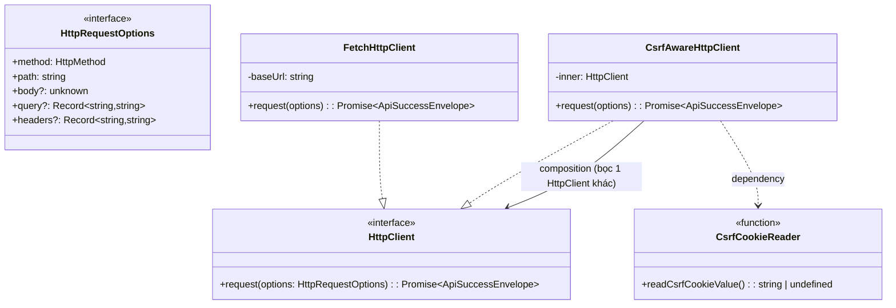
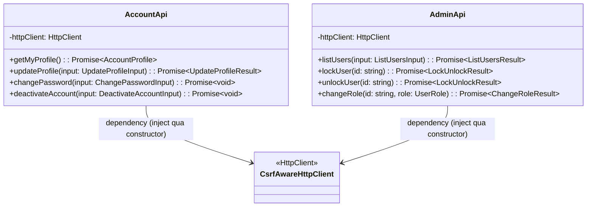
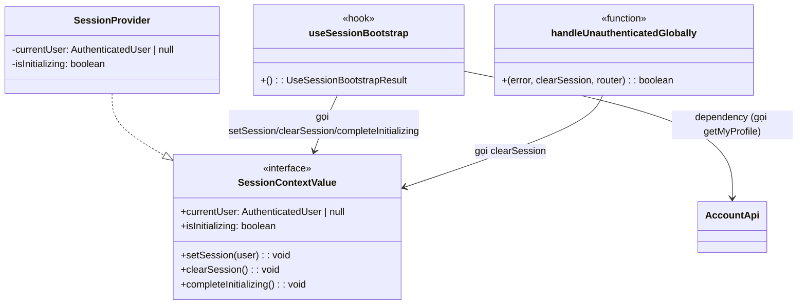
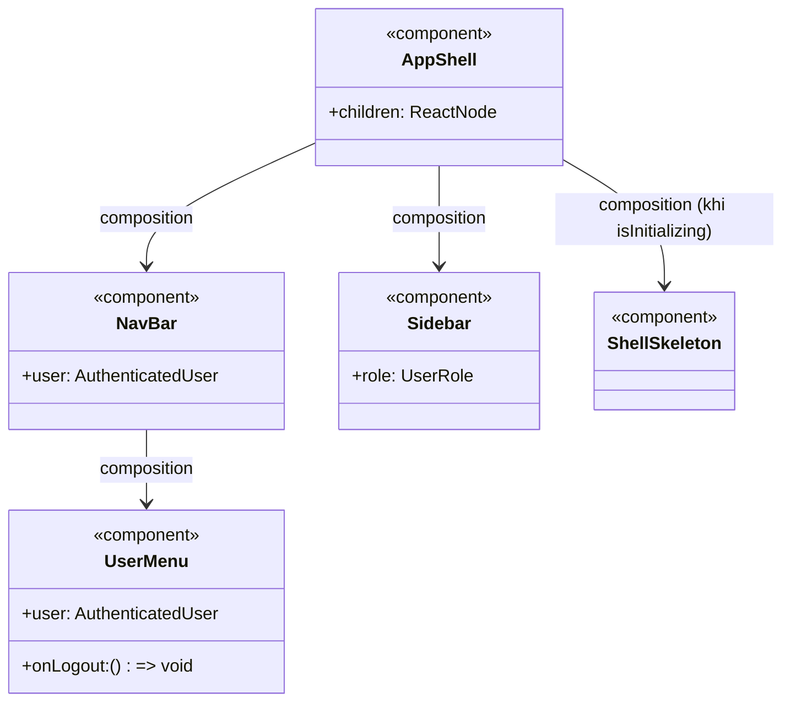
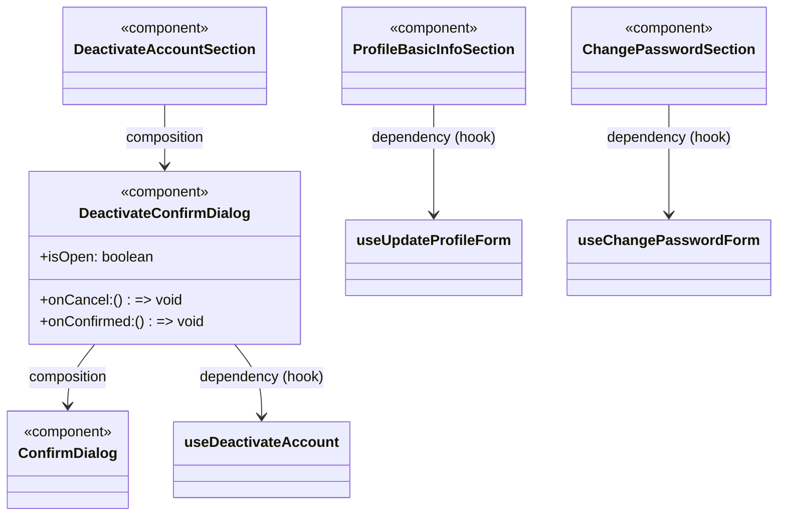
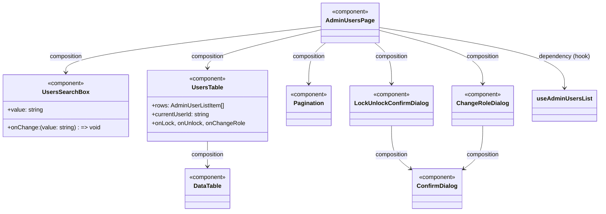
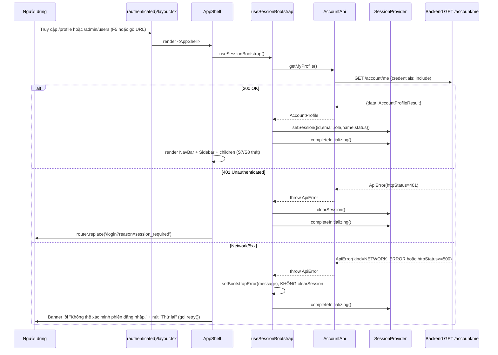
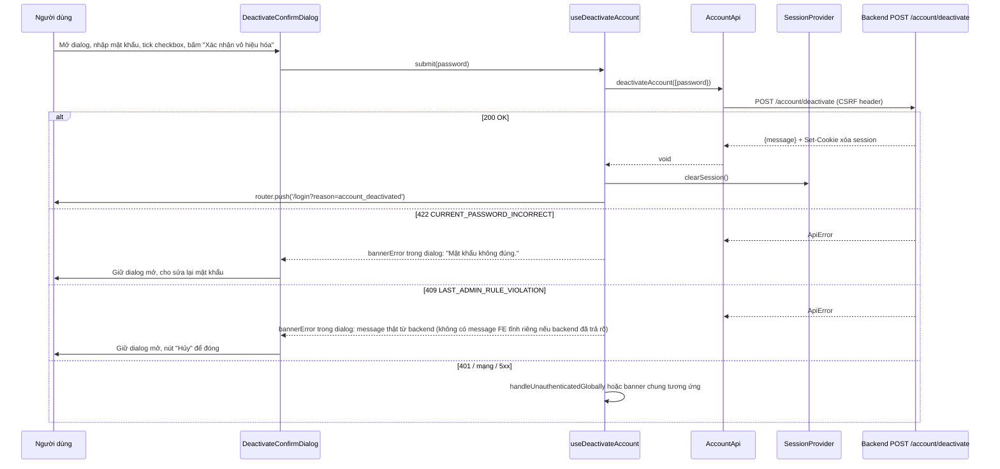

# Low-Level Design: Frontend Phase 2 — S7 (Hồ sơ cá nhân), S8 (Quản trị người dùng), S9 (Shell layout) — Multi-User System

## HLD/phương án kiến trúc làm căn cứ
- Kiến trúc nền tảng **đã chốt ở `docs/design/lld-frontend-phase0-1.md`** (Next.js App Router, layering `Page → Feature component/hook → lib/api → lib/http`, `HttpClient`/`ApiError`/`SessionProvider` đã code xong) — LLD này **chi tiết hóa tiếp**, KHÔNG thiết kế lại hạ tầng đã có. Mọi class/hook mới phải tái sử dụng `components/ui/*`, `HttpClient` interface, `SessionProvider` đã tồn tại.
- Phạm vi màn hình: S7 (Hồ sơ cá nhân, 3 section), S8 (Quản trị người dùng, chỉ ADMIN), S9 (Shell NavBar/Sidebar) — theo đúng đặc tả `docs/design/ui-wireframes-multi-user-system.md`.
- Contract API căn cứ: `docs/design/api-spec-multi-user-system.md` + **code backend thật đã đọc trực tiếp** (`backend/src/account/*`, `backend/src/admin/*`, `backend/src/common/csrf/*`) — ưu tiên code thật khi 2 nguồn lệch nhau (xem mục "Rủi ro").
- CSRF (double-submit cookie HMAC, C-14) áp dụng từ Phase 2 cho `PATCH /account/me`, `POST /account/change-password`, `POST /account/deactivate`, `POST /admin/users/:id/lock`, `POST /admin/users/:id/unlock`, `PATCH /admin/users/:id/role` — điểm mở rộng đã được Phase 0+1 chuẩn bị sẵn ở `HttpClient`/`HttpRequestOptions`, LLD này cắm vào đúng điểm đó.
- Nguồn: `docs/design/lld-frontend-phase0-1.md`, `docs/design/ui-wireframes-multi-user-system.md`, `docs/design/api-spec-multi-user-system.md`, code thật `backend/src/account/**`, `backend/src/admin/**`, `backend/src/common/csrf/**`, code thật `frontend/src/**` (Phase 0+1 đã code xong).

## Bối cảnh code hiện tại (đã khảo sát)
- `frontend/src/**` đã tồn tại đầy đủ Phase 0+1 (đã đọc trực tiếp, không suy diễn): `lib/http/{http-client.interface.ts, fetch-http-client.ts, api-envelope.types.ts, api-error.ts}`, `lib/session/{session-context.tsx, use-session.ts, authenticated-user.types.ts}`, `lib/auth/{auth-api.ts, auth-error-display.ts}`, toàn bộ `components/ui/*`, `components/auth/{AuthFormCard.tsx, AuthScreenLayout.tsx, PasswordRuleHint.tsx}`, `app/(authenticated)/layout.tsx` (stub placeholder), `proxy.ts` (middleware, matcher `['/profile/:path*', '/admin/:path*']` — đã khớp sẵn với URL `/profile`, `/admin/users` dự kiến dùng ở Phase 2, không cần sửa).
- **`PublicEnv.apiBaseUrl`** (`.env`: `NEXT_PUBLIC_API_BASE_URL=http://localhost:3001/api/v1`) **đã bao gồm `/api/v1`** → mọi path trong `AuthApi`/`AccountApi`/`AdminApi` chỉ cần viết từ `/account/...`, `/admin/...`, KHÔNG lặp lại `/api/v1`.
- **`HttpClient.request<TData>(options): Promise<ApiSuccessEnvelope<TData>>`** — `HttpRequestOptions` hiện tại (Phase 1) chỉ có `{method, path, body?, query?}`, CHƯA có `headers?` — đúng như Phase 0+1 LLD đã dự đoán ("Phase 2 thêm header `X-CSRF-Token` bằng cách mở rộng `HttpRequestOptions`"). `FetchHttpClient.performFetch` hiện tự dựng `headers` cố định (`Content-Type` nếu có body) — cần sửa tối thiểu (thêm field optional, merge) để không phá Phase 1.
- **`ApiSuccessEnvelope<TData> = {data?: TData; message?: string}`** — CHƯA có field `meta` vì Phase 1 không có list endpoint. `GET /admin/users` trả `{data: [...], meta: {page,limit,totalItems,totalPages}}` ở top-level response (không lồng trong `data`) → cần mở rộng type.
- **`AuthenticatedUser = {id, email, role}`** (`lib/session/authenticated-user.types.ts`) — chưa có `name`/`status`. `AuthApi.login()` trả đúng `{id,email,role}` (xác nhận từ `backend/src/auth/auth-results.interface.ts` — `LoginResult.user = {id,email,role}`, không có `name`).
- **`SessionProvider`** (`lib/session/session-context.tsx`) hiện là state holder thuần, **không gọi API** — đây là ranh giới kiến trúc đã chốt ở Phase 0+1 ("SessionProvider KHÔNG tự gọi API"). LLD này **giữ nguyên ranh giới đó**: không nhúng lệnh gọi `AccountApi` vào `SessionProvider`; thay vào đó thêm 1 hook orchestration mới ở tầng `features/` (đúng layering đã có — nơi DUY NHẤT gọi API + gọi `setSession`/`clearSession`).
- **CSRF, đã đọc trực tiếp `backend/src/common/csrf/*`**: `CSRF_COOKIE_NAME='csrfToken'`, `CSRF_HEADER_NAME='x-csrf-token'` (`csrf.constants.ts`). `CsrfGuard` so khớp `cookie === header` + verify HMAC theo `sessionId` (`csrf-token.service.ts`, `deriveToken = HMAC-SHA256(secret, sessionId)`). `CsrfCookieIssuerInterceptor` set lại cookie `csrfToken` (`httpOnly: false, secure: true, sameSite: 'lax'`) trên **mọi response** của `AccountController`/`AdminController` (áp ở class-level, áp dụng cho CẢ route GET) → bất kỳ lần gọi `GET /account/me` hoặc `GET /admin/users` nào cũng tự làm mới cookie, không cần endpoint riêng để "lấy CSRF token".
- **Phát hiện kỹ thuật quan trọng cho FE dev-local**: cookie `csrfToken` được set với `secure: true` **cố định** (không theo `NODE_ENV`) — qua HTTP thường (không TLS) ở local dev, browser sẽ **từ chối lưu cookie này**, khiến mọi hành động POST/PATCH ở Account/Admin thất bại 403 `CSRF_TOKEN_INVALID` cục bộ. Đây là hành vi backend đã code — KHÔNG sửa ở LLD này (ngoài phạm vi), chỉ ghi nhận là rủi ro cần xác nhận (xem mục Rủi ro).
- **`AccountController`/`AdminController`** (đã đọc trực tiếp): path thật `api/v1/account/*`, `api/v1/admin/*`; thứ tự guard `AuthGuard` (class-level) → `CsrfGuard` (method-level, chỉ áp cho route state-changing) → (riêng `PATCH /account/me` có thêm `RejectNonEditableProfileFieldsGuard` chạy ở pha Guards, chặn `email`/`role` lạ trong body bằng 422 `FIELD_NOT_EDITABLE` TRƯỚC khi tới `ValidationPipe`).
- **`UpdateProfileDto`**: `name` là `@IsString() @Length(1,100)` — **bắt buộc, không optional** (khác wireframe S7a "không bắt buộc, có thể để trống" — điểm lệch #1, xem Rủi ro).
- **`AdminUserListItemRecord`** (`admin-user-record.interface.ts`, đã đọc trực tiếp): `{id, email, role, status, createdAt}` — **không có `name`** (điểm lệch #2). **`ListUsersQueryDto`** không có field `status` → **không filter theo status** (điểm lệch #3), `status` thật có 4 giá trị: `ACTIVE | LOCKED | PENDING_VERIFICATION | DEACTIVATED`.
- **`AdminService.lockUser`/`unlockUser`/`changeRole`** (đã đọc trực tiếp `admin.service.ts`): hành vi **idempotent-im-lặng** đáng chú ý cho thiết kế FE — gọi `lock` trên user đã `LOCKED` trả `200 {id,status:'LOCKED'}` ngay (không log, không revoke lại); gọi `unlock` trên user đã `ACTIVE` trả `200` tương tự; gọi `changeRole` với `role` giống hiện tại trả `200` ngay (không log). Đây **không phải lỗi** — FE không cần xử lý case riêng, chỉ cần hiển thị đúng `status`/`role` mới trong response (luôn thành công về mặt UI).
- **Rate-limit chỉ áp cho `lock`/`unlock`** (`ADMIN_LOCK_UNLOCK_RATE_LIMITED`, 30 lần/600s theo actor admin, đã đọc `rate-limit-policies.ts`) — **`changeRole` KHÔNG có rate-limit** (đã đọc `admin.service.ts`, không có `consumeAdminActionRateLimit` trong `changeRole`).
- **`LastAdminPolicyService`** (đã đọc `rbac/last-admin-policy.service.ts`) ném `LastAdminRuleViolationException` → `409 LAST_ADMIN_RULE_VIOLATION` — dùng chung cho cả `AccountService.deactivateAccount` và `AdminService.lockUser`/`changeRole` (nhánh hạ cấp). Không có API nào cho FE biết trước "ai là admin duy nhất" (điểm lệch #4).
- **`InsufficientRoleException`** (`RolesGuard`) → `403 FORBIDDEN` khi USER gọi route `/admin/*` — dùng để FE nhận diện trạng thái "Không đủ quyền truy cập" ở S8 khi truy cập URL trực tiếp.
- Naming convention/layering kế thừa nguyên trạng từ Phase 0+1 (không đổi): interface không tiền tố `I`, PascalCase class/component, camelCase hàm/biến, `kebab-case.ts` cho module, `PascalCase.tsx` cho component, hook `use-*.ts` trả object thuần (không trả JSX).

---

## Cấu trúc thư mục `frontend/` — phần bổ sung Phase 2

```
frontend/src/
├── app/
│   └── (authenticated)/
│       ├── layout.tsx                         # SỬA: cắm <AppShell> (bỏ stub Phase 0)
│       ├── profile/
│       │   └── page.tsx                       # MỚI — S7, URL /profile
│       └── admin/
│           └── users/
│               └── page.tsx                   # MỚI — S8, URL /admin/users
├── components/
│   ├── ui/                                     # MỞ RỘNG (Phase 2 thêm, vẫn không biết nghiệp vụ)
│   │   ├── DataTable.tsx                       # MỚI — bảng dùng chung (S8)
│   │   ├── Pagination.tsx                      # MỚI — phân trang dùng chung (S8)
│   │   ├── ConfirmDialog.tsx                   # MỚI — dialog xác nhận dùng chung (S7c + S8)
│   │   ├── Checkbox.tsx                        # MỚI — dùng ở S7c (checkbox xác nhận hậu quả)
│   │   └── SelectField.tsx                     # MỚI — dùng ở S8 (chọn vai trò)
│   └── shell/                                   # MỚI — riêng cho S9
│       ├── AppShell.tsx
│       ├── NavBar.tsx
│       ├── UserMenu.tsx
│       ├── Sidebar.tsx
│       └── ShellSkeleton.tsx
├── features/
│   ├── session/                                 # MỚI — orchestration rehydrate, KHÔNG phải "màn hình"
│   │   └── hooks/
│   │       ├── use-session-bootstrap.ts
│   │       └── handle-unauthenticated.ts        # helper dùng chung (không phải hook React)
│   ├── account/                                  # MỚI — S7
│   │   ├── components/
│   │   │   ├── ProfileBasicInfoSection.tsx      # S7a
│   │   │   ├── ChangePasswordSection.tsx        # S7b
│   │   │   ├── DeactivateAccountSection.tsx      # S7c
│   │   │   └── DeactivateConfirmDialog.tsx       # S7c dialog
│   │   └── hooks/
│   │       ├── use-update-profile-form.ts
│   │       ├── use-change-password-form.ts
│   │       └── use-deactivate-account.ts
│   └── admin/                                    # MỚI — S8
│       ├── components/
│       │   ├── AdminUsersPage.tsx
│       │   ├── UsersSearchBox.tsx
│       │   ├── UsersTable.tsx
│       │   ├── LockUnlockConfirmDialog.tsx
│       │   └── ChangeRoleDialog.tsx
│       └── hooks/
│           ├── use-admin-users-list.ts
│           ├── use-lock-unlock-user.ts
│           └── use-change-role.ts
└── lib/
    ├── http/
    │   ├── http-client.interface.ts            # SỬA — + field `headers?`
    │   ├── fetch-http-client.ts                 # SỬA — merge `headers` thay vì hard-code
    │   ├── api-envelope.types.ts                # SỬA — + `PaginationMeta`, + field `meta?`
    │   ├── csrf.constants.ts                    # MỚI — mirror CSRF_COOKIE_NAME/CSRF_HEADER_NAME backend
    │   ├── csrf-cookie-reader.ts                 # MỚI
    │   └── csrf-aware-http-client.ts             # MỚI
    ├── session/
    │   ├── authenticated-user.types.ts          # SỬA — + `AccountStatus`, + `name?`/`status?`
    │   └── session-context.tsx                   # SỬA — + `isInitializing`, `completeInitializing()`
    ├── account/
    │   └── account-api.ts                        # MỚI
    ├── admin/
    │   └── admin-api.ts                           # MỚI
    ├── validation/
    │   └── name-rule.ts                           # MỚI — rule 1-100 ký tự (khớp UpdateProfileDto thật)
    └── utils/
        └── use-debounced-value.ts                 # MỚI — dùng cho ô tìm kiếm S8
```

**Ghi chú ranh giới (giữ nguyên tinh thần Phase 0+1)**:
- `lib/account/account-api.ts`, `lib/admin/admin-api.ts`: như `AuthApi` — nơi DUY NHẤT biết path `/account/*`, `/admin/*`; không biết "banner"/"dialog" là gì.
- `lib/http/csrf-aware-http-client.ts`: hạ tầng thuần, không biết "account"/"admin" là gì — chỉ biết "method nào cần CSRF header". `AuthApi` (Phase 1) **tiếp tục dùng `FetchHttpClient` trần**, không đổi.
- `features/session/*`: nơi DUY NHẤT orchestration rehydrate (gọi `AccountApi` + gọi `setSession`/`clearSession`) — `lib/session/*` vẫn chỉ là state holder, đúng ranh giới đã chốt ở Phase 0+1 (không bị phá bởi yêu cầu rehydrate).
- `features/account/*`, `features/admin/*`: state + logic gọi API cho S7/S8, giống `features/auth/*` ở Phase 1.
- `components/shell/*`: biết khái niệm "vai trò hiện tại" ở mức hiển thị (ẩn/hiện mục Sidebar), KHÔNG tự quyết định quyền — chỉ đọc `currentUser.role` từ context, quyết định thật luôn ở backend (403).

---

## Thiết kế class/module

### Nhóm 1 — Hạ tầng HTTP/CSRF (`lib/http`)



#### `HttpRequestOptions` (SỬA — mở rộng, không phá Phase 1)
- File: `src/lib/http/http-client.interface.ts`.
- Thêm field optional `headers?: Record<string, string>` — mọi lời gọi hiện có của `AuthApi` không truyền field này nên hành vi Phase 1 giữ nguyên (Open/Closed — mở rộng bằng field mới, không đổi field cũ).

#### `FetchHttpClient` (SỬA tối thiểu)
- File: `src/lib/http/fetch-http-client.ts`.
- Trách nhiệm không đổi. Method `performFetch` sửa để **merge** `headers` tuỳ chọn vào header mặc định (`Content-Type` nếu có `body`) thay vì hard-code — vẫn là nơi DUY NHẤT gọi `fetch` thật.
- Method: `performFetch(options: HttpRequestOptions): Promise<Response>` — hành vi mới: `headers = { ...(body !== undefined ? {'Content-Type': 'application/json'} : {}), ...options.headers }`.

#### `csrf.constants.ts` (MỚI)
- File: `src/lib/http/csrf.constants.ts`.
- Trách nhiệm: Giữ 2 hằng số **mirror thủ công** với backend (`CSRF_COOKIE_NAME='csrfToken'`, `CSRF_HEADER_NAME='x-csrf-token'`) — không có cơ chế chia sẻ package chung giữa `backend/`/`frontend/` (giống cách `PASSWORD_STRENGTH_REGEX` đã xử lý ở Phase 1, xem Giả định).

#### `readCsrfCookieValue()` (MỚI)
- File: `src/lib/http/csrf-cookie-reader.ts`.
- Trách nhiệm: Đọc giá trị cookie `csrfToken` từ `document.cookie` (non-HttpOnly, JS đọc được theo đúng xác nhận C-14) — trả `string | undefined`, không throw (nếu cookie chưa có, trả `undefined` để caller tự quyết định).
- Method: `readCsrfCookieValue(): string | undefined`.

#### `CsrfAwareHttpClient` (MỚI — decorator, Open/Closed)
- File: `src/lib/http/csrf-aware-http-client.ts`.
- Trách nhiệm: Tự gắn header `X-CSRF-Token` cho request **state-changing** (`POST`/`PATCH`/`DELETE`) bằng cách đọc cookie `csrfToken` — **KHÔNG** sửa `FetchHttpClient`/`AuthApi` hiện có (đúng điểm mở rộng Phase 0+1 đã chuẩn bị: "tạo decorator mới implement `HttpClient`").
- Thuộc tính: `inner: HttpClient` (constructor-injected, default `new FetchHttpClient()`).
- Method: `request<TData>(options: HttpRequestOptions): Promise<ApiSuccessEnvelope<TData>>` — nếu `options.method === 'GET'`, chuyển thẳng cho `inner`; ngược lại gắn thêm `headers[CSRF_HEADER_NAME] = readCsrfCookieValue() ?? ''` rồi chuyển cho `inner`.
- Quan hệ: **Chỉ `AccountApi`/`AdminApi` dùng client này** — `AuthApi` (Phase 1) giữ nguyên `FetchHttpClient` trần, không đổi chữ ký.
- **Bất biến cần giữ (invariant quan trọng)**: Vì `AppShell` (xem Nhóm 3) luôn gọi `GET /account/me` (route KHÔNG cần CSRF nhưng VẪN được `CsrfCookieIssuerInterceptor` set cookie) **trước khi** render bất kỳ nội dung S7/S8 nào, nên tại thời điểm người dùng có thể bấm nút submit đầu tiên ở S7/S8, cookie `csrfToken` chắc chắn đã tồn tại trong browser. Nếu vì lý do nào đó (xem Rủi ro — `secure: true` ở dev) cookie không tồn tại, `readCsrfCookieValue()` trả `undefined` → header gửi `''` → backend trả `403 CSRF_TOKEN_INVALID` → xử lý như lỗi hệ thống thông thường (xem mục Xử lý lỗi), KHÔNG crash.

### Nhóm 2 — `AccountApi` / `AdminApi`



#### `AccountApi`
- File: `src/lib/account/account-api.ts`.
- Trách nhiệm: Lớp DUY NHẤT trong FE biết path `/account/*` (khớp `AccountController` thật, không có tiền tố `/api/v1` vì đã nằm trong `baseUrl`).
- Dependency: `HttpClient` (default `new CsrfAwareHttpClient()`).
- Method (khớp đúng path/HTTP method/body thật đã đọc từ `AccountController`):

  | Method | HTTP | Path | Body | Cần CSRF? |
  |---|---|---|---|---|
  | `getMyProfile()` | GET | `/account/me` | — | Không |
  | `updateProfile({name})` | PATCH | `/account/me` | `{name}` **(chỉ `name`, KHÔNG BAO GIỜ gửi `email`/`role`)** | Có |
  | `changePassword({currentPassword,newPassword})` | POST | `/account/change-password` | `{currentPassword,newPassword}` | Có |
  | `deactivateAccount({password})` | POST | `/account/deactivate` | `{password}` | Có |

- Không làm: Không biết "toast"/"dialog" là gì; chỉ trả `data` hoặc để `ApiError` lan truyền lên `features/account/hooks/*`.

#### `AdminApi`
- File: `src/lib/admin/admin-api.ts`.
- Trách nhiệm: Lớp DUY NHẤT trong FE biết path `/admin/*` (khớp `AdminController` thật).
- Dependency: `HttpClient` (default `new CsrfAwareHttpClient()`).
- Method:

  | Method | HTTP | Path | Body/Query | Cần CSRF? |
  |---|---|---|---|---|
  | `listUsers({page,limit,email})` | GET | `/admin/users` | query `?page=&limit=&email=` | Không |
  | `lockUser(id)` | POST | `/admin/users/:id/lock` | — | Có |
  | `unlockUser(id)` | POST | `/admin/users/:id/unlock` | — | Có |
  | `changeRole(id, role)` | PATCH | `/admin/users/:id/role` | `{role}` | Có |

- **Bất biến**: `listUsers` giả định response LUÔN có `meta` (theo contract thật) — nếu `response.meta === undefined`, đây là vi phạm bất biến hợp đồng (lỗi lập trình/BE đổi contract), `AdminApi` ném `Error` thường (không phải `ApiError` nghiệp vụ) — tương tự cách `AccountService.findUserOrThrowInvariantError` ở backend phân biệt "vi phạm bất biến hệ thống" với "lỗi input người dùng".

### Nhóm 3 — Rehydrate session (`features/session`, `lib/session`)



#### `SessionContextValue` / `SessionProvider` (SỬA — mở rộng, giữ nguyên ranh giới "không gọi API")
- File: `src/lib/session/session-context.tsx`.
- Thêm thuộc tính `isInitializing: boolean` (khởi tạo `true`) và method `completeInitializing(): void` (set `isInitializing = false`, idempotent — gọi nhiều lần vô hại).
- **KHÔNG** thêm bất kỳ lệnh gọi API nào vào file này — `SessionProvider` vẫn chỉ là state holder thuần, đúng quyết định đã chốt ở Phase 0+1. Quyết định "khi nào gọi API để rehydrate" thuộc về `features/session/hooks/use-session-bootstrap.ts` (tầng orchestration), không phải `lib/session`.

#### `useSessionBootstrap` (MỚI)
- File: `src/features/session/hooks/use-session-bootstrap.ts`.
- Trách nhiệm: Orchestration DUY NHẤT cho việc rehydrate phiên khi `AppShell` mount — gọi `AccountApi.getMyProfile()` MỘT LẦN, map kết quả vào `AuthenticatedUser` qua `setSession`, hoặc `clearSession` nếu không còn phiên hợp lệ.
- Method: `useSessionBootstrap(): { isInitializing: boolean; bootstrapError: string | null; retry: () => void }`.
- Logic khái niệm (xem pseudocode (b)): phân biệt rõ **401 (chưa đăng nhập/hết hạn)** → `clearSession()` + để `AppShell` tự điều hướng `/login`, với **lỗi khác (network/5xx)** → **KHÔNG** `clearSession()` (tránh đăng xuất nhầm người dùng hợp lệ do lỗi tạm thời), set `bootstrapError` để `AppShell` hiển thị banner + nút "Thử lại" (gọi `retry()`).
- Quan hệ: Chỉ được gọi 1 lần bởi `AppShell` (không gọi lại ở `ProfileBasicInfoSection` hay nơi khác — tránh gọi trùng `GET /account/me`).

#### `handleUnauthenticatedGlobally` (MỚI — helper, không phải hook)
- File: `src/features/session/hooks/handle-unauthenticated.ts`.
- Trách nhiệm: Dùng CHUNG ở mọi hook của `features/account/*`/`features/admin/*` — nếu `ApiError.httpStatus === 401` xảy ra **giữa lúc đang dùng** S7/S8 (phiên bị revoke đột ngột, ví dụ admin khác khóa đúng user này), gọi `clearSession()` + điều hướng `/login?reason=session_required` NGAY, thay vì hiển thị banner lỗi vô nghĩa tại chỗ.
- Method: `handleUnauthenticatedGlobally(error: unknown, clearSession: () => void, router: AppRouterInstance): boolean` — trả `true` nếu đã xử lý (caller return ngay), `false` nếu không phải lỗi 401 (caller tiếp tục switch-case riêng của mình).

### Nhóm 4 — Shell (`components/shell`) — S9



#### `AppShell`
- File: `src/components/shell/AppShell.tsx`.
- Trách nhiệm: Gốc của route group `(authenticated)` — gọi `useSessionBootstrap()`, quyết định render `ShellSkeleton` / điều hướng `/login` / banner lỗi retry / hoặc `NavBar + Sidebar + children` thật.
- Props: `{ children: ReactNode }`.
- Logic khái niệm (xem pseudocode (c)):
  1. `isInitializing === true` → render `ShellSkeleton`.
  2. `isInitializing === false` và `bootstrapError !== null` (lỗi hạ tầng, không phải 401) → render banner lỗi + nút "Thử lại" (gọi `retry()`), KHÔNG render Sidebar/children.
  3. `isInitializing === false` và `currentUser === null` (401 đã xử lý) → gọi `router.replace('/login?reason=session_required')`, render `null` tạm thời (tránh render nhầm nội dung bảo vệ).
  4. `isInitializing === false` và `currentUser !== null` → render `NavBar` + `Sidebar` + `children`.
- Quan hệ: Composition `NavBar`, `Sidebar`, `ShellSkeleton`; dependency `useSessionBootstrap`, `useSession`, `useRouter`.

#### `NavBar` / `UserMenu`
- File: `src/components/shell/NavBar.tsx`, `UserMenu.tsx`.
- Trách nhiệm: `NavBar` hiển thị logo + `UserMenu` (avatar/tên + badge vai trò, dropdown "Hồ sơ cá nhân"/"Đăng xuất"). `UserMenu` không tự gọi `AuthApi.logout()` — nhận `onLogout: () => void` từ cha (Dependency Inversion, dễ test).
- Props `NavBar`: `{ user: AuthenticatedUser }`. Props `UserMenu`: `{ user: AuthenticatedUser; onLogout: () => void }`.
- Hiển thị tên: nếu `user.name` có giá trị → hiển thị `name`; nếu `null`/`undefined` → hiển thị phần trước `@` của `email` làm fallback (không để trống hoàn toàn).
- Logic "Đăng xuất" (được gọi từ `AppShell`, không nằm trong `UserMenu`): `authApi.logout()` (route `/auth/logout`, **không CSRF** theo api-spec 1.6.1 — vẫn đúng ranh giới `AuthApi` Phase 1) → `clearSession()` → `router.push('/login')`.

#### `Sidebar`
- File: `src/components/shell/Sidebar.tsx`.
- Trách nhiệm: Mục "Hồ sơ cá nhân" (luôn hiện) + mục "Quản trị" **chỉ hiện nếu `role === 'ADMIN'`** — đây là lớp UX, KHÔNG phải lớp phân quyền thật (403 thật luôn do backend quyết định, S8 tự xử lý trạng thái Forbidden khi truy cập URL trực tiếp).
- Props: `{ role: UserRole }`.

#### `ShellSkeleton`
- File: `src/components/shell/ShellSkeleton.tsx`.
- Trách nhiệm: Khung shimmer cho vùng avatar/tên (NavBar) + khung mục menu dạng shimmer (Sidebar) trong lúc `isInitializing === true` — đúng wireframe S9.

### Nhóm 5 — S7 (Hồ sơ cá nhân, `features/account`)



#### `ProfileBasicInfoSection` (S7a)
- File: `src/features/account/components/ProfileBasicInfoSection.tsx`.
- Trách nhiệm: Hiển thị Email (readonly)/Vai trò (readonly, badge)/Họ tên (editable) + nút "Lưu thay đổi".
- **Nguồn dữ liệu**: đọc trực tiếp `useSession().currentUser` (đã được `AppShell` rehydrate đầy đủ TRƯỚC khi section này mount — xem Nhóm 3/4) — **KHÔNG gọi lại `AccountApi.getMyProfile()`** (tránh gọi trùng, vì `AppShell` đã đảm bảo `currentUser !== null` và đầy đủ `name`/`status` trước khi render `children`). Đây là điểm hợp nhất trạng thái Loading/Error ban đầu của S7a vào Shell-level (xem Rủi ro — điểm cần xác nhận lại với wireframe).
- Props: không nhận props nghiệp vụ (tự đọc context) — chỉ `className?` nếu cần.
- Dependency: hook `useUpdateProfileForm()`.

#### `useUpdateProfileForm`
- File: `src/features/account/hooks/use-update-profile-form.ts`.
- Method: `useUpdateProfileForm(): { nameInput: string; fieldError: string | null; isSubmitting: boolean; updateNameInput(value): void; submit(): Promise<void> }`.
- Logic: validate client-side D-S7a (xem Cấu trúc dữ liệu) trước khi gọi `AccountApi.updateProfile({name})`; khi thành công, gọi `setSession({...currentUser, name: result.name})` (giữ `NavBar` đồng bộ tên mới ngay) + `showSuccess('Đã cập nhật hồ sơ.')`.

#### `ChangePasswordSection` (S7b) / `useChangePasswordForm`
- File: `src/features/account/components/ChangePasswordSection.tsx`, `src/features/account/hooks/use-change-password-form.ts`.
- Trách nhiệm: Form 3 field (mật khẩu hiện tại/mới/xác nhận) + `PasswordRuleHint` tái dùng từ Phase 1 + nút "Cập nhật mật khẩu".
- Method hook: `useChangePasswordForm(): { values, fieldErrors, bannerError, isSubmitting, updateField, submit }` — cấu trúc giống `useLoginForm`/`useResetPasswordForm` đã có.
- Logic: validate D-S7b client-side (giống D6 Phase 1, dùng lại `PASSWORD_STRENGTH_REGEX`/`PASSWORD_MIN_LENGTH` từ `lib/validation/password-rules.ts` đã có) → `AccountApi.changePassword(...)` → thành công: `showSuccess('Đổi mật khẩu thành công.')` + reset form rỗng.

#### `DeactivateAccountSection` (S7c) / `DeactivateConfirmDialog` / `useDeactivateAccount`
- File: `src/features/account/components/{DeactivateAccountSection.tsx, DeactivateConfirmDialog.tsx}`, `src/features/account/hooks/use-deactivate-account.ts`.
- `DeactivateAccountSection`: `GlassCard variant="danger"` + nút destructive "Vô hiệu hóa tài khoản của tôi" → mở `DeactivateConfirmDialog`. **KHÔNG tự disable nút trước** dựa trên "có phải last-admin không" (không có dữ liệu để biết trước — điểm lệch #4 áp dụng tương tự ở đây dù backend đã có field sẵn cho trường hợp account riêng của chính mình; xem Rủi ro — khác với mô tả wireframe gốc).
- `DeactivateConfirmDialog`: composition `ConfirmDialog` (dùng chung) + field mật khẩu + `Checkbox` xác nhận hậu quả — nút "Xác nhận vô hiệu hóa" chỉ enable khi `password !== ''` VÀ checkbox đã tick (validate thuần client, không cần gọi API để biết).
- `useDeactivateAccount`: method `submit(password): Promise<void>` → `AccountApi.deactivateAccount({password})` → thành công: `clearSession()` + `router.push('/login?reason=account_deactivated')` (tái dùng key `account_deactivated` đã có sẵn trong `CONTEXT_BANNER_MESSAGE` của `LoginForm` từ Phase 1 — không cần sửa `LoginForm`).

### Nhóm 6 — S8 (Quản trị người dùng, `features/admin`)



#### `AdminUsersPage`
- File: `src/features/admin/components/AdminUsersPage.tsx`.
- Trách nhiệm: Trang tổng (gắn vào `app/(authenticated)/admin/users/page.tsx`) — điều phối `UsersSearchBox`, `UsersTable`, `Pagination`, mở `LockUnlockConfirmDialog`/`ChangeRoleDialog` theo state được chọn.
- Dependency: `useAdminUsersList()`, `useLockUnlockUser()`, `useChangeRole()`.
- **Trạng thái Forbidden (403)**: nếu `useAdminUsersList` trả `viewState.kind === 'forbidden'` (khi `ApiError.httpStatus === 403`), render `StatusResultCard` (TÁI DÙNG component Phase 1) với `icon="error"`, `title="Không đủ quyền truy cập"`, `primaryAction={{label:'Về trang hồ sơ cá nhân', onClick: () => router.push('/profile')}}` — KHÔNG render bảng/tìm kiếm.

#### `UsersSearchBox`
- File: `src/features/admin/components/UsersSearchBox.tsx`.
- Trách nhiệm: Input tìm theo email + icon kính lúp — KHÔNG tự debounce (debounce là trách nhiệm của hook `useAdminUsersList`/`useDebouncedValue`, giữ component thuần hiển thị).
- Props: `{ value: string; onChange: (value: string) => void; onClear: () => void }`.

#### `UsersTable`
- File: `src/features/admin/components/UsersTable.tsx`.
- Trách nhiệm: Định nghĩa cột cụ thể cho S8 (Email, Vai trò badge, Trạng thái chấm glow, Hành động) bằng cách cấu hình `DataTableColumn[]` rồi render `DataTable` — **KHÔNG có cột "Họ tên"** (điểm lệch #2, API không trả `name`).
- Props: `{ rows: AdminUserListItem[]; isLoading: boolean; currentUserId: string; onRequestLock(row), onRequestUnlock(row), onRequestChangeRole(row) }`.
- Hiển thị Trạng thái: map 4 giá trị thật `ACTIVE→'Hoạt động'(xanh lá)`, `LOCKED→'Đã khóa'(đỏ-magenta)`, `PENDING_VERIFICATION→'Chưa xác thực email'(amber)`, `DEACTIVATED→'Đã vô hiệu hóa'(xám/trung tính — nhãn MỚI, không có trong wireframe gốc, điểm lệch #3)`.
- Nút hành động: với dòng có `status==='DEACTIVATED'` → nút "Khóa"/"Mở khóa" **disabled kèm tooltip** "Tài khoản đã vô hiệu hóa, không áp dụng khóa/mở khóa." (đây là suy luận HỢP LÝ từ `CONFLICT_ACCOUNT_DEACTIVATED` đã biết trước, KHÔNG cần đợi lỗi 409 mới biết — khác với trường hợp last-admin không thể biết trước). Với mọi dòng khác (bao gồm dòng của chính actor đang đăng nhập) → nút LUÔN enable, không tự đoán "last-admin" (điểm lệch #4).

#### `LockUnlockConfirmDialog` / `useLockUnlockUser`
- File: `src/features/admin/components/LockUnlockConfirmDialog.tsx`, `src/features/admin/hooks/use-lock-unlock-user.ts`.
- `LockUnlockConfirmDialog`: composition `ConfirmDialog`, tiêu đề/mô tả động theo `action: 'lock' | 'unlock'`. KHÔNG có input (đúng wireframe).
- `useLockUnlockUser`: `submit(userId, action): Promise<AdminUserListItem | null>` → gọi `AdminApi.lockUser`/`unlockUser` tương ứng → thành công: đóng dialog, cập nhật đúng dòng trong danh sách hiện tại bằng `status` mới trả về (KHÔNG optimistic update trước khi có response — xem Giả định), `showSuccess(message từ response)`.

#### `ChangeRoleDialog` / `useChangeRole`
- File: `src/features/admin/components/ChangeRoleDialog.tsx`, `src/features/admin/hooks/use-change-role.ts`.
- `ChangeRoleDialog`: composition `ConfirmDialog` + `SelectField` (2 option `USER`/`ADMIN`) — mặc định chọn vai trò KHÁC vai trò hiện tại của dòng (theo wireframe "loại trừ vai trò hiện tại"); nút "Xác nhận thay đổi" disabled nếu `selectedRole === currentRole` (validate client thuần, map đúng rule D-S8 ở bảng wireframe).
- `useChangeRole`: `submit(userId, newRole): Promise<AdminUserListItem | null>` → `AdminApi.changeRole(userId, newRole)` → thành công: đóng dialog, cập nhật dòng, `showSuccess('Đã đổi vai trò.')` (toast tĩnh FE — response PATCH role không có `message` từ backend, xem bảng Nhóm 2).

#### `useAdminUsersList`
- File: `src/features/admin/hooks/use-admin-users-list.ts`.
- Trách nhiệm: Quản lý toàn bộ state danh sách — ô tìm kiếm (debounce), trang hiện tại, gọi `AdminApi.listUsers`, chống race-condition khi người dùng gõ nhanh (xem pseudocode (d)).
- Method: `useAdminUsersList(): { viewState, searchInput, page, totalPages, updateSearchInput(value), setPage(page), retry(), refetchCurrentPage() }` — `viewState` là discriminated union `{kind:'loading'} | {kind:'success', items} | {kind:'empty'} | {kind:'error', message} | {kind:'forbidden'}`.
- Dependency: `useDebouncedValue` (`lib/utils`), `AdminApi`, `handleUnauthenticatedGlobally`.

### Nhóm 7 — Component dùng chung mới (`components/ui`)

```mermaid
classDiagram
  class DataTable~T~ {
    <<component>>
    +columns: DataTableColumn~T~[]
    +rows: T[]
    +rowKey: (row: T) => string
    +isLoading?: boolean
    +skeletonRowCount?: number
    +emptyState?: ReactNode
  }
  class Pagination {
    <<component>>
    +page: number
    +totalPages: number
    +onPageChange: (page: number) => void
    +disabled?: boolean
  }
  class ConfirmDialog {
    <<component>>
    +isOpen: boolean
    +title: string
    +description?: string
    +variant?: "default" | "danger"
    +confirmLabel: string
    +cancelLabel?: string
    +isConfirmDisabled?: boolean
    +isLoading?: boolean
    +bannerError?: string
    +children?: ReactNode
    +onConfirm: () => void
    +onCancel: () => void
  }
  class Checkbox {
    <<component>>
    +id: string
    +label: string
    +checked: boolean
    +onChange: (checked: boolean) => void
    +error?: string
  }
  class SelectField~T~ {
    <<component>>
    +id: string
    +label: string
    +value: T
    +options: Array~{value: T, label: string}~
    +onChange: (value: T) => void
    +error?: string
  }
```

#### `DataTable<T>`
- File: `src/components/ui/DataTable.tsx`.
- Trách nhiệm: Bảng ngữ nghĩa thật (`<table>`) dùng chung — nhận cấu hình cột generic, tự render skeleton-row khi `isLoading` (giữ nguyên số cột, đúng wireframe) và `emptyState` khi `rows.length === 0 && !isLoading`. KHÔNG biết "user"/"admin" là gì — generic hoàn toàn.
- Method: không có method công khai ngoài render; props như class diagram.

#### `Pagination`
- File: `src/components/ui/Pagination.tsx`.
- Trách nhiệm: Điều khiển trang (nút trước/sau + số trang hiện tại/tổng) — generic, không biết nguồn dữ liệu.

#### `ConfirmDialog`
- File: `src/components/ui/ConfirmDialog.tsx`.
- Trách nhiệm: **Dùng lại cho cả 3 nơi** (`DeactivateConfirmDialog`, `LockUnlockConfirmDialog`, `ChangeRoleDialog`) — khung modal (overlay blur, focus trap, `Esc` đóng, trả focus khi đóng — theo Accessibility đã tả ở wireframe), nút Hủy/Xác nhận, khe `children` cho nội dung đặc thù (password+checkbox, hoặc select, hoặc rỗng), khe `bannerError` cho lỗi hiển thị NGAY TRONG dialog (xem Giả định — quyết định giữ dialog mở khi có lỗi, không đóng+toast).
- Method: không có method công khai; props như class diagram. `variant="danger"` dùng cho các hành động phá hủy (vô hiệu hóa, khóa) — viền/nút nhấn mạnh đỏ-magenta.

#### `Checkbox`, `SelectField<T>`
- File: `src/components/ui/Checkbox.tsx`, `SelectField.tsx`.
- Trách nhiệm: Input nguyên thủy còn thiếu ở Phase 1 (`TextField`/`PasswordField` không đủ) — theo đúng pattern `<label>` thật + `aria-describedby` đã chốt ở Phase 0+1 Accessibility.

---

## Luồng xử lý chi tiết

### Luồng chính 1: Rehydrate session khi vào vùng `(authenticated)` (F5 hoặc điều hướng trực tiếp)



### Luồng chính 2: S7a — Cập nhật tên hồ sơ

1. `ProfileBasicInfoSection` đọc `currentUser` từ `useSession()` (đã sẵn có nhờ Luồng 1) — hiển thị ngay, không gọi API riêng.
2. Người dùng sửa field "Họ tên", bấm "Lưu thay đổi" → `useUpdateProfileForm.submit()`.
3. Validate D-S7a client-side (1–100 ký tự, không rỗng — khớp `UpdateProfileDto` thật).
4. Nếu hợp lệ → `AccountApi.updateProfile({name})` → `PATCH /account/me` (có header CSRF qua `CsrfAwareHttpClient`).
5. `200 OK` → `setSession({...currentUser, name: response.data.name})` (đồng bộ `NavBar`) + `showSuccess('Đã cập nhật hồ sơ.')`.
6. `401` → `handleUnauthenticatedGlobally` xử lý (logout cứng, xem Nhóm 3).
7. `403 CSRF_TOKEN_INVALID` / lỗi mạng/5xx → toast lỗi "Không thể lưu thay đổi, vui lòng thử lại."

### Luồng lỗi S7b: Đổi mật khẩu

1. Submit → validate D-S7b client-side (giống D6 Phase 1).
2. `AccountApi.changePassword({currentPassword, newPassword})`.
3. `200 OK` → toast "Đổi mật khẩu thành công." + reset form.
4. `422 CURRENT_PASSWORD_INCORRECT` → inline lỗi dưới field "Mật khẩu hiện tại": "Mật khẩu hiện tại không đúng."
5. `422 PASSWORD_SAME_AS_OLD` → inline lỗi dưới field "Mật khẩu mới".
6. `401` → `handleUnauthenticatedGlobally`.
7. Lỗi mạng/5xx/CSRF → banner chung.

### Luồng chính + lỗi S7c: Vô hiệu hóa tài khoản



### Luồng chính 3: S8 — Tìm kiếm + phân trang danh sách người dùng

1. `AdminUsersPage` mount → `useAdminUsersList` tự fetch `page=1, limit=20, email=undefined`.
2. Người dùng gõ vào `UsersSearchBox` → `updateSearchInput(value)` cập nhật state hiển thị NGAY (không giật UI) nhưng giá trị dùng để gọi API được debounce (xem pseudocode (d)).
3. Sau khi debounce ổn định → fetch lại với `page=1` (reset trang khi đổi từ khóa) + `email=debouncedValue`.
4. `totalItems === 0` → `viewState.kind='empty'` → hiển thị gợi ý + nút "Xóa tìm kiếm".
5. Người dùng bấm số trang khác → `setPage(n)` → fetch lại với `email` hiện tại + `page=n` (giữ nguyên từ khóa).

### Luồng lỗi S8: Khóa/Mở khóa tài khoản

1. Bấm "Khóa"/"Mở khóa" một dòng → mở `LockUnlockConfirmDialog` với `action` tương ứng.
2. Bấm "Xác nhận" → `useLockUnlockUser.submit(userId, action)` → `AdminApi.lockUser(id)`/`unlockUser(id)`.
3. `200 OK` (bao gồm cả case idempotent — target đã ở đúng trạng thái mong muốn, xem "Bối cảnh") → đóng dialog, cập nhật dòng, toast thành công theo `message` thật từ response.
4. `404 USER_NOT_FOUND` → bannerError trong dialog + gợi ý làm mới danh sách (hiếm, do user bị xóa dữ liệu đồng thời — ngoài phạm vi nghiệp vụ hiện tại nhưng vẫn phải xử lý không nuốt lỗi).
5. `409 CONFLICT_ACCOUNT_DEACTIVATED` → bannerError trong dialog: message thật từ backend ("Tài khoản mục tiêu đã bị vô hiệu hóa.").
6. `409 LAST_ADMIN_RULE_VIOLATION` (chỉ nhánh lock) → bannerError trong dialog.
7. `429 ADMIN_LOCK_UNLOCK_RATE_LIMITED` → bannerError + `CountdownText` trong dialog (tái dùng `retryAfterSeconds`), disable nút "Xác nhận" tới khi hết đếm ngược.
8. `401` → `handleUnauthenticatedGlobally`.

### Luồng lỗi S8: Đổi vai trò

Tương tự Luồng lỗi "Khóa/Mở khóa" nhưng KHÔNG có nhánh `429` (contract thật không rate-limit `changeRole`) và KHÔNG có nhánh `409 LAST_ADMIN_RULE_VIOLATION` chỉ-khi-lock (ở đây xảy ra khi hạ cấp khiến hệ thống còn 0 ADMIN, cùng mã lỗi, xử lý cùng cách).

### Luồng lỗi S9/S8: Truy cập `/admin/users` khi role USER

1. `Sidebar` không hiện mục "Quản trị" cho `role==='USER'` (lớp UX) — nhưng nếu người dùng gõ URL `/admin/users` trực tiếp, `AppShell` vẫn render bình thường (USER đã đăng nhập hợp lệ, không phải 401).
2. `AdminUsersPage` mount → `useAdminUsersList` gọi `AdminApi.listUsers(...)` → backend `RolesGuard` chặn → `403 FORBIDDEN`.
3. `useAdminUsersList` set `viewState={kind:'forbidden'}` → `AdminUsersPage` render `StatusResultCard` "Không đủ quyền truy cập" + CTA về `/profile` — KHÔNG redirect tự động (để người dùng tự quyết định, đúng wireframe).

---

## Cấu trúc dữ liệu nội bộ (Ý TƯỞNG THIẾT KẾ — không phải API contract/DB schema thật)

> Các bảng dưới đây là mô hình dữ liệu NỘI BỘ phía client phục vụ thiết kế component/luồng xử lý. KHÔNG phải API request/response contract thật (đã chốt ở `api-spec-multi-user-system.md`, thuộc `api-designer`) và KHÔNG phải migration/schema database (thuộc `db-schema-reviewer`).

### `HttpRequestOptions` (mở rộng Phase 1)
| Field | Kiểu | Validation rule | Invariant |
|---|---|---|---|
| `headers` | `Record<string,string> \| undefined` | Optional | Nếu có, merge (không ghi đè) với `Content-Type` mặc định; `AuthApi` Phase 1 không dùng field này |

### `ApiSuccessEnvelope<TData>` (mở rộng Phase 1)
| Field | Kiểu | Validation rule | Invariant |
|---|---|---|---|
| `meta` | `PaginationMeta \| undefined` | Optional | CHỈ có mặt ở response của `AdminApi.listUsers`; mọi response khác (Account/Auth) không có field này |

### `PaginationMeta`
| Field | Kiểu | Validation rule | Invariant |
|---|---|---|---|
| `page` | `number` | ≥ 1 | Khớp `page` đã gửi trong query |
| `limit` | `number` | 1–100 | Khớp `limit` đã gửi |
| `totalItems` | `number` | ≥ 0 | |
| `totalPages` | `number` | ≥ 0 | `= Math.ceil(totalItems/limit)` (do backend tính, FE không tự tính lại) |

### `AuthenticatedUser` (mở rộng Phase 1)
| Field | Kiểu | Validation rule | Invariant |
|---|---|---|---|
| `id` | `string` | Không rỗng | Không đổi |
| `email` | `string` | | Không đổi |
| `role` | `UserRole` | `'USER' \| 'ADMIN'` | Không đổi |
| `name` | `string \| null \| undefined` | | `undefined` nếu chưa rehydrate lần nào (ví dụ ngay sau `login()` trước khi `AppShell` chạy bootstrap); `null` nếu đã rehydrate nhưng user chưa từng đặt tên; `string` sau khi đã đặt |
| `status` | `AccountStatus \| undefined` | Thuộc enum | `undefined` cùng lý do với `name` — KHÔNG dùng để quyết định UI quan trọng trước khi rehydrate xong (Shell luôn đợi `isInitializing=false` trước khi render nội dung dùng `status`) |

### `AccountStatus` (type mới, `lib/session/authenticated-user.types.ts`)
| Giá trị | Ý nghĩa |
|---|---|
| `'ACTIVE'` | Hoạt động bình thường |
| `'LOCKED'` | Bị khóa (brute-force hoặc admin khóa) |
| `'PENDING_VERIFICATION'` | Chưa xác thực email |
| `'DEACTIVATED'` | Đã tự vô hiệu hóa (soft-delete) |

### `AccountProfile` (kết quả `AccountApi.getMyProfile()`)
| Field | Kiểu | Validation rule | Invariant |
|---|---|---|---|
| `id`,`email`,`role` | như trên | | |
| `name` | `string \| null` | | |
| `status` | `AccountStatus` | | |
| `emailVerifiedAt` | `string \| null` (ISO date) | | |
| `createdAt`,`updatedAt` | `string` (ISO date) | | |

### `ProfileBasicInfoFormValues` / Errors (D-S7a — khớp `UpdateProfileDto` thật, KHÁC wireframe gốc)
| Field | Rule client-side | Thông báo lỗi |
|---|---|---|
| `name` | **Bắt buộc** (khác wireframe "không bắt buộc"), 1–100 ký tự | "Vui lòng nhập họ tên" (rỗng) / "Họ tên phải có 1 đến 100 ký tự" |

### `ChangePasswordFormValues` (D-S7b)
| Field | Rule | Thông báo lỗi |
|---|---|---|
| `currentPassword` | Bắt buộc | "Vui lòng nhập mật khẩu hiện tại" |
| `newPassword` | Bắt buộc, ≥8 ký tự, ≥1 chữ + ≥1 số (đồng bộ `password-rules.ts` Phase 1) | như Phase 1 |
| `confirmNewPassword` | Bắt buộc, trùng `newPassword` | "Mật khẩu xác nhận không khớp" |

### `DeactivateDialogState`
| Field | Kiểu | Validation rule | Invariant |
|---|---|---|---|
| `password` | `string` | Bắt buộc, không rỗng | |
| `acknowledged` | `boolean` | Phải `true` trước khi submit | Nút "Xác nhận" `disabled` nếu `false` |
| `bannerError` | `{message, countdownSeconds?} \| null` | | Hiển thị NGAY trong dialog, không đóng dialog khi có lỗi |

### `AdminUserListItem` (kết quả `AdminApi.listUsers`, khớp `AdminUserListItemRecord` thật — KHÔNG có `name`)
| Field | Kiểu | Validation rule | Invariant |
|---|---|---|---|
| `id` | `string` | | |
| `email` | `string` | | |
| `role` | `UserRole` | | |
| `status` | `AccountStatus` | | Có thể là `DEACTIVATED` — vẫn hiện trong danh sách (điểm lệch #3) |
| `createdAt` | `string` | | |

### `AdminUsersQueryState`
| Field | Kiểu | Validation rule | Invariant |
|---|---|---|---|
| `searchInput` | `string` | Không validate (cho phép chuỗi con bất kỳ) | Hiển thị NGAY khi gõ (không delay) |
| `debouncedSearch` | `string` | | Giá trị thực tế dùng để gọi API, trễ ~400ms sau lần gõ cuối |
| `page` | `number` | ≥1 | Reset về `1` mỗi khi `debouncedSearch` đổi |

---

## Xử lý lỗi/exception

| Method/luồng | Lỗi | Tình huống | Nơi bắt/xử lý | Retry/Fallback |
|---|---|---|---|---|
| `useSessionBootstrap` | `ApiError(httpStatus=401)` | Chưa đăng nhập hoặc session hết hạn/bị revoke | Hook bắt → `clearSession()` | Không retry — `AppShell` điều hướng `/login?reason=session_required` |
| `useSessionBootstrap` | `ApiError(kind='NETWORK_ERROR')` hoặc `httpStatus>=500` | Backend/mạng tạm trục trặc | Hook bắt → `setBootstrapError`, **không** `clearSession` | Retry THỦ CÔNG qua nút "Thử lại" (`retry()`) — không tự động lặp lại |
| Mọi hook `features/account/*`, `features/admin/*` | `ApiError(httpStatus=401)` | Phiên bị revoke giữa lúc đang dùng (ví dụ admin khác khóa đúng user này) | `handleUnauthenticatedGlobally` bắt ĐẦU TIÊN trong mọi catch-block | Không retry — logout cứng + điều hướng `/login?reason=session_required` |
| `useUpdateProfileForm.submit` | `ApiError(code='FIELD_NOT_EDITABLE')` | CHỈ xảy ra nếu code FE lỗi gửi kèm `email`/`role` — không nên xảy ra trong vận hành bình thường | Không map case riêng (đúng chỉ dẫn: FE chỉ cần không gửi field đó) | Rơi vào nhánh `default` generic — coi là bug FE nếu từng gặp |
| `useChangePasswordForm.submit` | `ApiError(code='CURRENT_PASSWORD_INCORRECT')` | Sai mật khẩu hiện tại | Hook bắt → field error dưới "Mật khẩu hiện tại" | Không retry — lỗi input |
| `useChangePasswordForm.submit` | `ApiError(code='PASSWORD_SAME_AS_OLD')` | Mật khẩu mới trùng cũ | Hook bắt → field error dưới "Mật khẩu mới" | Không retry |
| `useDeactivateAccount.submit` | `ApiError(code='CURRENT_PASSWORD_INCORRECT')` | Sai mật khẩu xác nhận (mã lỗi DÙNG CHUNG với S7b) | Hook bắt → bannerError trong dialog | Không retry — sửa lại mật khẩu |
| `useDeactivateAccount.submit` | `ApiError(code='LAST_ADMIN_RULE_VIOLATION', httpStatus=409)` | Actor là ADMIN duy nhất | Hook bắt → bannerError trong dialog, dialog GIỮ MỞ | Không retry — cần gán ADMIN khác trước (hành động ở S8) |
| `useLockUnlockUser.submit` | `ApiError(code='USER_NOT_FOUND', httpStatus=404)` | Target bị xóa đồng thời (hiếm) | Hook bắt → bannerError trong dialog | Không retry — gợi ý làm mới danh sách |
| `useLockUnlockUser.submit` | `ApiError(code='CONFLICT_ACCOUNT_DEACTIVATED', httpStatus=409)` | Target đã `DEACTIVATED` | Hook bắt → bannerError (lớp phòng vệ — UI đã disable trước ở `UsersTable`, đây là trường hợp race) | Không retry |
| `useLockUnlockUser.submit` (chỉ `lock`) | `ApiError(code='LAST_ADMIN_RULE_VIOLATION', httpStatus=409)` | Lock đúng ADMIN duy nhất | Hook bắt → bannerError | Không retry |
| `useLockUnlockUser.submit` | `ApiError(code='ADMIN_LOCK_UNLOCK_RATE_LIMITED', httpStatus=429)` | Actor admin spam khóa/mở khóa | Hook bắt → bannerError + `CountdownText`, disable nút Xác nhận | Không tự động retry; enable lại nút khi hết đếm ngược, người dùng tự bấm |
| `useChangeRole.submit` | `ApiError(code='LAST_ADMIN_RULE_VIOLATION', httpStatus=409)` | Hạ cấp khiến hệ thống còn 0 ADMIN | Hook bắt → bannerError trong dialog | Không retry |
| `useAdminUsersList` (fetch) | `ApiError(httpStatus=403, code='FORBIDDEN')` | USER truy cập `/admin/users` trực tiếp | Hook bắt → `viewState={kind:'forbidden'}` | Không retry — CTA về `/profile` |
| `useAdminUsersList` (fetch) | `ApiError` khác (mạng/5xx) | Lỗi tải danh sách | Hook bắt → `viewState={kind:'error', message}` | Nút "Thử lại" gọi lại `refetchCurrentPage()` |
| `CsrfAwareHttpClient` (gián tiếp, mọi method POST/PATCH/DELETE của Account/Admin) | `ApiError(code='CSRF_TOKEN_INVALID', httpStatus=403)` | Cookie `csrfToken` thiếu/hết hạn/không khớp (xem Rủi ro — `secure:true` ở dev) | Rơi vào nhánh `default` của hook gọi tương ứng | Không retry tự động — banner generic; gợi ý người dùng tải lại trang (sẽ trigger lại `GET /account/me` qua bootstrap, làm mới cookie) |

**Nguyên tắc chung (nhất quán với Phase 0+1)**: Không có `catch` rỗng ở bất kỳ hook nào. `401` LUÔN được xử lý ƯU TIÊN TRƯỚC (qua `handleUnauthenticatedGlobally`) ở mọi hook Account/Admin, tách biệt khỏi switch-case lỗi nghiệp vụ cụ thể của từng hook — tránh lặp lại logic "nếu 401 thì..." rải rác.

---

## Pseudocode minh họa (chỉ cho thuật toán phức tạp — không phải code cuối cùng)

### (a) `CsrfAwareHttpClient.request` — quyết định gắn header CSRF

```
# Pseudocode minh họa ý tưởng, không phải code cuối cùng
function request(options):
    if options.method == 'GET':
        return inner.request(options)

    token = readCsrfCookieValue()   # có thể undefined nếu cookie chưa từng được set
    return inner.request({
        ...options,
        headers: { ...options.headers, [CSRF_HEADER_NAME]: token ?? '' }
    })
```

### (b) `useSessionBootstrap` — rehydrate, phân biệt 401 vs lỗi hạ tầng

```
# Pseudocode minh họa ý tưởng, không phải code cuối cùng
function useSessionBootstrap():
    isInitializing = useState(true)
    bootstrapError = useState(null)
    { setSession, clearSession, completeInitializing } = useSession()

    async function runBootstrap():
        bootstrapError.set(null)
        try:
            profile = await accountApi.getMyProfile()
            setSession({
                id: profile.id, email: profile.email, role: profile.role,
                name: profile.name, status: profile.status,
            })
        catch (error):
            if error instanceof ApiError and error.httpStatus == 401:
                clearSession()                      # chưa đăng nhập / hết hạn — KHÔNG coi là lỗi hạ tầng
            else:
                # NETWORK_ERROR hoặc 5xx — KHÔNG clearSession (tránh đăng xuất nhầm)
                bootstrapError.set(displayMessageFor(error) hoặc GENERIC_MESSAGE)
        finally:
            isInitializing.set(false)
            completeInitializing()

    useEffectOnMount(() => { runBootstrap() })

    return {
        isInitializing: isInitializing.value,
        bootstrapError: bootstrapError.value,
        retry: () => { isInitializing.set(true); runBootstrap() },
    }
```

### (c) `AppShell` — rẽ nhánh render theo kết quả bootstrap

```
# Pseudocode minh họa ý tưởng, không phải code cuối cùng
function AppShell({ children }):
    router = useRouter()
    { currentUser } = useSession()
    { isInitializing, bootstrapError, retry } = useSessionBootstrap()

    useEffect(() => {
        if not isInitializing and bootstrapError == null and currentUser == null:
            router.replace('/login?reason=session_required')
    }, [isInitializing, bootstrapError, currentUser])

    if isInitializing:
        return <ShellSkeleton />

    if bootstrapError != null:
        return <ErrorBanner message={bootstrapError} /> + <SecondaryButton onClick={retry}>Thử lại</SecondaryButton>

    if currentUser == null:
        return null   # đang điều hướng ở effect trên, tránh render nhầm nội dung bảo vệ

    return (
        <div>
            <NavBar user={currentUser} />
            <div className="flex">
                <Sidebar role={currentUser.role} />
                <main>{children}</main>
            </div>
        </div>
    )
```

### (d) `useAdminUsersList` — debounce tìm kiếm + chống race-condition khi gõ nhanh

```
# Pseudocode minh họa ý tưởng, không phải code cuối cùng
function useAdminUsersList():
    searchInput = useState('')
    debouncedSearch = useDebouncedValue(searchInput, delayMs=400)
    page = useState(1)
    viewState = useState({ kind: 'loading' })
    requestEpoch = useRef(0)              # chống response cũ "đè" lên response mới

    useEffect(() => {
        page.set(1)                        # reset trang khi từ khóa đổi
    }, [debouncedSearch])

    useEffect(() => {
        fetchPage(page.value, debouncedSearch.value)
    }, [page.value, debouncedSearch.value])

    async function fetchPage(currentPage, email):
        myEpoch = ++requestEpoch.current
        viewState.set({ kind: 'loading' })
        try:
            result = await adminApi.listUsers({ page: currentPage, limit: 20, email: email || undefined })
            if myEpoch != requestEpoch.current:
                return                       # có request mới hơn đã gửi sau — bỏ kết quả cũ này
            if result.items.length == 0:
                viewState.set({ kind: 'empty' })
            else:
                viewState.set({ kind: 'success', items: result.items, meta: result.meta })
        catch (error):
            if myEpoch != requestEpoch.current:
                return
            if handleUnauthenticatedGlobally(error, clearSession, router):
                return
            if error.httpStatus == 403:
                viewState.set({ kind: 'forbidden' })
            else:
                viewState.set({ kind: 'error', message: displayMessageFor(error) })

    return { viewState, searchInput, updateSearchInput: searchInput.set, page, setPage: page.set,
              retry: () => fetchPage(page.value, debouncedSearch.value) }
```

---

## Gợi ý điểm cần test
- `FetchHttpClient.performFetch` (sau khi sửa) — unit test: `headers` tuỳ chọn được MERGE đúng (không mất `Content-Type` khi có `body` + `headers` cùng truyền vào); không truyền `headers` vẫn hoạt động như Phase 1 (regression test chống phá hành vi cũ).
- `CsrfAwareHttpClient.request` — unit test (mock `inner: HttpClient`): `GET` không gắn header; `POST`/`PATCH`/`DELETE` gắn đúng `X-CSRF-Token` từ cookie giả lập; cookie không tồn tại → gắn `''` (không throw).
- `useSessionBootstrap` — unit test (mock `AccountApi`): 200 → `setSession` đúng field; 401 → `clearSession`, không set `bootstrapError`; network/5xx → KHÔNG `clearSession`, có `bootstrapError`; gọi `retry()` sau lỗi → gọi lại API đúng 1 lần nữa.
- `AppShell` — test tích hợp (mock hook): đủ 4 trạng thái (loading/error-retry/redirect-login/success) render đúng UI tương ứng; đặc biệt test KHÔNG render `children` khi `currentUser === null` (chống lộ nội dung bảo vệ dù chỉ 1 frame).
- `useUpdateProfileForm` — unit test: validate 1–100 ký tự (biên 0, 1, 100, 101 ký tự); submit thành công gọi đúng `setSession` với `name` mới (đồng bộ NavBar).
- `useDeactivateAccount` — unit test đủ nhánh `CURRENT_PASSWORD_INCORRECT`/`LAST_ADMIN_RULE_VIOLATION`/success (đặc biệt: success phải gọi `clearSession` TRƯỚC `router.push`, tránh race hiển thị nhầm nội dung Shell cũ).
- `useAdminUsersList` — unit test (fake timer cho debounce): gõ nhanh nhiều ký tự chỉ tạo ĐÚNG 1 lần gọi API sau khi dừng gõ; response của request cũ về SAU response mới KHÔNG được ghi đè state (race-condition test bằng cách resolve promise không theo thứ tự gọi) — đây là edge case QUAN TRỌNG nhất của Phase 2.
- `useLockUnlockUser`/`useChangeRole` — unit test đủ nhánh lỗi ở bảng "Xử lý lỗi" + test case đặc biệt: lock/unlock trên user đã ở đúng trạng thái đích (idempotent 200) vẫn cập nhật UI đúng, không hiển thị lỗi.
- `DataTable`/`Pagination`/`ConfirmDialog` — unit test component thuần: `DataTable` giữ đúng số cột khi `isLoading`; `ConfirmDialog` bẫy focus + `Esc` đóng + trả focus đúng phần tử đã mở (Accessibility regression).
- Test tích hợp: luồng S8 forbidden (mock 403) → `AdminUsersPage` render đúng `StatusResultCard`, không render bảng/tìm kiếm.
- Edge case: double-click nút "Xác nhận" trong `ConfirmDialog` trước khi `isLoading` cập nhật — nút phải `disabled` ngay cùng tick render (giống nguyên tắc đã kiểm chứng ở `PrimaryButton` Phase 1).

Gợi ý dùng `test-writer` để viết test thật dựa trên các điểm trên.

---

## Bảo mật ở cấp class/module
- **CSRF token đọc từ cookie non-HttpOnly**: `readCsrfCookieValue()` (`lib/http/csrf-cookie-reader.ts`) là điểm DUY NHẤT đọc `document.cookie` cho mục đích này — giá trị đọc được chỉ dùng để gắn vào header, KHÔNG log ra console/analytics, KHÔNG hiển thị lại trên UI.
- **Input chưa validate từ bên ngoài** (S7a/S7b/S7c/S8 dialog): mọi dữ liệu người dùng nhập được validate CLIENT-SIDE ở hook tương ứng (`useUpdateProfileForm`, `useChangePasswordForm`, `useDeactivateAccount`, `useChangeRole`) TRƯỚC khi gọi `AccountApi`/`AdminApi` — đây là điểm validate đầu tiên ở FE, KHÔNG thay thế validate server-side (`class-validator` ở backend đã có), chỉ để UX tốt hơn.
- **Kiểm soát quyền truy cập ở cấp component**: `Sidebar` ẩn mục "Quản trị" dựa vào `role` đọc từ `SessionProvider` (dữ liệu do backend trả qua `GET /account/me`, KHÔNG tự suy luận) — đây CHỈ là lớp UX, quyết định quyền thật LUÔN ở backend (`RolesGuard` → 403). `AdminUsersPage` KHÔNG tự chặn render trước khi gọi API dựa trên `role` phía client (tránh ảo tưởng "đã chặn" — luôn để lỗi 403 thật từ server quyết định trạng thái Forbidden).
- **`password` trong `DeactivateDialogState`/`ChangePasswordFormValues`**: không log ra console/toast; chỉ truyền thẳng vào body request, không lưu vào `localStorage`/`SessionProvider`.
- **Session/cookie `sid`**: không đổi so với Phase 0+1 — FE không đọc/ghi cookie `sid` (HttpOnly). Cookie `csrfToken` là cookie non-HttpOnly DUY NHẤT mà FE được phép đọc, và CHỈ đọc qua `readCsrfCookieValue()`, không đọc rải rác ở nơi khác.
- **Không có secret nào được FE giữ ở Phase 2** (không có API key/secret client-side mới) — `CSRF_SECRET` (dùng để derive token) chỉ tồn tại ở backend, FE không bao giờ cần biết giá trị này, chỉ cần đọc token đã derive sẵn trong cookie.

---

## Giả định đã đưa ra
- **Hợp nhất Loading/Error ban đầu của S7a vào Shell-level**: `ProfileBasicInfoSection` đọc `currentUser` từ context (đã rehydrate bởi `AppShell`) thay vì tự gọi lại `GET /account/me` — tránh gọi trùng API và giữ một nguồn sự thật duy nhất cho dữ liệu profile. Đây là quyết định thiết kế ở LLD này (không phải đổi HLD), nhưng khác với mô tả wireframe S7a (ngụ ý S7a có Loading/Error riêng cho chính nó) — cần xác nhận lại UX có chấp nhận việc Loading/Error đó hiển thị ở cấp Shell (trước khi vào trang) thay vì trong chính khung 3 field.
- **Không áp dụng optimistic update cho S8** (lock/unlock/changeRole): luôn chờ response thành công rồi mới cập nhật UI, không optimistic-rollback như gợi ý ở wireframe — đổi lại UI chờ 1 network round-trip trước khi phản hồi, chấp nhận được vì đây là hành động quản trị, không cần tối ưu tốc độ cảm nhận, và tránh phải cài đặt logic rollback phức tạp cho race-condition hiếm.
- **Lỗi hiển thị NGAY trong `ConfirmDialog`** (banner inline, dialog giữ mở) thay vì "đóng dialog + toast lỗi" như gợi ý ở một vài chỗ của wireframe S7c/S8 — cho phép người dùng sửa/chờ countdown mà không mất ngữ cảnh; nhất quán với cách `ErrorBanner` đã dùng ở các form S1–S6.
- **Thời gian debounce ô tìm kiếm S8 = 400ms** — giá trị mặc định hợp lý tự đề xuất (SRS/wireframe không chỉ định con số), cần xác nhận với UX nếu muốn giá trị khác.
- **`csrf.constants.ts` ở FE là bản mirror thủ công** với `backend/src/common/csrf/csrf.constants.ts` — không có cơ chế chia sẻ package chung (giống cách xử lý `PASSWORD_STRENGTH_REGEX` ở Phase 1); nếu backend đổi `CSRF_COOKIE_NAME`/`CSRF_HEADER_NAME`, phải sửa tay cả 2 nơi.
- **`AuthApi.logout()` được gọi từ `AppShell`/`UserMenu`, không CSRF** — giữ đúng quyết định Phase 1 rằng Auth module không áp CSRF (đã xác nhận qua code thật `AuthController` không có `CsrfGuard`).
- **Badge nhãn cho `status='DEACTIVATED'`** ("Đã vô hiệu hóa", màu xám/trung tính) ở `UsersTable` là đề xuất MỚI của LLD này (wireframe gốc không mô tả) — cần xác nhận màu/nhãn chính thức với UX.

---

## Rủi ro: phương án HLD/đặc tả có khả thi ở mức chi tiết này không

Phát hiện **4 điểm lệch đã được giao sẵn trong brief (đã xác nhận lại bằng cách đọc trực tiếp code backend)** cộng **2 điểm rủi ro mới phát sinh khi chi tiết hóa xuống cấp class/luồng** — cần xác nhận lại với stakeholder/`system-architect` trước khi code thật, giống tinh thần đã làm ở Phase 0+1:

1. **S7a — `name` là BẮT BUỘC (1–100 ký tự), khác wireframe "không bắt buộc, có thể để trống".**
   `UpdateProfileDto` thật dùng `@Length(1,100)` (không `@IsOptional()`), nghĩa là `PATCH /account/me` với `name=''` hoặc thiếu `name` sẽ bị `400 VALIDATION_ERROR`. LLD này thiết kế `useUpdateProfileForm` validate client-side theo ĐÚNG rule thật (bắt buộc, 1–100 ký tự) — khác bảng D-S7a wireframe gốc ("Không bắt buộc... nếu nhập thì 2–100 ký tự" — cả 2 chi tiết "optional" VÀ "2–100" đều sai so với code thật là "bắt buộc, 1–100"). Cần cập nhật lại wireframe S7a cho khớp, hoặc xác nhận có cần sửa `UpdateProfileDto` thành optional (ngoài phạm vi agent này, thuộc backend).

2. **S8 — Không có cột "Họ tên" vì `AdminUserListItemRecord` không SELECT field `name`.**
   Wireframe S8 yêu cầu cột "Họ tên" trong bảng — `AdminUserRepository`/`AdminUserListItemRecord` thật chỉ có `{id,email,role,status,createdAt}`. LLD này thiết kế `UsersTable` KHÔNG có cột Họ tên. Cần xác nhận: bỏ cột này khỏi wireframe (chấp nhận hành vi thật), hoặc bổ sung `name` vào `AdminUserListItemRecord`/repository thật (thay đổi contract + sửa backend — ngoài phạm vi LLD này).

3. **S8 — Không filter theo trạng thái; user `DEACTIVATED` vẫn hiện trong danh sách, cần thêm 1 badge trạng thái mới không có trong wireframe.**
   `ListUsersQueryDto` không có field lọc `status`. LLD này thiết kế hiển thị đủ 4 trạng thái (thêm nhãn "Đã vô hiệu hóa" tự đề xuất, xem Giả định) và các nút Khóa/Mở khóa tự `disabled` cho dòng `DEACTIVATED` (suy luận hợp lý từ `CONFLICT_ACCOUNT_DEACTIVATED` đã biết trước). Cần xác nhận nhãn/màu chính thức và việc có cần thêm filter trạng thái ở Phase sau (đổi contract, thuộc `api-designer`/`system-architect`).

4. **S7c/S8 — Không thể biết trước "ai là ADMIN duy nhất" ở phía client; nút KHÔNG thể tự `disabled` như wireframe mô tả.**
   `GET /admin/users` và `GET /account/me` không trả thông tin "có phải last-admin không". LLD này thiết kế theo hướng khả thi DUY NHẤT: nút LUÔN enable (trừ trường hợp suy luận được từ `status` như điểm #3), lỗi `409 LAST_ADMIN_RULE_VIOLATION` chỉ hiển thị SAU khi submit (dialog giữ mở, bannerError) — khác hẳn mô tả wireframe "disabled kèm tooltip cố định trước khi mở dialog". Cần cập nhật lại wireframe S7c/S8 cho khớp, hoặc bổ sung endpoint mới trả về "số lượng ADMIN đang active" để FE tự tính trước (thay đổi contract — thuộc `system-architect`/`api-designer`, ngoài phạm vi LLD này).

5. **MỚI phát hiện — `csrfToken` cookie set với `secure: true` cố định ở backend, có thể không hoạt động ở local dev (HTTP thường, không TLS).**
   `CsrfCookieIssuerInterceptor` (`backend/src/common/csrf/csrf-cookie-issuer.interceptor.ts`) set cookie với `secure: true` không điều kiện theo `NODE_ENV`. Nếu môi trường dev chạy frontend/backend qua `http://localhost`, browser chuẩn sẽ TỪ CHỐI lưu cookie `secure`, khiến `readCsrfCookieValue()` luôn trả `undefined`, mọi hành động PATCH/POST ở S7/S8 sẽ LUÔN thất bại `403 CSRF_TOKEN_INVALID` cục bộ — không phải lỗi thiết kế FE, mà là rủi ro khả thi của toàn bộ Phase 2 ở môi trường dev chưa có TLS. Cần xác nhận với `system-architect`/backend team: dev stack đã dùng HTTPS cục bộ (mkcert/proxy) hay cần sửa `secure` theo `NODE_ENV` — đây là thay đổi backend, ngoài phạm vi agent này, nhưng BẮT BUỘC xác nhận trước khi dev bắt đầu code S7/S8 thật (nếu không, mọi test tích hợp thật đều fail mà không rõ nguyên nhân).

6. **MỚI phát hiện — Rehydrate hợp nhất Loading/Error của S7a vào Shell (xem Giả định #1) làm thay đổi NGỮ CẢNH hiển thị lỗi tải hồ sơ so với wireframe.**
   Không phải bất khả thi, nhưng là một thay đổi về NƠI hiển thị trạng thái Loading/Error đã tả riêng cho S7a — cần xác nhận với UX trước khi code, để tránh hiểu nhầm khi so khớp lại với wireframe sau này.

Ngoài 6 điểm trên, không phát hiện vấn đề bất khả thi khác khi chi tiết hóa xuống cấp class/module/luồng của Phase 2 Frontend.

## Ngoài phạm vi LLD này
- Sửa `UpdateProfileDto`/`AdminUserListItemRecord`/thêm endpoint "số ADMIN đang active"/sửa `secure` cookie CSRF theo `NODE_ENV` — đều là thay đổi **backend thật đã code xong**, thuộc `system-architect` (quyết định lại contract) rồi `low-level-designer` backend/`api-designer` (nếu đổi contract) — KHÔNG tự sửa ở LLD Frontend này.
- Cập nhật lại `docs/design/ui-wireframes-multi-user-system.md` cho khớp 6 điểm lệch ở mục Rủi ro — thuộc `doc-writer` (ghi file) sau khi bạn xác nhận hướng xử lý, giống cách đã làm với S1/S6 ở Phase 0+1.
- Thiết lập design token Tailwind chính thức cho badge trạng thái `DEACTIVATED` mới đề xuất — là việc code thật (`tailwind.config.ts`/CSS), không thuộc phạm vi thiết kế class/luồng của agent này.
- API contract REST/GraphQL công khai cho `/api/v1/account/*`, `/api/v1/admin/*` — đã chốt sẵn ở `api-spec-multi-user-system.md`, LLD này chỉ tiêu thụ, không thiết kế lại (thuộc `api-designer` nếu cần đổi).
- Deployment/hosting, cấu hình `NODE_ENV`/HTTPS cho dev stack — ngoài phạm vi LLD.

## Bước tiếp theo gợi ý
- Xác nhận với stakeholder/`system-architect` 6 điểm ở mục "Rủi ro" TRƯỚC khi code `ProfileBasicInfoSection`/`UsersTable`/`DeactivateConfirmDialog`/`LockUnlockConfirmDialog`/`ChangeRoleDialog` thật — đặc biệt điểm #5 (CSRF `secure` cookie ở dev) vì nó ảnh hưởng tới khả năng TEST được toàn bộ Phase 2 ở máy local.
- Sau khi xác nhận, implement theo đúng thứ tự phụ thuộc: (1) sửa `lib/http/*` (headers, envelope, CSRF) → (2) `lib/session/*` + `features/session/*` (rehydrate) → (3) `lib/account/*`/`lib/admin/*` → (4) `components/shell/*` + cắm vào `(authenticated)/layout.tsx` → (5) S7 → (6) S8 (các `components/ui` mới dùng chung `DataTable`/`Pagination`/`ConfirmDialog`/`Checkbox`/`SelectField` nên code trước S8 vì S7c cũng cần `ConfirmDialog`/`Checkbox`).
- Dùng `doc-writer` để cập nhật `ui-wireframes-multi-user-system.md` theo 6 điểm lệch đã xác nhận.
- Dùng `test-writer` để viết test thật dựa trên các điểm gợi ý ở mục "Gợi ý điểm cần test" — đặc biệt test race-condition của `useAdminUsersList` (pseudocode (d)).
