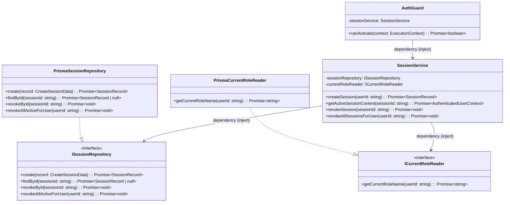
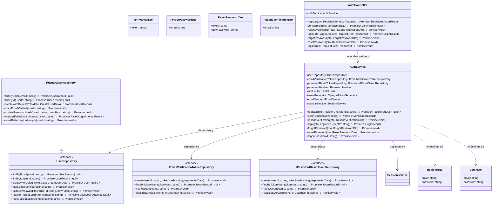
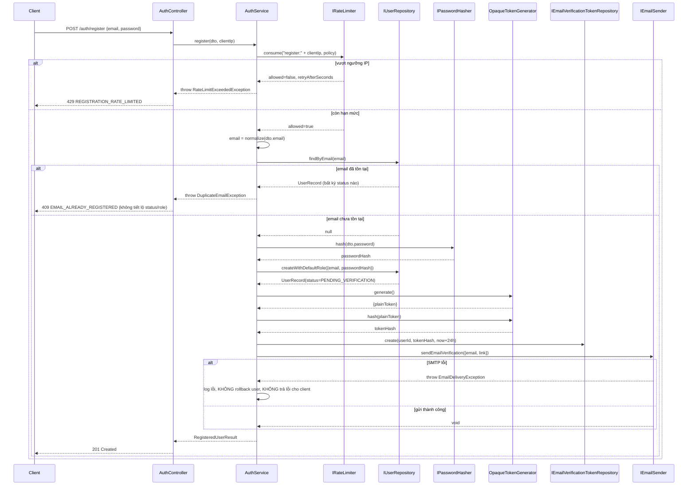
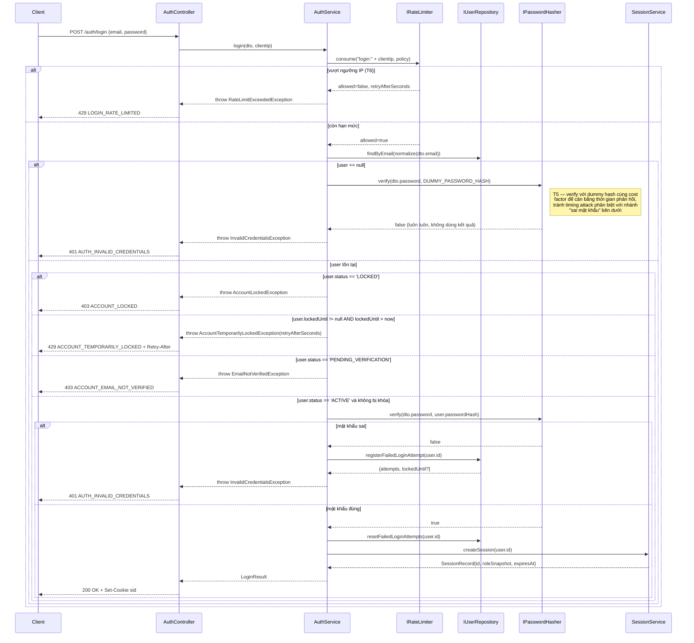
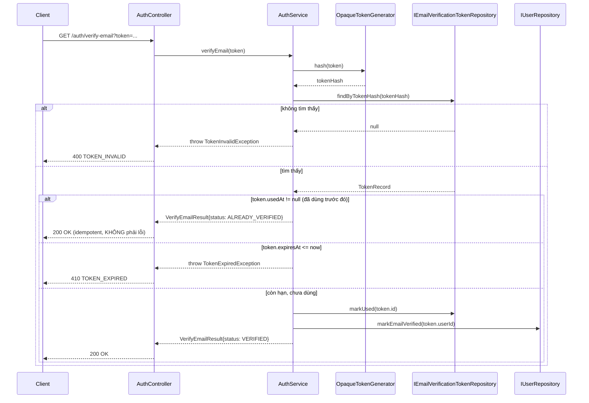

# Low-Level Design: Phase 1 — Auth + Session (Multi-User System)

## HLD/phương án kiến trúc làm căn cứ
- Modular Monolith NestJS (AuthModule, SessionModule, EmailModule, CommonModule
  trong phạm vi Phase 1; RbacModule/AccountModule/AdminModule là Phase 2, KHÔNG
  thiết kế ở đây).
- Session server-side lưu PostgreSQL qua Prisma, không dùng JWT (ADR-0001,
  Accepted).
- Rate-limit brute-force login (C-5, per-account, 5 lần sai → khóa 15 phút) và
  spam đăng ký (C-6, per-IP) — cơ chế in-memory counter cho giai đoạn 1 instance
  đơn (HLD, mục Deployment view).
- Email transactional qua SMTP bên thứ ba, adapter `IEmailSender` (HLD,
  EmailModule).
- `sessions.role_snapshot` đã được bổ sung vào data-model theo đúng yêu cầu
  C-11 (role chỉ áp dụng ở phiên đăng nhập tiếp theo, không real-time).
- Thứ tự kiểm tra login theo đúng api-spec mục 1.7.1 (4 bước, không đổi).
- **Cập nhật sau threat modeling (C-13, 2026-10-18)**: `IRateLimiter` (đã
  thiết kế ở CommonModule) được dùng ở Phase 1 cho **5 endpoint**, không
  chỉ `register`: `login` (theo IP, bổ sung cho per-account C-5, chống
  credential stuffing — T6 Critical), `verify-email`, `resend-verification`,
  `forgot-password`, `reset-password` (theo IP, chống spam/email-bombing —
  T3 High). Xem cập nhật sequence diagram "Đăng nhập" bên dưới.
- **Cập nhật sau threat modeling (T5, Medium)**: `AuthService.login()` phải
  verify với một dummy password hash (cost factor giống hệt bcrypt thật)
  khi email không tồn tại, để tránh timing attack phân biệt "email không
  tồn tại" (fail-fast) với "sai mật khẩu" (tốn thời gian bcrypt) qua chênh
  lệch thời gian phản hồi.
- Nguồn: `docs/design/hld-multi-user-system.md`,
  `docs/architecture/adr/0001-session-management-strategy.md`,
  `docs/design/data-model-multi-user-system.md`,
  `docs/design/api-spec-multi-user-system.md`,
  `docs/requirements/srs-multi-user-system.md`.

## Bối cảnh code hiện tại (đã khảo sát)
- `Glob **/*` xác nhận repo chỉ có `CLAUDE.md` + 6 file tài liệu thiết kế/yêu
  cầu — **không có code nào tồn tại** (`backend/`, `schema.prisma`,... chưa
  được tạo). Toàn bộ class dưới đây là MỚI, không có convention cũ để đối
  chiếu ngoài quy định trong `CLAUDE.md`.
- Pattern kiến trúc áp dụng: layered trong từng NestJS module —
  `Controller → Service → Repository (interface) → Prisma`, theo đúng mô tả
  trách nhiệm module trong HLD.
- Naming: PascalCase cho class/interface (interface tiền tố `I`, ví dụ
  `IPasswordHasher`), camelCase cho method/biến, UPPER_SNAKE_CASE cho hằng số,
  file `kebab-case.ts` với hậu tố theo vai trò NestJS chuẩn
  (`.service.ts`, `.controller.ts`, `.module.ts`, `.repository.ts`,
  `.interface.ts`, `.dto.ts`, `.exception.ts`, `.guard.ts`).
- Xử lý exception: chưa có code cũ — thiết kế mới dùng exception hierarchy
  riêng (`AppException` kế thừa `HttpException`) + 1 `AllExceptionsFilter`
  toàn cục, map đúng response envelope đã chốt ở api-spec mục 1.4.

## Quy ước Dependency Injection dùng xuyên suốt tài liệu này
Mọi interface (`I...`) được bind qua NestJS custom provider token (ví dụ
`export const PASSWORD_HASHER = Symbol('IPasswordHasher')`), inject bằng
`@Inject(PASSWORD_HASHER)` tại constructor. Class service/controller luôn khai
báo kiểu tham số là **interface**, không bao giờ là class implementation cụ
thể (Dependency Inversion — CLAUDE.md). Chi tiết token không lặp lại ở từng
class để tránh dài dòng.

---

## Thiết kế class/module

### Sơ đồ tổng quan — CommonModule + EmailModule

```mermaid
classDiagram
  class IPasswordHasher {
    <<interface>>
    +hash(plainPassword: string): Promise~string~
    +verify(plainPassword: string, passwordHash: string): Promise~boolean~
  }
  class BcryptPasswordHasher {
    -saltRounds: number
    +hash(plainPassword: string): Promise~string~
    +verify(plainPassword: string, passwordHash: string): Promise~boolean~
  }
  class IRateLimiter {
    <<interface>>
    +consume(key: string, policy: RateLimitPolicy): Promise~RateLimitConsumeResult~
  }
  class InMemoryRateLimiter {
    -buckets: Map~string, RateLimitBucket~
    +consume(key: string, policy: RateLimitPolicy): Promise~RateLimitConsumeResult~
  }
  class OpaqueTokenGenerator {
    +generate(): GeneratedToken
    +hash(plainToken: string): string
  }
  class PrismaService {
    +onModuleInit(): Promise~void~
    +onModuleDestroy(): Promise~void~
  }
  class AppException {
    <<abstract>>
    +errorCode: string
    +details: ErrorDetailItem[]
    +retryAfterSeconds: number
  }
  class AllExceptionsFilter {
    +catch(exception: unknown, host: ArgumentsHost): void
  }
  class IEmailSender {
    <<interface>>
    +sendEmailVerification(params: SendEmailVerificationParams): Promise~void~
    +sendPasswordReset(params: SendPasswordResetParams): Promise~void~
  }
  class NodemailerSmtpSender {
    -transporter: Transporter
    +sendEmailVerification(params: SendEmailVerificationParams): Promise~void~
    +sendPasswordReset(params: SendPasswordResetParams): Promise~void~
  }

  BcryptPasswordHasher ..|> IPasswordHasher
  InMemoryRateLimiter ..|> IRateLimiter
  NodemailerSmtpSender ..|> IEmailSender
  AllExceptionsFilter --> AppException : đọc errorCode/status
```



#### `PrismaService`
- File: `backend/src/common/prisma/prisma.service.ts`
- Trách nhiệm: Quản lý vòng đời `PrismaClient` dùng chung cho toàn bộ ứng dụng.
- Method:
  - `onModuleInit(): Promise<void>` — gọi `this.$connect()`.
  - `onModuleDestroy(): Promise<void>` — gọi `this.$disconnect()`.
- Quan hệ: Mọi `Prisma*Repository` (SessionModule, AuthModule) composition qua
  constructor injection, phụ thuộc trực tiếp lớp này (lớp duy nhất được phép
  phụ thuộc cụ thể, không qua interface, vì đây chính là hạ tầng).

#### `IPasswordHasher` / `BcryptPasswordHasher`
- File: `backend/src/common/security/password-hasher.interface.ts`,
  `backend/src/common/security/bcrypt-password-hasher.service.ts`
- Trách nhiệm: Trừu tượng hóa thuật toán hash mật khẩu để `AuthService` không
  phụ thuộc trực tiếp bcrypt (có thể đổi sang argon2id sau mà không đổi
  `AuthService`).
- Method:
  - `hash(plainPassword: string): Promise<string>` — trả password hash.
  - `verify(plainPassword: string, passwordHash: string): Promise<boolean>` —
    so khớp, KHÔNG bao giờ throw khi sai (trả `false`).
- `BcryptPasswordHasher`: thuộc tính `saltRounds: number` (config qua env, mặc
  định đề xuất `12`). *Giả định: chọn bcrypt (không phải argon2id) vì HLD để
  ngỏ quyết định này cho LLD; cần xác nhận nếu team muốn argon2id.*
- Quan hệ: `AuthService` dependency qua interface.

#### `IRateLimiter` / `InMemoryRateLimiter`
- File: `backend/src/common/rate-limit/rate-limiter.interface.ts`,
  `backend/src/common/rate-limit/in-memory-rate-limiter.service.ts`
- Trách nhiệm: Đếm số lần request theo 1 key tùy ý (ví dụ `register:<ip>`)
  trong 1 cửa sổ thời gian, dùng cho rate-limit theo NGUỒN (IP) — **KHÔNG**
  dùng cho brute-force login theo tài khoản (cơ chế đó dùng cột
  `failed_login_attempts`/`locked_until` trực tiếp trên `users`, xem
  `IUserRepository` bên dưới — hai cơ chế tách biệt vì khóa theo 2 chiều dữ
  liệu khác nhau: IP nguồn (ephemeral, không cần bền) vs tài khoản (cần bền
  qua restart, đã có cột DB sẵn)).
- Method:
  - `consume(key: string, policy: RateLimitPolicy): Promise<RateLimitConsumeResult>`
    — tăng bộ đếm cho `key`, trả `allowed`/`remainingAttempts`/`retryAfterSeconds`.
- `InMemoryRateLimiter`: thuộc tính `buckets: Map<string, RateLimitBucket>`
  (fixed-window counter). *Giới hạn đã ghi nhận ở HLD: chỉ đúng khi 1
  instance backend — nếu scale ngang, cần implementation Redis mới của cùng
  `IRateLimiter`, không đổi `AuthService`.*
- Quan hệ: `AuthService.register()` phụ thuộc qua interface (Strategy pattern
  — nhiều implementation cùng interface).

#### `OpaqueTokenGenerator`
- File: `backend/src/common/security/opaque-token-generator.service.ts`
- Trách nhiệm: Sinh token ngẫu nhiên đủ entropy (email-verification,
  password-reset) và hash nó để lưu DB. Đây là **class cụ thể, không có
  interface** — chỉ 1 implementation, không có nhu cầu swap (tránh premature
  abstraction theo CLAUDE.md).
- Method:
  - `generate(): GeneratedToken` — trả `{ plainToken: string }` (ví dụ 256-bit
    random base64url).
  - `hash(plainToken: string): string` — SHA-256 hex, dùng để tra DB và để
    lưu (token KHÔNG lưu thô).
- Quan hệ: Dùng bởi `AuthService` cho cả luồng verify-email và reset-password
  (dùng chung logic sinh/hash, tránh trùng lặp).

#### `AppException` (base exception) + exception con (xem mục Xử lý lỗi)
- File: `backend/src/common/exceptions/app.exception.ts`
- Trách nhiệm: Lớp cha cho mọi lỗi nghiệp vụ có mã lỗi ổn định
  (`errorCode`), map 1-1 với response envelope lỗi ở api-spec mục 1.4.
- Thuộc tính: `errorCode: string`, `details?: ErrorDetailItem[]`,
  `retryAfterSeconds?: number`.
- Constructor (khái niệm): `(httpStatus, errorCode, message, details?, retryAfterSeconds?)`.
- Quan hệ: Mọi exception nghiệp vụ trong AuthModule/SessionModule kế thừa lớp
  này.

#### `AllExceptionsFilter`
- File: `backend/src/common/filters/all-exceptions.filter.ts`
- Trách nhiệm: Bắt MỌI exception ném ra trong request lifecycle, chuẩn hóa về
  đúng response envelope (api-spec 1.4) — là nơi DUY NHẤT build response lỗi,
  không controller nào tự build.
- Method: `catch(exception: unknown, host: ArgumentsHost): void`.
- Logic khái niệm: nếu `exception instanceof AppException` → dùng
  `httpStatus/errorCode/message/details/retryAfterSeconds` của chính nó; nếu
  là `HttpException` khác (vd `BadRequestException` do `ValidationPipe` ném)
  → map về `400 VALIDATION_ERROR`, giữ nguyên mảng lỗi field vào `details`;
  nếu là `Error` bất kỳ khác → log đầy đủ stack trace nội bộ, trả
  `500 INTERNAL_ERROR` với message chung, **không bao giờ lộ stack/chi tiết
  nội bộ**.
- Quan hệ: Đăng ký toàn cục (`APP_FILTER`) trong `CommonModule`.

#### `IEmailSender` / `NodemailerSmtpSender`
- File: `backend/src/email/email-sender.interface.ts`,
  `backend/src/email/nodemailer-smtp.sender.ts`
- Trách nhiệm (`IEmailSender`): Trừu tượng hóa việc gửi 2 loại email nghiệp vụ
  (xác thực, reset mật khẩu) để `AuthService` không phụ thuộc Nodemailer cụ
  thể (Dependency Inversion + Adapter pattern).
- Method:
  - `sendEmailVerification(params: SendEmailVerificationParams): Promise<void>`
  - `sendPasswordReset(params: SendPasswordResetParams): Promise<void>`
- `NodemailerSmtpSender` (Adapter cho thư viện Nodemailer):
  - Thuộc tính: `transporter: Transporter` (khởi tạo từ `ConfigService`:
    host/port/user/pass SMTP).
  - Hiện thực 2 method trên bằng cách dựng nội dung email đơn giản (subject +
    link) rồi gọi `transporter.sendMail(...)`.
  - Nếu gửi thất bại → ném `EmailDeliveryException`
    (`backend/src/email/exceptions/email-delivery.exception.ts`, kế thừa
    `Error` thường — KHÔNG kế thừa `HttpException` vì đây là lỗi hạ tầng nội
    bộ, không map trực tiếp ra response HTTP của request đang xử lý).
- Quan hệ: Chỉ `AuthService` được gọi `IEmailSender` (đúng biên giới HLD).

---

### Sơ đồ tổng quan — SessionModule



#### `ISessionRepository` / `PrismaSessionRepository`
- File: `backend/src/session/session-repository.interface.ts`,
  `backend/src/session/prisma-session.repository.ts`
- Trách nhiệm: Truy cập dữ liệu bảng `sessions` (Repository pattern, theo
  đúng ADR-0001 — cho phép thêm cache layer sau mà không đổi `SessionService`).
- Method:
  - `create(record: CreateSessionData): Promise<SessionRecord>` — insert 1
    dòng (`id`, `userId`, `roleSnapshot`, `expiresAt`).
  - `findById(sessionId: string): Promise<SessionRecord | null>`.
  - `revokeById(sessionId: string): Promise<void>` — set `revokedAt = now()`
    (dùng cho logout).
  - `revokeAllActiveForUser(userId: string): Promise<void>` — set
    `revokedAt = now()` cho mọi dòng `revokedAt IS NULL` của user — cần cho
    Phase 1 vì `AuthService.resetPassword()` thu hồi toàn bộ session sau khi
    đổi mật khẩu (api-spec mục 2.6).
- `PrismaSessionRepository`: implement bằng Prisma trên model `Session`.

#### `ICurrentRoleReader` / `PrismaCurrentRoleReader`
- File: `backend/src/session/current-role-reader.interface.ts`,
  `backend/src/session/prisma-current-role.reader.ts`
- Trách nhiệm: Đọc tên role HIỆN TẠI của 1 user tại đúng thời điểm gọi (join
  `user_roles`/`roles`), phục vụ `SessionService.createSession()` snapshot
  đúng theo C-11 (không join real-time sau khi đã tạo session, chỉ join
  real-time tại THỜI ĐIỂM TẠO).
- Method: `getCurrentRoleName(userId: string): Promise<string>` — nếu user
  không có role nào gán (vi phạm bất biến hệ thống) → ném lỗi nội bộ.
- *Ghi chú ranh giới*: interface này cố tình tách riêng khỏi RbacModule
  (Phase 2) vì Phase 1 cần đọc role để snapshot vào session TRƯỚC KHI
  RbacModule tồn tại. Khi Phase 2 thiết kế RbacModule, cần xem xét hợp
  nhất/tái sử dụng `ICurrentRoleReader` thay vì viết lại logic đọc role.

#### `SessionService`
- File: `backend/src/session/session.service.ts`
- Trách nhiệm: Nghiệp vụ vòng đời session (tạo, validate, thu hồi) — là API
  nội bộ duy nhất mà `AuthModule` được phép gọi để thao tác session.
- Dependency (constructor): `ISessionRepository`, `ICurrentRoleReader`.
- Method:
  - `createSession(userId: string): Promise<SessionRecord>` — xem pseudocode (a).
  - `getActiveSessionContext(sessionId: string): Promise<AuthenticatedUserContext>`
    — dùng bởi `AuthGuard`, xem pseudocode (b).
  - `revokeSession(sessionId: string): Promise<void>` — dùng bởi
    `AuthService.logout()`.
  - `revokeAllSessionsForUser(userId: string): Promise<void>` — dùng bởi
    `AuthService.resetPassword()` (Phase 1) và sau này `AdminModule`/
    `AccountModule` (Phase 2, không đổi chữ ký).

#### `AuthGuard`
- File: `backend/src/session/guards/auth.guard.ts`
- Trách nhiệm: NestJS `CanActivate` — chặn request vào route cần đăng nhập
  nếu không có session hợp lệ; gắn `AuthenticatedUserContext` vào `request`
  nếu hợp lệ.
- Dependency: `SessionService`.
- Method: `canActivate(context: ExecutionContext): Promise<boolean>` — xem
  pseudocode (b).
- *Lưu ý phạm vi*: Guard này CHỈ xác thực (authentication), KHÔNG kiểm tra
  role/quyền (authorization) — đó là `RolesGuard` của RbacModule, Phase 2.
  Phase 1 chỉ có 1 route dùng `AuthGuard`: `POST /auth/logout`.

---

### Sơ đồ tổng quan — AuthModule



#### DTO (validate bằng class-validator, mô tả rule ở mức khái niệm)
| DTO | Field | Rule |
|---|---|---|
| `RegisterDto` | `email` | `@IsEmail()`, `@IsNotEmpty()`, `@MaxLength(255)` |
| | `password` | `@IsString()`, `@MinLength(8)`, `@MaxLength(128)`, `@Matches(PASSWORD_STRENGTH_REGEX)` — regex yêu cầu ≥1 chữ cái + ≥1 chữ số (C-9) |
| `LoginDto` | `email` | `@IsEmail()`, `@IsNotEmpty()` |
| | `password` | `@IsString()`, `@IsNotEmpty()`, `@MaxLength(128)` |
| `VerifyEmailDto` | `token` | `@IsString()`, `@IsNotEmpty()`, `@MaxLength(255)` |
| `ForgotPasswordDto` | `email` | `@IsEmail()`, `@IsNotEmpty()` |
| `ResetPasswordDto` | `token` | `@IsString()`, `@IsNotEmpty()` |
| | `newPassword` | Giống `RegisterDto.password` |
| `ResendVerificationDto` | `email` | `@IsEmail()`, `@IsNotEmpty()` |

Chuẩn hóa email (lowercase + trim, theo api-spec 1.10) thực hiện **tại
`AuthService`** (1 chỗ duy nhất, trước khi gọi `IUserRepository`), không rải
rác ở từng DTO.

#### `IUserRepository` / `PrismaUserRepository`
- File: `backend/src/auth/repositories/user-repository.interface.ts`,
  `backend/src/auth/repositories/prisma-user.repository.ts`
- Trách nhiệm: Truy cập/thay đổi dữ liệu bảng `users` + gán role mặc định lúc
  tạo (xem mục Rủi ro về ranh giới với RbacModule).
- Method:
  - `findByEmail(emailLowercase: string): Promise<UserRecord | null>`.
  - `findById(userId: string): Promise<UserRecord | null>`.
  - `createWithDefaultRole(data: CreateUserData): Promise<UserRecord>` — tạo
    `users` (status `PENDING_VERIFICATION`) + `user_roles(role='USER')` trong
    **1 transaction Prisma**.
  - `markEmailVerified(userId: string): Promise<void>`.
  - `updatePasswordHash(userId: string, newPasswordHash: string): Promise<void>`.
  - `registerFailedLoginAttempt(userId: string): Promise<FailedLoginAttemptResult>`
    — **atomic increment** ở tầng DB, không đọc-rồi-ghi ở tầng ứng dụng (tránh
    lost-update khi nhiều request sai mật khẩu đồng thời); nếu kết quả mới
    `>= 5` (C-5) → set `locked_until = now() + 15 phút` trong CÙNG câu
    update; trả `{ attempts, lockedUntil }`.
  - `resetFailedLoginAttempts(userId: string): Promise<void>` — set
    `failed_login_attempts = 0, locked_until = NULL`, gọi khi login thành
    công.

#### `IEmailVerificationTokenRepository` / `IPasswordResetTokenRepository`
- File: `backend/src/auth/repositories/email-verification-token-repository.interface.ts`
  (+ `prisma-email-verification-token.repository.ts`), tương tự cho
  `password-reset-token-repository.interface.ts`.
- Trách nhiệm: Truy cập bảng `email_verification_tokens` /
  `password_reset_tokens` tương ứng — 2 interface tách riêng dù có cùng
  shape method, vì gắn với 2 bảng/luồng nghiệp vụ độc lập (REQ-AUTH-002 vs
  REQ-AUTH-004).
- Method (giống nhau cho cả 2):
  - `create(userId: string, tokenHash: string, expiresAt: Date): Promise<void>`.
  - `findByTokenHash(tokenHash: string): Promise<TokenRecord | null>`.
  - `markUsed(tokenId: string): Promise<void>`.
  - `invalidateActiveTokensForUser(userId: string): Promise<void>` — set
    `used_at = now()` cho các token cũ chưa dùng của user khi phát hành token
    mới (tránh nhiều link cùng hợp lệ).

#### `AuthService`
- File: `backend/src/auth/auth.service.ts`
- Trách nhiệm: Toàn bộ nghiệp vụ Auth (register/verify/resend/login/forgot/
  reset/logout) — điều phối giữa repository, hasher, rate-limiter, email
  sender, session service; nơi duy nhất quyết định luồng/thứ tự kiểm tra 1.7.1.
- Dependency (constructor): `IUserRepository`, `IEmailVerificationTokenRepository`,
  `IPasswordResetTokenRepository`, `IPasswordHasher`, `IRateLimiter`,
  `OpaqueTokenGenerator`, `IEmailSender`, `SessionService`.
- Method:
  - `register(dto: RegisterDto, clientIp: string): Promise<RegisteredUserResult>`.
  - `verifyEmail(token: string): Promise<VerifyEmailResult>`.
  - `resendVerification(dto: ResendVerificationDto): Promise<void>` — luôn
    thành công "im lặng" (không lộ tồn tại email).
  - `login(dto: LoginDto, clientIp: string): Promise<LoginResult>` — đúng 4
    bước 1.7.1.
  - `forgotPassword(dto: ForgotPasswordDto): Promise<void>` — luôn thành
    công "im lặng".
  - `resetPassword(dto: ResetPasswordDto): Promise<void>` — kiểm tra token →
    kiểm tra mật khẩu mới khác mật khẩu cũ → cập nhật → gọi
    `sessionService.revokeAllSessionsForUser(userId)`.
  - `logout(sessionId: string): Promise<void>` — gọi
    `sessionService.revokeSession(sessionId)`.

#### `AuthController`
- File: `backend/src/auth/auth.controller.ts`
- Trách nhiệm: Map HTTP request/response (đúng contract ở api-spec) → gọi
  `AuthService`; set/xóa cookie `sid`; **không chứa logic nghiệp vụ**.
- Dependency: `AuthService`.
- Method (ứng với 7 route Phase 1): `register`, `verifyEmail` (GET, đọc
  `token` từ query), `resendVerification`, `login` (set cookie `sid` khi
  thành công), `forgotPassword`, `resetPassword`, `logout` (có
  `@UseGuards(AuthGuard)`, xóa cookie khi thành công).

---

## Luồng xử lý chi tiết

### Luồng chính: Đăng ký thành công + thất bại do email đã tồn tại



### Luồng chính: Đăng nhập — đầy đủ nhánh theo thứ tự 1.7.1



**Lưu ý cố ý**: nhánh "email không tồn tại" và nhánh "mật khẩu sai" ném
**CÙNG MỘT** class `InvalidCredentialsException` với CÙNG `errorCode`/
`message` — không có 2 exception riêng biệt. Đây là điểm dễ sai nhất của
luồng này (lộ thông tin qua message khác nhau), đã được thiết kế loại trừ
ngay từ cấp class.

### Luồng chính: Xác thực email — hợp lệ / hết hạn / đã dùng



### Luồng lỗi bổ sung: Đặt lại mật khẩu — token đã dùng (khác hành vi với verify-email)

**Bất đối xứng có chủ đích**: verify-email coi token-đã-dùng là **thành công
idempotent** (`ALREADY_VERIFIED`), còn reset-password coi token-đã-dùng là
**lỗi** (`409 TOKEN_ALREADY_USED`) vì dùng lại token reset nhiều lần là hành
vi đáng ngờ, khác bản chất với việc người dùng vô tình bấm lại link xác
thực email.

1. `AuthService.resetPassword()` → `IPasswordResetTokenRepository.findByTokenHash()`.
2. Không tìm thấy → `TokenInvalidException` (400).
3. Tìm thấy, `usedAt != null` → `TokenAlreadyUsedException` (409).
4. Tìm thấy, chưa dùng, `expiresAt <= now` → `TokenExpiredException` (410).
5. Hợp lệ → `passwordHasher.verify(newPassword, user.passwordHash)`; nếu
   trùng mật khẩu cũ → `PasswordSameAsOldException` (422); nếu khác →
   `updatePasswordHash` + `markUsed` + `sessionService.revokeAllSessionsForUser(userId)`,
   trả thành công.

---

## Cấu trúc dữ liệu nội bộ (Ý TƯỞNG THIẾT KẾ — không phải API contract/DB schema thật)

### `AuthenticatedUserContext`
Được `AuthGuard` gắn vào `request.authContext` sau khi validate session
thành công; handler phía sau đọc từ đây (không bao giờ tự tra session lại).

| Field | Kiểu | Validation rule | Invariant |
|---|---|---|---|
| `userId` | string (UUID) | Không rỗng | Phải khớp `session.userId` đã validate |
| `role` | string | Phải là 1 trong các role hợp lệ (`USER`\|`ADMIN`) | Lấy từ `session.roleSnapshot`, KHÔNG join real-time `user_roles` (đúng C-11) |
| `sessionId` | string | Không rỗng | Khớp cookie `sid` của request hiện tại |

### `SessionRecord` (nội bộ, map từ bảng `sessions`)
| Field | Kiểu | Validation rule | Invariant |
|---|---|---|---|
| `id` | string | độ dài cố định, sinh ngẫu nhiên đủ entropy | Duy nhất (PK) |
| `userId` | string (UUID) | Không rỗng | FK tới user tồn tại |
| `roleSnapshot` | string | Thuộc enum role hợp lệ tại thời điểm tạo | Bất biến sau khi tạo — không được cập nhật lại bởi bất kỳ luồng nào trong Phase 1 |
| `createdAt` | Date | | |
| `expiresAt` | Date | `= createdAt + 7 ngày` (C-7) | |
| `revokedAt` | Date \| null | | null = đang hoạt động |

### `UserRecord` (nội bộ, map từ bảng `users`, KHÔNG bao giờ serialize `passwordHash` ra ngoài AuthModule)
| Field | Kiểu | Validation rule | Invariant |
|---|---|---|---|
| `id` | string (UUID) | | |
| `email` | string | lowercase đã chuẩn hóa | Duy nhất theo `LOWER(email)` |
| `passwordHash` | string | | Không bao giờ log/serialize ra response hoặc exception message |
| `status` | enum | `ACTIVE`\|`LOCKED`\|`DISABLED`\|`PENDING_VERIFICATION` | |
| `failedLoginAttempts` | number | `>= 0` | Reset về 0 khi login thành công |
| `lockedUntil` | Date \| null | | Chỉ set bởi `registerFailedLoginAttempt`, clear bởi `resetFailedLoginAttempts` |

### `RateLimitPolicy` / `RateLimitConsumeResult`
| Field | Kiểu | Ghi chú |
|---|---|---|
| `maxAttempts` | number | Ngưỡng cho phép trong 1 cửa sổ |
| `windowSeconds` | number | Độ dài cửa sổ |
| `allowed` | boolean (kết quả) | |
| `remainingAttempts` | number (kết quả) | |
| `retryAfterSeconds` | number (kết quả) | Dùng khi `allowed=false`, đồng bộ với header `Retry-After` |

**LƯU Ý**: Toàn bộ cấu trúc trên là mô hình dữ liệu nội bộ phục vụ thiết kế
class/luồng xử lý, **KHÔNG phải** API request/response contract thật
(`api-spec-multi-user-system.md`) và **KHÔNG phải** migration/DDL schema
database thật (cần `db-schema-reviewer` review sau khi viết migration
Prisma thật dựa trên `data-model-multi-user-system.md`).

---

## Xử lý lỗi/exception

| Method/luồng | Exception | Tình huống | Nơi bắt/xử lý | Retry/Fallback |
|---|---|---|---|---|
| `AuthService.register` | `RateLimitExceededException` (common) | Vượt ngưỡng đăng ký theo IP (C-6) | `AllExceptionsFilter` → 429 | Không retry tự động; client tự thử lại sau `retryAfterSeconds` |
| `AuthService.login` | `RateLimitExceededException` (common) | Vượt ngưỡng đăng nhập theo IP (C-13, T6 Critical) — kiểm tra TRƯỚC `findByEmail` | `AllExceptionsFilter` → 429 LOGIN_RATE_LIMITED | Không retry tự động; client tự thử lại sau `retryAfterSeconds` |
| `AuthService.verifyEmail` / `resendVerification` / `forgotPassword` / `resetPassword` | `RateLimitExceededException` (common) | Vượt ngưỡng theo IP cho 4 endpoint public nhạy cảm (C-13, T3 High) | `AllExceptionsFilter` → 429 | Không retry tự động |
| `AuthService.register` | `DuplicateEmailException` (auth) | Email đã tồn tại bất kể status | `AllExceptionsFilter` → 409 | Không retry — lỗi logic/input, fail nhanh |
| `AuthService.register` (nội bộ) | `EmailDeliveryException` (email) | SMTP lỗi tạm thời | `AuthService` tự bắt, log, KHÔNG lan truyền — request vẫn trả 201 | Không retry đồng bộ ở Phase 1; fallback = log để vận hành theo dõi, cân nhắc hàng đợi retry ở Phase 3 |
| `AuthService.verifyEmail` | `TokenInvalidException` (auth) | Token không khớp bản ghi nào | `AllExceptionsFilter` → 400 | Không retry — input sai |
| `AuthService.verifyEmail` | `TokenExpiredException` (auth) | Token quá 24h | `AllExceptionsFilter` → 410 | Không retry — gợi ý gọi `resend-verification` |
| `AuthService.login` | `InvalidCredentialsException` (auth) | Email không tồn tại HOẶC mật khẩu sai — dùng chung 1 class | `AllExceptionsFilter` → 401 | Không retry tự động |
| `AuthService.login` | `AccountLockedException` (auth) | `status = LOCKED` (admin khóa) | `AllExceptionsFilter` → 403 | Không retry |
| `AuthService.login` | `AccountTemporarilyLockedException` (auth) | `lockedUntil > now` (brute-force, C-5) | `AllExceptionsFilter` → 429 | Client tự thử lại sau `retryAfterSeconds` |
| `AuthService.login` | `EmailNotVerifiedException` (auth) | `status = PENDING_VERIFICATION` | `AllExceptionsFilter` → 403 | Không retry — gợi ý resend-verification |
| `AuthService.resetPassword` | `TokenInvalidException` / `TokenExpiredException` / `TokenAlreadyUsedException` / `PasswordSameAsOldException` (auth) | Xem sequence lỗi ở trên | `AllExceptionsFilter` → 400/410/409/422 tương ứng | Không retry — lỗi input/logic |
| `AuthGuard.canActivate` | `UnauthenticatedException` (session) | Không có cookie / session không tồn tại / đã revoke / hết hạn / user không `ACTIVE` | `AllExceptionsFilter` → 401 UNAUTHENTICATED | Không retry — client cần đăng nhập lại |
| `SessionService.createSession` | Lỗi nội bộ không HttpException | Vi phạm bất biến hệ thống (user không có role) | KHÔNG bắt ở `SessionService` — lan truyền lên, `AllExceptionsFilter` log stack đầy đủ, trả `500 INTERNAL_ERROR` | Không retry — bug cần sửa code |
| `IUserRepository.registerFailedLoginAttempt` | Lỗi DB tạm thời | Prisma ném lỗi kết nối | Lan truyền lên → `AllExceptionsFilter` → 500 | Không retry tự động ở Phase 1 |

**Nguyên tắc chung**: mọi exception nghiệp vụ (có `errorCode` ổn định) kế
thừa `AppException`; mọi lỗi hạ tầng không lường trước lan truyền tự nhiên
tới `AllExceptionsFilter` — không có catch rỗng ở bất kỳ method nào.

---

## Pseudocode minh họa (chỉ cho thuật toán phức tạp — không phải code cuối cùng)

### (a) `SessionService.createSession()`

```
function createSession(userId):
    # Bước quan trọng nhất: đọc role HIỆN TẠI tại đúng thời điểm này,
    # KHÔNG dùng giá trị role đã cache ở bất kỳ nơi nào khác.
    currentRoleName = currentRoleReader.getCurrentRoleName(userId)
    # getCurrentRoleName bên trong thực hiện:
    #   SELECT roles.name FROM user_roles
    #   JOIN roles ON roles.id = user_roles.role_id
    #   WHERE user_roles.user_id = :userId
    #   ORDER BY user_roles.assigned_at DESC
    #   LIMIT 1

    if currentRoleName is null:
        throw InternalStateViolationError("user has no role assigned")

    sessionId = generateHighEntropyId()
    now = currentTimestamp()
    expiresAt = now + 7 days              # C-7

    sessionRecord = sessionRepository.create({
        id: sessionId,
        userId: userId,
        roleSnapshot: currentRoleName,     # snapshot — KHÔNG đổi lại sau này
        createdAt: now,
        expiresAt: expiresAt,
        revokedAt: null
    })

    return sessionRecord
```

### (b) `AuthGuard.canActivate()`

```
function canActivate(executionContext):
    request = executionContext.switchToHttp().getRequest()
    sessionId = request.cookies["sid"]

    if sessionId is null or empty:
        throw UnauthenticatedException()

    # Thứ tự kiểm tra BẮT BUỘC đúng trình tự sau (ADR-0001 + REQ-SESSION-001 AC3):
    session = sessionRepository.findById(sessionId)

    if session is null:
        throw UnauthenticatedException()            # 1. tồn tại?

    if session.revokedAt is not null:
        throw UnauthenticatedException()             # 2. chưa revoke?

    if session.expiresAt <= currentTimestamp():
        throw UnauthenticatedException()             # 3. chưa hết hạn?

    user = userRepository.findById(session.userId)
    if user is null or user.status != "ACTIVE":
        throw UnauthenticatedException()             # 4. user.status active?

    authenticatedContext = {
        userId: session.userId,
        role: session.roleSnapshot,   # từ snapshot, KHÔNG join real-time
        sessionId: session.id
    }

    request.authContext = authenticatedContext
    return true
```

*(`SessionService.getActiveSessionContext()` đóng gói đúng 4 bước trên;
`AuthGuard.canActivate()` chỉ gọi method này và gắn kết quả vào `request`.)*

---

## Gợi ý điểm cần test

- `BcryptPasswordHasher.hash/verify` — unit test round-trip hash→verify
  đúng/sai; không throw khi password sai (chỉ trả `false`).
- `InMemoryRateLimiter.consume` — unit test: đúng ngưỡng cho phép, vượt
  ngưỡng trả `allowed=false`; race condition: gọi `Promise.all()` nhiều
  `consume()` đồng thời sát ngưỡng, kiểm tra không bị "mất" lần đếm.
- `SessionService.createSession` — unit test role snapshot phản ánh ĐÚNG role
  hiện tại (mock `ICurrentRoleReader`); edge case user không có role → ném
  lỗi nội bộ đúng loại.
- `AuthGuard.canActivate` — unit test từng nhánh: không cookie, session
  không tồn tại, đã revoke, đã hết hạn, user không `ACTIVE`, thành công gắn
  đúng `AuthenticatedUserContext`.
- `AuthService.login` — unit test đủ cả 2 nhánh "email không tồn tại" và
  "mật khẩu sai" đều ném **cùng class, cùng message/errorCode** (regression
  test bắt buộc chống lộ thông tin). Unit test tài khoản `LOCKED` phải được
  trả về TRƯỚC khi kiểm tra mật khẩu.
- `AuthService.register` — integration test: đăng ký thành công tạo đúng 1
  dòng `user_roles(role=USER)` trong cùng transaction; đăng ký email đã tồn
  tại (bất kỳ status nào) trả đúng `409`; email viết hoa/thường khác nhau
  của cùng địa chỉ vẫn coi là trùng.
- `AuthService.verifyEmail` — integration test gọi 2 lần cùng token hợp lệ:
  lần 1 `VERIFIED`, lần 2 `ALREADY_VERIFIED` (không lỗi).
- `AuthService.resetPassword` — integration test token đã dùng → `409`;
  mật khẩu mới trùng mật khẩu cũ → `422`; sau khi đổi mật khẩu thành công,
  mọi session cũ của user bị revoke.
- Brute-force lockout — integration test 5 lần sai liên tiếp → lần 6 (dù
  đúng mật khẩu) vẫn `429` cho tới khi `lockedUntil` qua; counter reset về
  0 sau login thành công.
- `IUserRepository.registerFailedLoginAttempt` — test tính atomic: 2 request
  sai mật khẩu đồng thời phải cho tổng đếm đúng (không mất update).

Gợi ý dùng `test-writer` để viết test thật dựa trên các điểm trên.

---

## Bảo mật ở cấp class/module

- **Input chưa validate từ bên ngoài**: `AuthController` là điểm validate
  đầu tiên — mọi DTO đi qua NestJS `ValidationPipe` toàn cục TRƯỚC khi tới
  `AuthService`.
- **Mật khẩu/token không bao giờ xuất hiện trong log/exception message**:
  các exception chỉ nhận `errorCode` cố định + message tĩnh, không nội suy
  dữ liệu nhạy cảm. `AllExceptionsFilter` khi log lỗi 500 chỉ log
  `error.stack`, không log `request.body` thô.
- **Secret SMTP**: `NodemailerSmtpSender` đọc host/port/user/pass từ
  `ConfigService` tại thời điểm khởi tạo `transporter` — KHÔNG truyền secret
  qua tham số của `sendEmailVerification`/`sendPasswordReset`. Cơ chế quản
  lý secret cụ thể **chưa xác định** ở tầng vận hành (ngoài phạm vi LLD).
- **`AuthGuard` — chỉ xác thực, không phân quyền**: route `POST /auth/logout`
  chỉ cần "có session hợp lệ" — không có `RolesGuard` ở Phase 1.
- **`session.id` không hash (theo ADR-0001)**: không bao giờ log giá trị
  `sessionId` ra log ứng dụng ở mức `info`.
- **Token email/reset lưu hash**: `plainToken` chỉ tồn tại trong bộ nhớ tạm
  thời của `AuthService` lúc tạo/gửi email, không bao giờ persist.

---

## Giả định đã đưa ra
- Thuật toán hash mật khẩu: **bcrypt** (`saltRounds=12` đề xuất) — HLD để
  ngỏ quyết định này cho LLD; cần xác nhận nếu team muốn argon2id.
- Nếu `IEmailSender` thất bại (SMTP lỗi tạm thời), request chính vẫn trả
  thành công, lỗi gửi mail chỉ log nội bộ, không retry/hàng đợi ở Phase 1.
- `ICurrentRoleReader` được tách thành interface/implementation riêng trong
  `SessionModule` ở Phase 1 (không đợi `RbacModule` Phase 2).
- Ngưỡng `maxAttempts`/`windowSeconds` cụ thể của `IRateLimiter` cho
  `register`: đề xuất mặc định `10 request/giờ/IP`, cấu hình qua env.
- `registerFailedLoginAttempt` thực hiện atomic increment + set
  `lockedUntil` trong cùng 1 thao tác — có thể cần `prisma.$transaction`
  ngắn nếu không biểu diễn được trong 1 câu UPDATE đơn, cần xác nhận khi
  viết code thật.

## Rủi ro: ranh giới "gán role mặc định" giữa Phase 1 và Phase 2
HLD mô tả trách nhiệm "gán role mặc định USER khi đăng ký" thuộc
`RbacModule`, nhưng `RbacModule` được xếp vào Phase 2, trong khi luồng đăng
ký (Phase 1) bắt buộc phải tạo dòng `user_roles` ngay lúc này. LLD này giải
quyết bằng cách đặt `createWithDefaultRole()` trong `IUserRepository`
(thuộc AuthModule, Phase 1) để Phase 1 khả thi độc lập. Tương tự,
`ICurrentRoleReader` (SessionModule, Phase 1) đọc role tương tự những gì
RbacModule sẽ cần — nên rà soát hợp nhất khi thiết kế LLD Phase 2 để tránh
2 nơi đọc role theo 2 cách khác nhau. Ngoài điểm này, không phát hiện vấn đề
bất khả thi nào khác trong HLD khi chi tiết hóa xuống cấp class/method.

## Ngoài phạm vi LLD này
- `RbacModule`, `AccountModule`, `AdminModule` — thuộc Phase 2, sẽ có LLD
  riêng (bao gồm CSRF protection C-14 và actor-tracking C-15 cho AdminModule
  — đã chuyển sớm lên Phase 2 sau threat modeling, xem HLD cập nhật
  2026-10-18).
- Cơ chế hàng đợi/retry gửi email bất đồng bộ bền vững (message queue) —
  Phase 1 dùng fire-and-forget đơn giản + log lỗi.
- Job dọn session hết hạn định kỳ — thuộc Phase 3 theo HLD.

## Bước tiếp theo gợi ý
- Dùng `threat-modeler` để rà soát STRIDE cho luồng login/session trước khi code.
- Sau khi LLD này được xác nhận, bắt đầu implement Phase 1; khi tới Phase 2,
  quay lại `low-level-designer` để chi tiết hóa `RbacModule`/`AccountModule`/
  `AdminModule` dựa trên HLD và LLD Phase 1 này (tái sử dụng
  `AuthenticatedUserContext`, `SessionService`, `ICurrentRoleReader`).
