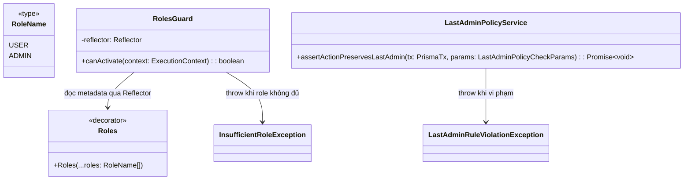
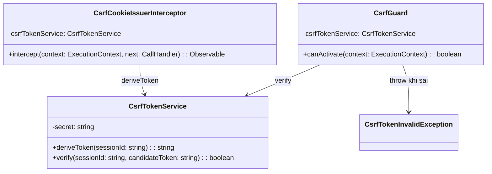
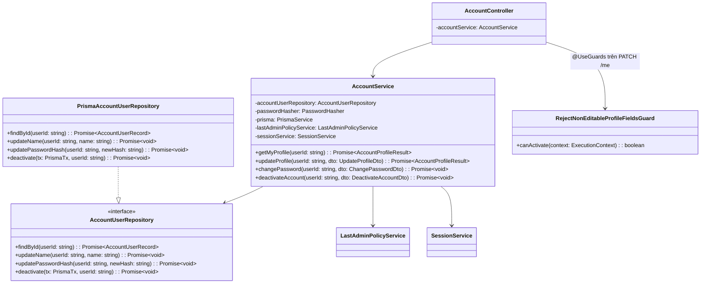
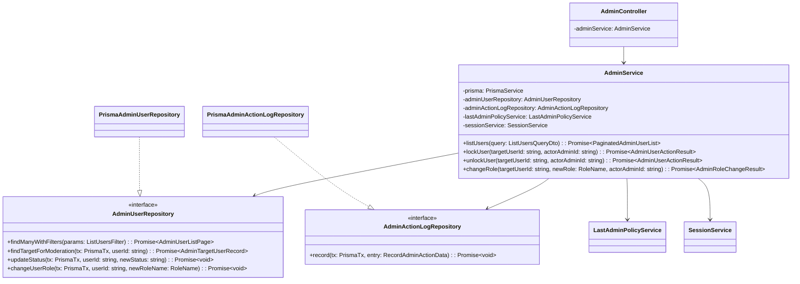
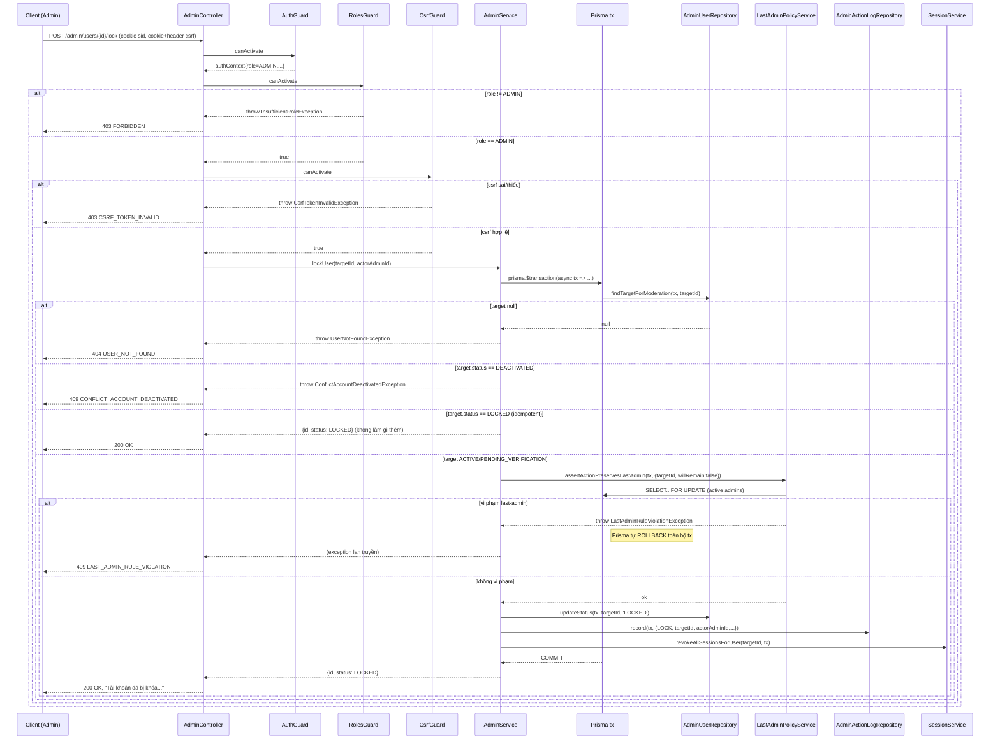
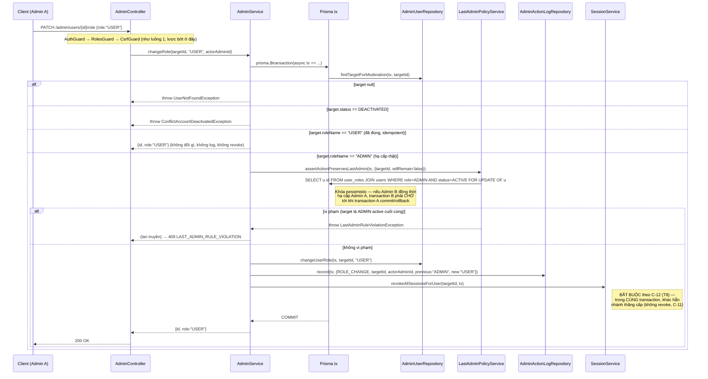

# Low-Level Design: Phase 2 — RbacModule + AccountModule + AdminModule (Multi-User System)

## HLD/phương án kiến trúc làm căn cứ
- Modular Monolith NestJS, tiếp tục đúng layering `Controller → Service → Repository (interface) → Prisma` đã dùng ở Phase 1 (`docs/design/hld-multi-user-system.md`, mục "Phase 2: RBAC + Account + Admin").
- Session server-side (ADR‑0001), role là snapshot trên `sessions.role_snapshot` tại thời điểm tạo session — **ngoại lệ C‑12**: hạ cấp ADMIN phải revoke session ngay, không chờ hết hạn.
- Last-admin rule (C‑3/C‑10) enforce bằng transaction + `SELECT...FOR UPDATE` (`docs/design/data-model-multi-user-system.md`, mục "Cách enforce last-admin rule").
- 3 cập nhật bắt buộc sau threat-modeling (2026‑10‑18, đưa vào Phase 2 theo SRS C‑12/C‑14/C‑15 và HLD):
  - **C‑12 (T8, High)**: `AdminModule.changeRole()` hạ cấp ADMIN→USER phải `SessionService.revokeAllSessionsForUser()` **trong cùng transaction**; thăng cấp USER→ADMIN giữ nguyên C‑11 (không revoke).
  - **C‑14 (T4, High)**: CSRF protection cụ thể cho mọi route state-changing của AccountModule/AdminModule, triển khai ngay Phase 2.
  - **C‑15 (T9, High)**: AdminModule phải ghi actor (`performed_by_admin_id`) + timestamp cho lock/unlock/role-change, ngay từ đầu.
- Nguồn: `docs/design/hld-multi-user-system.md`, `docs/design/lld-phase1-auth-session.md` (nền tái sử dụng), `docs/architecture/adr/0001-session-management-strategy.md`, `docs/design/data-model-multi-user-system.md`, `docs/design/api-spec-multi-user-system.md`, `docs/requirements/srs-multi-user-system.md`, `docs/security/threat-model-multi-user-system.md`.

## Bối cảnh code hiện tại (đã khảo sát — Phase 1 ĐÃ ĐƯỢC IMPLEMENT THẬT, không còn chỉ là LLD)
Khác với lúc viết LLD Phase 1, repo hiện **đã có code thật** dưới `backend/src/**` (Glob xác nhận `auth/`, `session/`, `email/`, `common/`, `generated/prisma/`). Toàn bộ thiết kế Phase 2 dưới đây bám theo đúng API/convention THẬT đã đọc trực tiếp từ các file sau (không suy diễn lại từ LLD Phase 1 doc, vì code thật có vài điểm khác nhẹ so với doc Phase 1):

- **Naming interface**: code thật **KHÔNG dùng tiền tố `I`** (khác mô tả trong `lld-phase1-auth-session.md`) — ví dụ `UserRepository`, `SessionRepository`, `CurrentRoleReader`, `RateLimiter`, mỗi interface export kèm 1 `Symbol` token cùng file (`export const USER_REPOSITORY = Symbol('UserRepository')`), inject qua `@Inject(TOKEN)`. LLD này **tuân theo convention thật**, không theo mô tả cũ của Phase 1 doc.
- **Exception**: mọi lỗi nghiệp vụ kế thừa `AppException` (`backend/src/common/exceptions/app.exception.ts`), 1 class/file trong `module/exceptions/*.exception.ts`, constructor gọi `super(httpStatus, errorCode, message, { details?, retryAfterSeconds? })`. `AllExceptionsFilter` (`backend/src/common/filters/all-exceptions.filter.ts`) là nơi DUY NHẤT build response lỗi — xác nhận lại: nếu ném `HttpException` thường (không phải `AppException`), filter map về `errorCode: 'HTTP_ERROR'`, **không** map đúng `errorCode` nghiệp vụ mong muốn → mọi lỗi nghiệp vụ Phase 2 PHẢI là subclass `AppException`, không dùng `ForbiddenException`/`NotFoundException` built-in của Nest trực tiếp.
- **Module boundary đã có tiền lệ rõ**: `SessionModule` **không** phụ thuộc `UserRepository` của `AuthModule` (không export `USER_REPOSITORY` ra ngoài `AuthModule`) — tự định nghĩa `UserStatusReader` riêng tối giản (`backend/src/session/user-status-reader.interface.ts`) với lý do ghi rõ trong code: "tránh coupling chéo giữa 2 module". **Đây là convention bắt buộc phải theo cho Phase 2**: AccountModule/AdminModule không được inject `UserRepository` của AuthModule — mỗi module tự định nghĩa interface tối giản đúng nhu cầu của mình.
- **PrismaModule là `@Global()`**, export `PrismaService` → mọi module (Rbac/Account/Admin) inject `PrismaService` trực tiếp được, không cần import `PrismaModule` lại.
- **Transaction pattern đã có tiền lệ**: `PrismaUserRepository.createWithDefaultRole()` dùng `this.prisma.$transaction(async (tx) => {...})`; `registerFailedLoginAttempt()` dùng `this.prisma.$queryRaw` cho update có điều kiện. Phase 2 theo đúng 2 pattern này (transaction interactive + raw SQL khi cần `FOR UPDATE`).
- **`AuthGuard`/`CurrentUser`/`AuthenticatedUserContext` đã có sẵn, tái sử dụng y nguyên**: `AuthGuard` gắn `request.authContext: AuthenticatedUserContext {userId, role, sessionId}` (role từ `session.roleSnapshot`). `@CurrentUser()` decorator (`backend/src/session/current-user.decorator.ts`) đọc lại đúng field đó. **RolesGuard/AccountModule/AdminModule dùng lại 2 thành phần này, không viết lại.**
- **`SessionService` hiện tại** (`backend/src/session/session.service.ts`) có đúng 4 method: `createSession`, `getActiveSessionContext`, `revokeSession`, `revokeAllSessionsForUser` — **tái sử dụng**, nhưng `revokeAllSessionsForUser(userId)` hiện **không nhận tham số transaction**, dùng trực tiếp `this.sessionRepository` (singleton `PrismaService`, không tham gia transaction của caller). Đây là một **điểm hở kỹ thuật phát hiện khi chi tiết hóa Phase 2** — xem mục "Amendment bắt buộc lên Phase 1" và "Rủi ro" bên dưới.
- **`USER_STATUS`** (`backend/src/auth/repositories/user-record.interface.ts`) đã dùng đúng 4 giá trị `PENDING_VERIFICATION | ACTIVE | LOCKED | DEACTIVATED` — xem "Điểm hở 1" bên dưới, **đã được giải quyết trong code thật**, không cần quyết định lại.
- **Env validation** qua `class-validator` trên `EnvironmentVariables` (`backend/src/common/config/validate-environment.ts` + `environment-variables.ts`), `ConfigModule.forRoot({validate: validateEnvironment})`. `main.ts` đã có `cookie-parser` + `ValidationPipe({whitelist:true, forbidNonWhitelisted:true, transform:true})` **toàn cục** — quan trọng cho thiết kế `PATCH /account/me` (xem mục AccountModule).
- Chưa có `RbacModule`/`AccountModule`/`AdminModule`/CSRF nào trong code — đúng như kế hoạch, đây là phần MỚI của LLD này.

---

## Giải quyết 2 điểm hở trước khi thiết kế class (theo yêu cầu đề bài)

### Điểm hở 1 — `DISABLED` (data-model doc) vs `DEACTIVATED` (api-spec) — ĐÃ ĐƯỢC CODE THẬT GIẢI QUYẾT, chỉ cần ghi nhận lại
Đọc trực tiếp `backend/src/auth/repositories/user-record.interface.ts`:
```
export const USER_STATUS = { PENDING_VERIFICATION, ACTIVE, LOCKED, DEACTIVATED } as const;
```
→ Code thật (Prisma schema `status String`, không có CHECK constraint ở tầng DB) đã **chuẩn hóa dùng `DEACTIVATED`**, khớp đúng `api-spec-multi-user-system.md` (REQ-ACCOUNT-003) và `AuthService.resendVerification()` cũng dùng `USER_STATUS.PENDING_VERIFICATION` nhất quán. Chuỗi `DISABLED` trong `data-model-multi-user-system.md` (dòng DDL minh họa `status IN ('ACTIVE','LOCKED','DISABLED')`) là **bản nháp cũ hơn implementation thật, đã lạc hậu**.
**Quyết định của LLD này**: dùng `DEACTIVATED` xuyên suốt Phase 2 (khớp code thật + api-spec), không dùng `DISABLED`. Khuyến nghị cập nhật lại `data-model-multi-user-system.md` (dòng ~134, ~146, ~378) cho khớp — ghi vào mục "Giả định"/"Rủi ro" vì đây là sửa tài liệu, không thuộc quyền agent này tự ý sửa file đó.

### Điểm hở 2 — Actor-tracking cho hành động Admin (C‑15/T9) — QUYẾT ĐỊNH THIẾT KẾ CỦA LLD NÀY
2 phương án đã nêu trong đề bài:
- (a) Thêm cột `locked_by_admin_id`/`last_role_changed_by_admin_id` + timestamp trực tiếp trên `users`.
- (b) Bảng `admin_action_log` tối giản, append-only.

**Chọn (b) — bảng `admin_action_log` tối giản**, lý do:
1. (a) chỉ giữ được hành động **gần nhất** của mỗi loại — ghi đè lại nếu admin lock→unlock→lock nhiều lần, mất khả năng truy vết (đi ngược đúng mục đích T9 — chống repudiation cần có **lịch sử**, không chỉ trạng thái cuối).
2. (a) phải thêm cột mới mỗi khi có loại hành động quản trị mới trong tương lai — vi phạm tinh thần NFR-005 (mở rộng không migration phá vỡ) mà `data-model-multi-user-system.md` đã áp dụng cho `roles`/`user_roles`.
3. Đánh đổi: (b) tốn 1 bảng mới + 1 INSERT phụ mỗi hành động — chi phí nhỏ, chấp nhận được vì tần suất hành động Admin thấp.

**Mô hình ý tưởng** (KHÔNG phải DDL/migration thật — xem lưu ý ở mục "Cấu trúc dữ liệu nội bộ"):
```
admin_action_log
- id                     BIGINT IDENTITY PK
- action_type            VARCHAR(30) NOT NULL   -- 'LOCK' | 'UNLOCK' | 'ROLE_CHANGE'
- target_user_id         UUID NOT NULL  FK -> users.id (ON DELETE RESTRICT — không hard-delete user)
- performed_by_admin_id  UUID NOT NULL  FK -> users.id (ON DELETE RESTRICT)
- previous_value         VARCHAR(50) NULL   -- status/role cũ, tối giản, optional
- new_value              VARCHAR(50) NULL   -- status/role mới
- performed_at           TIMESTAMPTZ NOT NULL DEFAULT now()
INDEX (target_user_id), INDEX (performed_by_admin_id), INDEX (performed_at DESC)
```
**Phân biệt quan trọng**: đây là audit **tối giản cho bảo mật** (ai/khi nào, phục vụ forensic — T9), **KHÔNG** phải "Audit log hành động Admin" đầy đủ bị liệt vào *Out of Scope* ở SRS mục 5.2 (log nghiệp vụ đầy đủ có UI xem, filter, export...). SRS/HLD đã tự phân biệt 2 khái niệm này (xem threat-model mục "Bất thường trong thiết kế"). Ghi nhận ngay trong LLD để tránh người review hiểu nhầm là vi phạm phạm vi SRS.
Việc ghi log này **phải nằm trong CÙNG transaction** với thao tác thay đổi chính (nếu insert log thất bại riêng lẻ sau khi đã commit thay đổi chính, mất tính atomic của chính mục đích "actor-tracking không thể bổ sung hồi tố").

---

## Thiết kế class/module

### RbacModule



#### `role.constants.ts`
- File: `backend/src/rbac/role.constants.ts`
- Trách nhiệm: Định danh hằng số role dùng chung, tránh magic string rải rác.
- Nội dung: `export const ROLE_NAME = { USER: 'USER', ADMIN: 'ADMIN' } as const; export type RoleName = (typeof ROLE_NAME)[keyof typeof ROLE_NAME];`
- Quan hệ: Không có dependency nào — hằng số thuần. `AuthModule.PrismaUserRepository.createWithDefaultRole()` (Phase 1, đã code xong) **vẫn giữ nguyên** hardcode string `'USER'` nội bộ — **không bắt buộc sửa Phase 1** để dùng hằng số này (tối giản rủi ro đụng code đã chạy); khuyến nghị dùng `ROLE_NAME` cho code MỚI viết sau (Rbac/Account/Admin).

#### `Roles` decorator
- File: `backend/src/rbac/roles.decorator.ts`
- Trách nhiệm: Gắn metadata role yêu cầu lên route handler (`@Roles(ROLE_NAME.ADMIN)`).
- Method: `Roles(...roles: RoleName[]): MethodDecorator & ClassDecorator` — implement bằng `SetMetadata(ROLES_METADATA_KEY, roles)`.
- Hằng số: `ROLES_METADATA_KEY = 'roles'`.

#### `RolesGuard`
- File: `backend/src/rbac/guards/roles.guard.ts`
- Trách nhiệm: Đọc metadata `@Roles` qua `Reflector`, so khớp với `request.authContext.role` (do `AuthGuard` Phase 1 gắn sẵn) — **KHÔNG tự tra DB**, đúng yêu cầu HLD.
- Dependency (constructor): `Reflector` (provider mặc định của `@nestjs/core`, không cần khai báo provider riêng).
- Method: `canActivate(context: ExecutionContext): boolean`:
  - Không có metadata `@Roles` trên route → cho qua (`true`) — route không giới hạn role.
  - Có metadata nhưng `request.authContext` rỗng → `throw UnauthenticatedException()` (tái dùng exception của SessionModule — tình huống này chỉ xảy ra nếu lắp sai thứ tự guard, coi là lỗi cấu hình, không phải input người dùng).
  - `authContext.role` không thuộc danh sách role yêu cầu → `throw InsufficientRoleException()`.
- **Bắt buộc thứ tự**: `RolesGuard` PHẢI chạy SAU `AuthGuard` trong `@UseGuards(AuthGuard, RolesGuard, ...)` — NestJS chạy guard theo đúng thứ tự khai báo trong array.
- Quan hệ: Dùng bởi mọi route của `AdminModule`.

#### `LastAdminPolicyService`
- File: `backend/src/rbac/last-admin-policy.service.ts`
- Trách nhiệm: Kiểm tra "sau hành động này hệ thống còn ≥1 ADMIN đang ACTIVE hay không", chạy trong transaction với `SELECT...FOR UPDATE` (đúng cơ chế đã chốt ở data-model). **Dùng chung duy nhất** bởi `AccountModule` (tự vô hiệu hóa) và `AdminModule` (lock, hạ cấp role) — tránh viết trùng logic đếm ADMIN ở 2 nơi.
- Dependency: Không có (nhận `tx` làm tham số mỗi lần gọi, không giữ state/connection riêng).
- Method:
  - `assertActionPreservesLastAdmin(tx: PrismaTx, params: LastAdminPolicyCheckParams): Promise<void>` — không trả gì khi hợp lệ; `throw LastAdminRuleViolationException()` khi vi phạm (ném exception bên trong callback của `prisma.$transaction()` khiến Prisma tự ROLLBACK, không cần gọi rollback thủ công).
  - `LastAdminPolicyCheckParams { targetUserId: string; willTargetRemainActiveAdminAfterAction: boolean }` — xem mục pseudocode để hiểu rõ ý nghĩa field thứ 2.
- **Quy tắc gọi (quan trọng, giúp caller không gọi sai)**: CHỈ gọi method này khi hành động có khả năng LÀM MẤT 1 ADMIN đang active (tự vô hiệu hóa, lock, hạ cấp ADMIN→USER). KHÔNG gọi khi unlock hoặc thăng cấp USER→ADMIN (hành động đó không bao giờ làm giảm số ADMIN active, gọi service chỉ tốn 1 `FOR UPDATE` vô ích, giảm concurrency không cần thiết).
- Quan hệ: `tx` là `Prisma.TransactionClient` — tham số callback của `prisma.$transaction(async (tx) => {...})`, caller (AccountService/AdminService) luôn là người MỞ transaction, `LastAdminPolicyService` không tự mở/commit/rollback transaction của chính nó.

#### `rbac.module.ts`
```
@Module({
  providers: [LastAdminPolicyService, RolesGuard],
  exports: [LastAdminPolicyService, RolesGuard],
})
export class RbacModule {}
```
*Ghi chú*: `RolesGuard` chỉ phụ thuộc `Reflector` (provider toàn cục của Nest) nên về kỹ thuật có thể dùng trực tiếp qua `@UseGuards(RolesGuard)` không cần khai báo provider — vẫn khai báo ở đây cho rõ ràng/dễ tìm, nhất quán với cách `CommonModule` khai báo mọi thứ.

#### Ranh giới với Phase 1 (trả lời câu hỏi mở của `lld-phase1-auth-session.md`)
- **`createWithDefaultRole()` (AuthModule, Phase 1)**: **giữ nguyên, không đổi.** RbacModule không sở hữu việc gán role mặc định lúc đăng ký — đúng như rủi ro đã ghi nhận ở Phase 1 LLD, giải pháp giữ nguyên nơi đặt (AuthModule) vì đã chạy đúng, không có lỗi cần sửa.
- **`CurrentRoleReader` (SessionModule, Phase 1) vs `LastAdminPolicyService` (RbacModule, Phase 2)**: **KHÔNG hợp nhất.** `CurrentRoleReader.getCurrentRoleName(userId)` là point-read 1 user (dùng 1 lần lúc tạo session). `LastAdminPolicyService` cần COUNT theo điều kiện + `FOR UPDATE` trên tập nhiều dòng (không phải point-read). Ép hợp nhất 2 interface khác bản chất truy vấn này sẽ tạo abstraction gượng ép, vi phạm nguyên tắc "tránh premature abstraction" (CLAUDE.md). Quyết định: giữ tách biệt, chỉ thống nhất **naming** (`ROLE_NAME.ADMIN` dùng ở cả 2 nơi) để tránh lệch magic-string `'ADMIN'` giữa các module.

---

### CSRF protection (C‑14) — thiết kế cụ thể, đặt trong CommonModule (hạ tầng dùng chung, không phải domain)

**Cơ chế chọn**: Double-submit cookie dạng **HMAC stateless** — không cần lưu token ở DB/cache, token cookie = `HMAC-SHA256(secret, sessionId)`, verify bằng cách tính lại HMAC và so sánh với cookie + header gửi lên. Giữ được tính "stateless" (giống session_id, không cần bảng mới), và ràng buộc được CSRF token với đúng session hiện tại (không chỉ so cookie==header thuần).



#### `CsrfTokenService`
- File: `backend/src/common/csrf/csrf-token.service.ts`
- Trách nhiệm: Sinh/verify CSRF token gắn với 1 session cụ thể. **Class cụ thể, không interface** (chỉ 1 implementation, nhất quán với `OpaqueTokenGenerator` của Phase 1 — tránh premature abstraction).
- Dependency: `ConfigService` (đọc `CSRF_SECRET`).
- Method:
  - `deriveToken(sessionId: string): string` — `HMAC-SHA256(secret, sessionId)` → base64url.
  - `verify(sessionId: string, candidateToken: string): boolean` — tính lại token, so sánh bằng `crypto.timingSafeEqual` (tránh timing attack trên chính bước so sánh CSRF, nhất quán tinh thần T5 đã áp dụng ở Phase 1).
- **Bảo mật**: `secret` đọc 1 lần từ `ConfigService` lúc khởi tạo, không log/throw lộ secret. Token CSRF **không cần bí mật với JS cùng origin** (double-submit pattern dựa vào Same-Origin Policy, không dựa vào JS không đọc được) — khác hẳn `sid` (phải httpOnly).

#### `CsrfGuard`
- File: `backend/src/common/csrf/csrf.guard.ts`
- Trách nhiệm: Chặn request state-changing thiếu/sai CSRF token.
- Dependency: `CsrfTokenService`.
- Method: `canActivate(context): boolean`:
  1. `authContext = request.authContext` — nếu rỗng → `throw UnauthenticatedException()` (lỗi cấu hình guard order, không phải input).
  2. `cookieToken = request.cookies[CSRF_COOKIE_NAME]`, `headerToken = request.headers[CSRF_HEADER_NAME]`.
  3. Thiếu 1 trong 2, hoặc `cookieToken !== headerToken` (double-submit core check) → `throw CsrfTokenInvalidException()`.
  4. `!csrfTokenService.verify(authContext.sessionId, cookieToken)` → `throw CsrfTokenInvalidException()` (ràng buộc thêm với đúng session, phòng hộ bổ sung).
- **Bắt buộc thứ tự**: chạy SAU `AuthGuard` (cần `authContext.sessionId`).

#### `CsrfCookieIssuerInterceptor`
- File: `backend/src/common/csrf/csrf-cookie-issuer.interceptor.ts`
- Trách nhiệm: Đảm bảo client luôn có cookie CSRF hợp lệ *trước khi* cần gửi request state-changing — set/refresh cookie (non-httpOnly, để JS đọc được và echo vào header) trên MỌI response của route đã authenticate (GET và mutating), tính toán lại `deriveToken(sessionId)` — việc này idempotent (cùng session → cùng giá trị) nên set lại nhiều lần vô hại.
- Method: `intercept(context: ExecutionContext, next: CallHandler): Observable<unknown>` — đọc `request.authContext` (đã có vì interceptor chạy sau Guards), gọi `response.cookie(CSRF_COOKIE_NAME, token, { httpOnly:false, secure:true, sameSite:'lax', path:'/' })` trước khi gọi `next.handle()`.
- Áp dụng ở mức controller: `@UseInterceptors(CsrfCookieIssuerInterceptor)` trên `AccountController` và `AdminController` (toàn bộ route, kể cả GET — để FE có cookie sẵn trước khi gọi route mutating lần đầu).

#### Hằng số & cấu hình
- `backend/src/common/csrf/csrf.constants.ts`: `CSRF_COOKIE_NAME = 'csrfToken'`, `CSRF_HEADER_NAME = 'x-csrf-token'` (hardcode, không cần cấu hình qua env — nhất quán cách Phase 1 hardcode `DUMMY_PASSWORD`/ngưỡng rate-limit).
- **Env mới cần thêm** (amendment Phase 1, xem mục riêng): `CSRF_SECRET` (string, bắt buộc, ≥32 ký tự) vào `EnvironmentVariables`.

#### `CsrfTokenInvalidException`
- File: `backend/src/common/csrf/exceptions/csrf-token-invalid.exception.ts`
- `super(HttpStatus.FORBIDDEN, 'CSRF_TOKEN_INVALID', 'Yêu cầu không hợp lệ (thiếu hoặc sai CSRF token).')`.
- *Giả định cần xác nhận*: mã lỗi `CSRF_TOKEN_INVALID` là **mới, chưa có trong `api-spec-multi-user-system.md`** (api-spec viết trước khi C‑14 được cụ thể hóa, chỉ nói "cần CSRF token" ở mức khuyến nghị mục 1.6, chưa định nghĩa response lỗi cụ thể). Cần `api-designer` xác nhận/bổ sung chính thức mã lỗi này vào api-spec.

#### Áp dụng cho `CommonModule`
```
@Global()
@Module({
  providers: [
    ...// các provider Phase 1 giữ nguyên
    CsrfTokenService,
  ],
  exports: [..., CsrfTokenService],
})
export class CommonModule {}
```
`CsrfGuard`/`CsrfCookieIssuerInterceptor` chỉ phụ thuộc `CsrfTokenService` (đã export global) nên dùng trực tiếp qua `@UseGuards(CsrfGuard)`/`@UseInterceptors(CsrfCookieIssuerInterceptor)` ở Account/AdminModule mà không cần khai báo provider lại ở từng module.

---

### AccountModule



#### `AccountUserRepository` / `PrismaAccountUserRepository`
- File: `backend/src/account/repositories/account-user-repository.interface.ts`, `prisma-account-user.repository.ts`
- Trách nhiệm: Truy cập `users` đúng phần AccountModule cần (profile, password, trạng thái tự vô hiệu hóa) — **tự định nghĩa riêng, không inject `UserRepository` của AuthModule** (đúng convention đã xác nhận ở `UserStatusReader`, tránh coupling chéo module).
- Method:
  - `findById(userId: string): Promise<AccountUserRecord | null>` — trả đủ field hiển thị (`id,email,name,status,emailVerifiedAt,createdAt,updatedAt`) + `passwordHash` (chỉ dùng nội bộ service, không serialize).
  - `updateName(userId: string, name: string): Promise<void>`.
  - `updatePasswordHash(userId: string, newPasswordHash: string): Promise<void>`.
  - `deactivate(tx: PrismaTx, userId: string): Promise<void>` — set `status='DEACTIVATED', disabledAt=now()` **trong transaction do caller mở** (để cùng nhịp với `LastAdminPolicyService`).

#### `AccountService`
- File: `backend/src/account/account.service.ts`
- Trách nhiệm: Nghiệp vụ hồ sơ cá nhân — xem/sửa `name`, đổi mật khẩu, tự vô hiệu hóa.
- Dependency: `AccountUserRepository`, `PasswordHasher` (CommonModule, tái dùng), `PrismaService` (mở transaction cho `deactivateAccount`), `LastAdminPolicyService` (RbacModule), `SessionService` (SessionModule, tái dùng).
- Method:
  - `getMyProfile(userId: string): Promise<AccountProfileResult>` — `userId` LUÔN lấy từ `authContext.userId` ở controller, KHÔNG nhận từ client (chống IDOR, đúng REQ-ACCOUNT-001 AC1).
  - `updateProfile(userId: string, dto: UpdateProfileDto): Promise<AccountProfileResult>` — chỉ set `name`.
  - `changePassword(userId: string, dto: ChangePasswordDto): Promise<void>` — so khớp `currentPassword`, chặn `newPassword === currentPassword` (C‑9/AC3).
  - `deactivateAccount(userId: string, dto: DeactivateAccountDto): Promise<void>` — xem pseudocode/sequence; gọi `LastAdminPolicyService` TRƯỚC khi mutate, `SessionService.revokeAllSessionsForUser` SAU khi mutate thành công.

#### `RejectNonEditableProfileFieldsGuard` — giải quyết xung đột với `ValidationPipe` toàn cục
**Vấn đề phát hiện khi chi tiết hóa** (nguyên tắc #2 — cần nêu rõ, không tự "chữa cháy" im lặng): `main.ts` Phase 1 đã cấu hình `ValidationPipe({whitelist:true, forbidNonWhitelisted:true})` **toàn cục**. Nếu client gửi `PATCH /account/me {name, email}`, Nest's `ValidationPipe` sẽ tự ném `BadRequestException` cho field `email` lạ TRƯỚC khi vào `AccountService` — `AllExceptionsFilter` map nó thành `400 VALIDATION_ERROR`, **không đúng** với contract api-spec 4.2 (`422 FIELD_NOT_EDITABLE`, `details: [{field:'email', issue:'NOT_EDITABLE_VIA_THIS_ENDPOINT'}]`).
**Giải pháp**: `Guard` chạy ở pha "Guards" của Nest — **trước** pha "Pipes" (thứ tự: Middleware → Guards → Interceptors(before) → Pipes → Handler) — nên 1 guard đọc `request.body` thô, nếu chứa `email`/`role` thì ném `FieldNotEditableException` (422) ngay, TRƯỚC khi `ValidationPipe` toàn cục có cơ hội tự ném `400`.
- File: `backend/src/account/guards/reject-non-editable-profile-fields.guard.ts`
- Method: `canActivate(context): boolean` — kiểm tra `Object.keys(request.body ?? {})` giao với `['email','role']`; nếu có → `throw FieldNotEditableException(details)`; ngược lại `return true`.
- Áp dụng: `@UseGuards(AuthGuard, CsrfGuard, RejectNonEditableProfileFieldsGuard)` trên `PATCH /account/me` — đặt SAU `CsrfGuard` (CSRF là kiểm tra giao thức, nên làm trước kiểm tra nghiệp vụ field).

#### Guard composition (bảng tổng hợp cho AccountModule)
| Route | Guards (đúng thứ tự) |
|---|---|
| `GET /account/me` | `AuthGuard` |
| `PATCH /account/me` | `AuthGuard`, `CsrfGuard`, `RejectNonEditableProfileFieldsGuard` |
| `POST /account/change-password` | `AuthGuard`, `CsrfGuard` |
| `POST /account/deactivate` | `AuthGuard`, `CsrfGuard` |

Toàn bộ 4 route gắn thêm `@UseInterceptors(CsrfCookieIssuerInterceptor)` ở mức `AccountController` để đảm bảo cookie CSRF luôn được cấp mới nhất.

#### DTO
| DTO | Field | Rule |
|---|---|---|
| `UpdateProfileDto` | `name` | `@IsString()`, `@MinLength(1)`, `@MaxLength(100)` |
| `ChangePasswordDto` | `currentPassword` | `@IsString()`, `@IsNotEmpty()` |
| | `newPassword` | Giống `RegisterDto.password` (tái dùng `PASSWORD_STRENGTH_REGEX` từ `auth/dto/password-rules.ts` — import trực tiếp file hằng số, không phải provider, nên import cross-module hợp lệ) |
| `DeactivateAccountDto` | `password` | `@IsString()`, `@IsNotEmpty()` |

#### Quyết định "dùng lại hay viết riêng" cho `PasswordSameAsOldException`
`AuthModule` Phase 1 đã có `PasswordSameAsOldException` (dùng cho `resetPassword`). `AccountService.changePassword` cũng cần đúng lỗi này (422 `PASSWORD_SAME_AS_OLD`).
**Quyết định**: AccountModule **định nghĩa class riêng** (`backend/src/account/exceptions/password-same-as-old.exception.ts`, cùng `errorCode`/`message`) thay vì import class của AuthModule. Lý do: nhất quán với tiền lệ `UserStatusReader` (mỗi module tự định nghĩa cái mình cần, dù trùng tên/nội dung, để tránh phụ thuộc chéo module business — khác với RbacModule's exceptions vốn được thiết kế để CHIA SẺ có chủ đích). *Đánh đổi*: `PASSWORD_SAME_AS_OLD` tồn tại ở 2 file khác nhau — chấp nhận trùng lặp nhỏ (3 dòng code) để giữ ranh giới module sạch. Cần xác nhận với team nếu muốn gộp vào 1 exception dùng chung ở `CommonModule` thay vì chấp nhận trùng lặp này.

---

### AdminModule



#### `AdminUserRepository` / `PrismaAdminUserRepository`
- File: `backend/src/admin/repositories/admin-user-repository.interface.ts`, `prisma-admin-user.repository.ts`
- Trách nhiệm: Truy vấn/thay đổi `users`/`user_roles` phục vụ nghiệp vụ Admin — **tự định nghĩa riêng**, cùng lý do ranh giới module như AccountModule.
- Method:
  - `findManyWithFilters(params: { page: number; limit: number; emailSubstring?: string }): Promise<{ items: AdminUserListItemRecord[]; totalItems: number }>` — đọc trực tiếp `this.prisma` (không cần `tx`, read-only, không cần `FOR UPDATE`), join `userRoles.role` lấy role gần nhất (`orderBy assignedAt desc, take 1`, cùng cách `PrismaCurrentRoleReader` đã làm).
  - `findTargetForModeration(tx: PrismaTx, userId: string): Promise<AdminTargetUserRecord | null>` — trả `{id, status, roleName}`, dùng trong transaction (đọc TRONG cùng tx với bước mutate sau đó, tránh đọc "stale" ngoài transaction rồi mutate trong transaction).
  - `updateStatus(tx: PrismaTx, userId: string, newStatus: 'ACTIVE' | 'LOCKED'): Promise<void>`.
  - `changeUserRole(tx: PrismaTx, userId: string, newRoleName: RoleName): Promise<void>` — xóa dòng `user_roles` cũ của user + insert dòng mới (đúng pattern "đúng 1 role/user enforce ở tầng service" đã ghi ở data-model).

#### `AdminActionLogRepository` / `PrismaAdminActionLogRepository`
- File: `backend/src/admin/repositories/admin-action-log-repository.interface.ts`, `prisma-admin-action-log.repository.ts`
- Trách nhiệm: Ghi 1 dòng vào `admin_action_log` (C‑15) — xem mô hình ở "Điểm hở 2".
- Method: `record(tx: PrismaTx, entry: { actionType: 'LOCK'|'UNLOCK'|'ROLE_CHANGE'; targetUserId: string; performedByAdminId: string; previousValue?: string; newValue?: string }): Promise<void>` — LUÔN nhận `tx`, không có overload không-transaction (ép buộc mọi lời gọi phải ở trong transaction của hành động chính, không để sót).

#### `AdminService`
- File: `backend/src/admin/admin.service.ts`
- Trách nhiệm: Điều phối toàn bộ nghiệp vụ Admin — list/search, lock/unlock, change-role; là nơi duy nhất quyết định khi nào gọi `LastAdminPolicyService`/ghi action log/revoke session.
- Dependency: `PrismaService`, `AdminUserRepository`, `AdminActionLogRepository`, `LastAdminPolicyService`, `SessionService`.
- Method: xem pseudocode chi tiết cho `changeRole()`; `lockUser`/`unlockUser` theo cùng khuôn (xem sequence diagram).

#### Guard composition (bảng tổng hợp cho AdminModule)
| Route | Guards (đúng thứ tự) |
|---|---|
| `GET /admin/users` | `AuthGuard`, `RolesGuard` (`@Roles(ROLE_NAME.ADMIN)`) |
| `POST /admin/users/:id/lock` | `AuthGuard`, `RolesGuard`, `CsrfGuard` |
| `POST /admin/users/:id/unlock` | `AuthGuard`, `RolesGuard`, `CsrfGuard` |
| `PATCH /admin/users/:id/role` | `AuthGuard`, `RolesGuard`, `CsrfGuard` |

*Lý do đặt `RolesGuard` trước `CsrfGuard`* (ngược thứ tự so với quyết định ở AccountModule): kiểm tra "có đủ quyền ADMIN" là điều kiện cơ bản nhất của toàn bộ module này (403 nếu không đủ quyền phải trả trước mọi kiểm tra khác) — còn AccountModule không có khái niệm role nên không áp dụng. Toàn bộ 4 route gắn `@UseInterceptors(CsrfCookieIssuerInterceptor)` ở mức `AdminController`.

#### DTO
| DTO | Field | Rule |
|---|---|---|
| `ListUsersQueryDto` | `page` | `@IsOptional()`, `@IsInt()`, `@Min(1)` |
| | `limit` | `@IsOptional()`, `@IsInt()`, `@Min(1)`, `@Max(100)` |
| | `email` | `@IsOptional()`, `@IsString()`, `@MaxLength(255)` |
| `UserIdParamDto` | `id` | `@IsUUID('4')` |
| `ChangeRoleDto` | `role` | `@IsIn(['USER','ADMIN'])` |

---

### Amendment bắt buộc lên Phase 1 (phát hiện khi chi tiết hóa — flag theo nguyên tắc #2, KHÔNG tự ý sửa code)

**Vấn đề**: ADR‑0001 + api-spec 5.2 yêu cầu "khóa tài khoản + revoke toàn bộ session PHẢI trong CÙNG 1 transaction Postgres" — C‑12 yêu cầu tương tự cho hạ cấp ADMIN. Nhưng `SessionService.revokeAllSessionsForUser(userId: string): Promise<void>` (Phase 1, đã code) gọi `this.sessionRepository.revokeAllActiveForUser(userId)` dùng **`PrismaService` singleton của riêng `SessionModule`**, KHÔNG nhận tham số transaction của caller. Gọi method này từ TRONG `prisma.$transaction(async (tx) => {...})` của `AdminService`/`AccountService` sẽ chạy **NGOÀI** transaction đó (2 connection/transaction khác nhau) — vi phạm đúng yêu cầu atomicity mà ADR‑0001 đã chốt.

**Giải pháp đề xuất (additive, backward-compatible, không đổi hành vi Phase 1 hiện tại)**:
```
// backend/src/session/session-repository.interface.ts
revokeAllActiveForUser(userId: string, tx?: PrismaTx): Promise<void>;

// backend/src/session/session.service.ts
async revokeAllSessionsForUser(userId: string, tx?: PrismaTx): Promise<void> {
  await this.sessionRepository.revokeAllActiveForUser(userId, tx);
}

// backend/src/session/prisma-session.repository.ts
async revokeAllActiveForUser(userId: string, tx?: PrismaTx): Promise<void> {
  const client = tx ?? this.prisma;
  await client.session.updateMany({ where: { userId, revokedAt: null }, data: { revokedAt: new Date() } });
}
```
Tham số `tx` là **optional** — lời gọi hiện tại của `AuthService.resetPassword()` (Phase 1, không truyền `tx`) tiếp tục chạy đúng như cũ. Phase 2 (`AdminService`, `AccountService`) truyền `tx` của transaction mình đang mở.

**Đây KHÔNG phải "viết lại logic" SessionService** (đúng yêu cầu đề bài "KHÔNG viết lại") — chỉ mở rộng chữ ký thêm 1 tham số optional để tương thích transaction, bản chất logic revoke không đổi. Tuy vậy đây vẫn là **sửa code đã triển khai của Phase 1** nên liệt kê rõ ràng ở đây theo nguyên tắc #2, cần xác nhận với team/`system-architect` trước khi code (không tự ý coi là "hiển nhiên đúng").

---

## Luồng xử lý chi tiết

### Luồng chính 1: Admin khóa tài khoản (Luồng chính 2 của HLD)



### Luồng chính 2: Admin hạ cấp một ADMIN khác (Luồng chính 3 của HLD, C‑12)



### Luồng chính 3: Tự vô hiệu hóa tài khoản (Account self-deactivate)

```mermaid
sequenceDiagram
  participant C as Client (User)
  participant Ctl as AccountController
  participant AG as AuthGuard
  participant CG as CsrfGuard
  participant Svc as AccountService
  participant PH as PasswordHasher
  participant Tx as Prisma tx
  participant AR as AccountUserRepository
  participant LAP as LastAdminPolicyService
  participant SS as SessionService

  C->>Ctl: POST /account/deactivate {password}
  Ctl->>AG: canActivate → authContext{userId,...}
  Ctl->>CG: canActivate (double-submit CSRF)
  Ctl->>Svc: deactivateAccount(userId, {password})
  Svc->>Tx: prisma.$transaction(async tx => ...)
  Tx->>AR: findById(userId) [trong tx]
  Svc->>PH: verify(dto.password, user.passwordHash)
  alt mật khẩu sai
    PH-->>Svc: false
    Svc-->>Ctl: throw CurrentPasswordIncorrectException
    note right of Tx: tx tự rollback (no-op, không có mutate nào xảy ra)
    Ctl-->>C: 422 CURRENT_PASSWORD_INCORRECT
  else mật khẩu đúng
    PH-->>Svc: true
    Svc->>LAP: assertActionPreservesLastAdmin(tx, {targetUserId:userId, willRemain:false})
    alt vi phạm (user là ADMIN active cuối cùng)
      LAP-->>Svc: throw LastAdminRuleViolationException
      Svc-->>Ctl: (lan truyền) → 409 LAST_ADMIN_RULE_VIOLATION
    else không vi phạm
      Svc->>AR: deactivate(tx, userId)
      Tx-->>Svc: COMMIT
      Svc->>SS: revokeAllSessionsForUser(userId, tx2)
      note right of SS: Gọi SAU khi tx đầu đã commit —<br/>dùng transaction MỚI (an toàn vì<br/>status đã DEACTIVATED, không còn<br/>race với last-admin check)
      Svc-->>Ctl: void
      Ctl->>Ctl: clearSessionCookie()
      Ctl-->>C: 200 OK, "Tài khoản đã được vô hiệu hóa." + Set-Cookie sid=;Max-Age=0
    end
  end
```

---

## Cấu trúc dữ liệu nội bộ (Ý TƯỞNG THIẾT KẾ — không phải API contract/DB schema thật)

### `LastAdminPolicyCheckParams`
| Field | Kiểu | Validation rule | Invariant |
|---|---|---|---|
| `targetUserId` | string (UUID) | Không rỗng | Phải là id của user đang bị thao tác (self hoặc user khác) |
| `willTargetRemainActiveAdminAfterAction` | boolean | — | `false` cho lock/deactivate/hạ cấp; service KHÔNG được gọi cho unlock/thăng cấp |

### `AdminTargetUserRecord` (nội bộ, đọc trong transaction trước khi mutate)
| Field | Kiểu | Validation rule | Invariant |
|---|---|---|---|
| `id` | string (UUID) | | |
| `status` | string | ∈ `USER_STATUS` (tái dùng enum Phase 1) | |
| `roleName` | string | ∈ `ROLE_NAME` | Role gần nhất theo `assignedAt DESC` |

### `AdminUserListItemRecord` / `PaginatedAdminUserList`
| Field | Kiểu | Ghi chú |
|---|---|---|
| `id`,`email`,`role`,`status`,`createdAt` | string/Date | Khớp field tối thiểu api-spec 5.1 AC1, không bao giờ kèm `passwordHash` |
| `meta.page/limit/totalItems/totalPages` | number | Offset-based, khớp api-spec 1.5 |

### `admin_action_log` (mô hình Ý TƯỞNG — xem lý giải ở mục "Điểm hở 2")
| Field | Kiểu | Validation rule | Invariant |
|---|---|---|---|
| `actionType` | enum | `LOCK`\|`UNLOCK`\|`ROLE_CHANGE` | |
| `targetUserId`, `performedByAdminId` | UUID | FK tới `users.id` tồn tại | `performedByAdminId` LUÔN là `authContext.userId` của request hiện tại, KHÔNG nhận từ body |
| `performedAt` | timestamptz | | Ghi trong CÙNG transaction với hành động chính — nếu transaction rollback, log KHÔNG được ghi (atomic) |

### `AccountProfileResult`
| Field | Kiểu | Ghi chú |
|---|---|---|
| `id`,`email`,`name`,`role`,`status`,`emailVerifiedAt`,`createdAt`,`updatedAt` | — | Không bao giờ chứa `passwordHash`; `role` lấy từ `authContext.role` (session snapshot) hoặc join real-time tùy controller quyết định hiển thị — **khuyến nghị dùng session snapshot** để nhất quán với những gì user đang thực sự có quyền trong phiên hiện tại, tránh hiển thị role "mới" mà chưa có hiệu lực (C‑11) |

**LƯU Ý**: Toàn bộ cấu trúc trên là mô hình dữ liệu nội bộ phục vụ thiết kế, **KHÔNG phải** API request/response contract thật (`api-spec-multi-user-system.md` — việc đó thuộc `api-designer`, và cần họ xác nhận bổ sung mã lỗi `CSRF_TOKEN_INVALID` còn thiếu) và **KHÔNG phải** migration/DDL schema database thật — đặc biệt bảng `admin_action_log` là **đề xuất mới, chưa có trong `data-model-multi-user-system.md`**, cần được chính thức hóa ở đó rồi qua `db-schema-reviewer` trước khi viết migration Prisma thật.

---

## Xử lý lỗi/exception

| Method/luồng | Exception | Tình huống | Nơi bắt/xử lý | Retry/Fallback |
|---|---|---|---|---|
| `RolesGuard.canActivate` | `InsufficientRoleException` (Rbac, 403 `FORBIDDEN`) | `authContext.role` không thuộc `@Roles(...)` yêu cầu | `AllExceptionsFilter` | Không retry — lỗi phân quyền |
| `RolesGuard.canActivate` | `UnauthenticatedException` (Session, tái dùng Phase 1) | `authContext` rỗng (lỗi thứ tự guard) | `AllExceptionsFilter` → 401 | Không retry — bug cấu hình route, cần sửa code |
| `CsrfGuard.canActivate` | `CsrfTokenInvalidException` (Common, 403 `CSRF_TOKEN_INVALID`) | Thiếu/sai cookie+header CSRF hoặc verify HMAC thất bại | `AllExceptionsFilter` | Không retry tự động — client cần gọi lại 1 GET trước để `CsrfCookieIssuerInterceptor` cấp cookie mới |
| `LastAdminPolicyService.assertActionPreservesLastAdmin` | `LastAdminRuleViolationException` (Rbac, 409 `LAST_ADMIN_RULE_VIOLATION`) | Hành động khiến hệ thống còn <1 ADMIN active | `AllExceptionsFilter`; transaction tự ROLLBACK (Prisma auto-rollback khi callback throw) | Không retry — lỗi logic nghiệp vụ, phải đổi hành động |
| `AdminService.lockUser/unlockUser/changeRole` | `UserNotFoundException` (Admin, 404 `USER_NOT_FOUND`) | `id` không khớp user nào | `AllExceptionsFilter` | Không retry |
| `AdminService.lockUser/unlockUser/changeRole` | `ConflictAccountDeactivatedException` (Admin, 409 `CONFLICT_ACCOUNT_DEACTIVATED`) | Target đã `DEACTIVATED` | `AllExceptionsFilter` | Không retry |
| `AccountService.changePassword` | `CurrentPasswordIncorrectException` (Account, 422 `CURRENT_PASSWORD_INCORRECT`) | `currentPassword` sai | `AllExceptionsFilter` | Không retry |
| `AccountService.deactivateAccount` | `CurrentPasswordIncorrectException` (dùng lại) | `password` xác nhận sai | `AllExceptionsFilter` | Không retry |
| `AccountService.changePassword` | `PasswordSameAsOldException` (Account, bản riêng — xem quyết định) | `newPassword === currentPassword` | `AllExceptionsFilter` → 422 | Không retry |
| `AccountController.updateProfile` (qua `RejectNonEditableProfileFieldsGuard`) | `FieldNotEditableException` (Account, 422 `FIELD_NOT_EDITABLE`) | Body chứa `email`/`role` | `AllExceptionsFilter` — bắt TRƯỚC `ValidationPipe` toàn cục | Không retry |
| `SessionService.revokeAllSessionsForUser` (gọi từ Admin/AccountService trong tx) | Lỗi DB/transaction (không HttpException) | Deadlock hiếm khi 2 transaction FOR UPDATE tranh chấp lẫn nhau theo thứ tự khác | Lan truyền → `AllExceptionsFilter` → 500; Postgres tự phát hiện deadlock và abort 1 transaction | Không retry tự động ở Phase 2; khuyến nghị FE cho phép người dùng bấm lại (deadlock rất hiếm vì `FOR UPDATE OF u` chỉ lock đúng tập dòng ACTIVE+ADMIN, không lock toàn bảng) |
| `AdminUserRepository.changeUserRole` | Lỗi DB (vi phạm FK/constraint bất ngờ) | Vi phạm bất biến hệ thống (không tìm thấy role `USER`/`ADMIN` trong bảng `roles` — dữ liệu seed bị xóa nhầm) | Lan truyền → 500 | Không retry — bug/thao tác vận hành sai, cần người vận hành can thiệp |

**Nguyên tắc chung (giữ nguyên từ Phase 1)**: mọi exception nghiệp vụ kế thừa `AppException`; không có catch rỗng ở bất kỳ method nào; mọi lỗi hạ tầng không lường trước lan truyền tự nhiên tới `AllExceptionsFilter`.

---

## Pseudocode minh họa (chỉ cho thuật toán phức tạp — không phải code cuối cùng)

### (a) `LastAdminPolicyService.assertActionPreservesLastAdmin()`

```
function assertActionPreservesLastAdmin(tx, { targetUserId, willTargetRemainActiveAdminAfterAction }):
    adminRole = tx.role.findUniqueOrThrow({ where: { name: "ADMIN" } })

    # Khóa pessimistic TOÀN BỘ dòng user đang là ADMIN + ACTIVE — để 2 request
    # đồng thời (vd 2 admin cuối cùng cùng hạ cấp lẫn nhau) không đọc cùng
    # giá trị đếm cũ (data-model "Cách enforce last-admin rule", FOR UPDATE).
    activeAdminRows = tx.$queryRaw(`
        SELECT u.id
        FROM user_roles ur
        JOIN users u ON u.id = ur.user_id
        WHERE ur.role_id = ${adminRole.id}
          AND u.status = 'ACTIVE'
        FOR UPDATE OF u
    `)

    currentActiveAdminCount = activeAdminRows.length
    targetIsCurrentlyActiveAdmin = activeAdminRows.any(row => row.id == targetUserId)

    projectedCount = currentActiveAdminCount
    if targetIsCurrentlyActiveAdmin AND NOT willTargetRemainActiveAdminAfterAction:
        projectedCount = projectedCount - 1
    # Nếu target KHÔNG phải ADMIN active hiện tại, hành động không ảnh hưởng
    # tới count — projectedCount giữ nguyên dù willTargetRemainActiveAdminAfterAction là gì.

    if projectedCount < 1:
        throw LastAdminRuleViolationException()
        # Ném exception TRONG callback của prisma.$transaction() khiến Prisma
        # tự ROLLBACK toàn bộ transaction — không cần gọi ROLLBACK thủ công.

    # Hợp lệ — trả về (void), transaction tiếp tục chạy các bước mutate của caller.
```

### (b) `AdminService.changeRole()` — nhánh hạ cấp vs thăng cấp (C‑11 vs C‑12)

```
function changeRole(targetUserId, newRoleName, actorAdminId):
    return prisma.$transaction(async (tx) => {
        target = adminUserRepository.findTargetForModeration(tx, targetUserId)
        if target is null:
            throw UserNotFoundException()
        if target.status == "DEACTIVATED":
            throw ConflictAccountDeactivatedException()

        if target.roleName == newRoleName:
            # Idempotent set-value (api-spec 5.4) — không đổi gì, không log,
            # không revoke session.
            return { role: newRoleName, changed: false }

        isDemotionFromAdmin = (target.roleName == "ADMIN" AND newRoleName == "USER")
        isPromotionToAdmin  = (target.roleName == "USER"  AND newRoleName == "ADMIN")

        if isDemotionFromAdmin:
            # CHỈ gọi LastAdminPolicyService cho nhánh có khả năng mất ADMIN cuối.
            lastAdminPolicyService.assertActionPreservesLastAdmin(tx, {
                targetUserId: targetUserId,
                willTargetRemainActiveAdminAfterAction: false
            })
        # isPromotionToAdmin: KHÔNG gọi — thăng cấp không bao giờ giảm số ADMIN.

        adminUserRepository.changeUserRole(tx, targetUserId, newRoleName)
        adminActionLogRepository.record(tx, {
            actionType: "ROLE_CHANGE",
            targetUserId: targetUserId,
            performedByAdminId: actorAdminId,
            previousValue: target.roleName,
            newValue: newRoleName
        })

        if isDemotionFromAdmin:
            # C-12 (T8) — BẮT BUỘC cùng transaction, khác nhánh thăng cấp.
            sessionService.revokeAllSessionsForUser(targetUserId, tx)
        # isPromotionToAdmin: KHÔNG revoke — giữ nguyên C-11, có hiệu lực ở
        # phiên đăng nhập tiếp theo của target.

        return { role: newRoleName, changed: true, sessionsRevoked: isDemotionFromAdmin }
    })
```

---

## Gợi ý điểm cần test

- `RolesGuard.canActivate` — unit test: route không có `@Roles` → cho qua; route có `@Roles(ADMIN)` với `authContext.role=USER` → `InsufficientRoleException`; `authContext.role=ADMIN` → cho qua; `authContext` rỗng → `UnauthenticatedException` (bug cấu hình).
- `CsrfTokenService.deriveToken/verify` — unit test: cùng `sessionId` → cùng token (deterministic); token của session A không verify được với session B; `verify` không throw khi sai (trả `false`), chỉ `CsrfGuard` mới throw.
- `CsrfGuard.canActivate` — unit test từng nhánh thiếu cookie/thiếu header/cookie≠header/cookie đúng nhưng không khớp session.
- `LastAdminPolicyService.assertActionPreservesLastAdmin` — **quan trọng nhất của Phase 2**:
  - unit test (mock Prisma tx): target là ADMIN active cuối cùng, `willRemain=false` → throw; còn ≥2 ADMIN active → không throw.
  - unit test: target không phải ADMIN hiện tại (vd là USER bị lock) → không bao giờ throw dù `willRemain=false`.
  - **integration test bắt buộc** (ghi nhận lại theo threat-model T11, dù task này gác lại phần integration sâu): race condition 2 ADMIN cuối cùng đồng thời gọi hạ cấp/khóa lẫn nhau — xác nhận `FOR UPDATE` chặn đúng, không có trường hợp cả 2 request đều thành công.
- `AdminService.changeRole` — unit test riêng 3 nhánh: idempotent (role trùng), thăng cấp (không gọi LastAdminPolicy, không revoke), hạ cấp (có gọi LastAdminPolicy, có revoke cùng tx — assert `sessionService.revokeAllSessionsForUser` được gọi với đúng `tx` instance, không phải `undefined`).
- `AdminService.lockUser` — unit test nhánh idempotent (target đã LOCKED → không gọi `LastAdminPolicyService`/`revokeAllSessionsForUser`/`record` lần nữa).
- `AccountService.deactivateAccount` — unit test mật khẩu sai → không mutate gì; là ADMIN cuối cùng → `LastAdminRuleViolationException`, không `DEACTIVATED`.
- `RejectNonEditableProfileFieldsGuard` — unit test body có `email`/`role` → throw trước khi tới `ValidationPipe`; body chỉ có `name` → cho qua.
- `SessionRepository.revokeAllActiveForUser(userId, tx)` (amendment Phase 1) — unit test: gọi với `tx` → dùng đúng client `tx`, không dùng `this.prisma`; gọi không có `tx` → fallback `this.prisma` (không phá hành vi Phase 1 cũ).
- `AdminUserRepository.findManyWithFilters` — unit/integration test phân trang đúng `totalPages = ceil(totalItems/limit)`, filter `email` substring không phân biệt hoa/thường.

Gợi ý dùng `test-writer` để viết test thật dựa trên các điểm trên.

---

## Bảo mật ở cấp class/module

- **Input chưa validate từ bên ngoài**: `AccountController`/`AdminController` là điểm validate đầu tiên qua `ValidationPipe` toàn cục (đã có từ Phase 1) — NGOẠI TRỪ trường hợp `PATCH /account/me` cần `RejectNonEditableProfileFieldsGuard` chạy TRƯỚC `ValidationPipe` để trả đúng mã lỗi nghiệp vụ (xem giải thích ở mục AccountModule).
- **Kiểm soát quyền (authorization)**: `RolesGuard` là điểm kiểm tra quyền DUY NHẤT cho mọi route `AdminModule` — không có controller/service nào tự kiểm tra `role` thủ công lần 2 (tránh logic phân quyền rải rác). `AccountModule` không có kiểm soát role, nhưng có kiểm soát sở hữu tuyệt đối: **không route nào của AccountModule nhận `id`/`userId` từ client** — luôn lấy từ `authContext.userId` (chống IDOR, đúng REQ-ACCOUNT-001 AC1/api-spec 4.1 ghi chú IDOR).
- **IDOR ở AdminModule**: `id` nhận từ path param — rủi ro giảm nhẹ nhờ `RolesGuard`, nhưng vẫn cần `404 USER_NOT_FOUND` nhất quán (không phân biệt "không tồn tại" vs "tồn tại nhưng ngoài phạm vi" — hệ thống single-tenant, A‑5, nên không có khái niệm "user thuộc tenant khác" cần che giấu thêm, đúng api-spec mục 7).
- **Actor-tracking (C‑15)**: `performedByAdminId` trong `admin_action_log` LUÔN lấy từ `authContext.userId` của chính admin đang gọi (qua `@CurrentUser()`), KHÔNG BAO GIỜ nhận từ body — nếu nhận từ body, 1 admin có thể "đổ lỗi" hành động cho admin khác (vi phạm đúng mục đích chống repudiation mà C‑15 muốn đạt).
- **CSRF secret**: `CSRF_SECRET` đọc 1 lần từ `ConfigService` lúc khởi tạo `CsrfTokenService`, không log, không lộ qua exception message (`CsrfTokenInvalidException` chỉ có message tĩnh).
- **`CsrfTokenService` không cần giữ bí mật giá trị token với JS cùng origin** — khác hẳn `sid` (phải httpOnly); nhưng secret ký (HMAC key) PHẢI giữ bí mật ở server, không bao giờ gửi ra client.
- **Transaction + `FOR UPDATE`**: `LastAdminPolicyService` khóa đúng tập dòng cần (`FOR UPDATE OF u` trên user đang ACTIVE+ADMIN) — không lock toàn bảng `users`, giảm rủi ro deadlock/giảm throughput không cần thiết.

---

## Giả định đã đưa ra
- `DEACTIVATED` là thuật ngữ chuẩn hóa duy nhất (khớp code thật Phase 1 + api-spec); `DISABLED` trong `data-model-multi-user-system.md` là bản nháp lạc hậu, khuyến nghị sửa lại tài liệu đó (không tự sửa trong phạm vi LLD này).
- Actor-tracking (C‑15) hiện thực bằng bảng `admin_action_log` tối giản (append-only), KHÔNG dùng cột trên `users` — xem lý giải đầy đủ ở "Điểm hở 2". Đây là bổ sung MỚI vào mô hình dữ liệu, cần chính thức hóa vào `data-model-multi-user-system.md` trước khi viết migration thật.
- CSRF: cơ chế HMAC stateless double-submit cookie, mã lỗi mới `CSRF_TOKEN_INVALID` (403) — **chưa có trong `api-spec-multi-user-system.md`**, cần `api-designer` xác nhận/bổ sung chính thức.
- `SessionRepository.revokeAllActiveForUser`/`SessionService.revokeAllSessionsForUser` cần mở rộng thêm tham số `tx?: PrismaTx` (optional, backward-compatible) — xem mục "Amendment bắt buộc lên Phase 1".
- `AccountModule`/`AdminModule` tự định nghĩa interface repository riêng (không tái sử dụng `UserRepository` của AuthModule), đúng tiền lệ `UserStatusReader` đã thấy trong code Phase 1.
- `PasswordSameAsOldException` được định nghĩa LẠI (duplicate) trong AccountModule thay vì import từ AuthModule — đánh đổi giữ ranh giới module sạch, chấp nhận trùng lặp nhỏ.
- `AccountService.deactivateAccount` revoke **toàn bộ session** (không chỉ session hiện tại) — theo đúng yêu cầu cụ thể của đề bài giao việc ("sau đó SessionService.revokeAllSessionsForUser"), dù câu chữ HLD gốc ghi "session hiện tại"; vì C‑4 (không multi-session) khiến 2 cách diễn giải thường tương đương trong thực tế, chọn cách tổng quát/an toàn hơn.
- Ngưỡng/field chi tiết của `ListUsersQueryDto` (`page`,`limit`,`email`) lấy đúng theo api-spec 5.1, không thêm filter khác ngoài phạm vi được giao.

## Rủi ro/điểm mở cần xác nhận
- **[Cần xác nhận trước khi code]** Amendment chữ ký `SessionService.revokeAllSessionsForUser(userId, tx?)` — về bản chất là sửa file Phase 1 đã triển khai (dù additive/backward-compatible). Cần `system-architect`/team xác nhận đây là cách chấp nhận được để giữ đúng yêu cầu atomicity của ADR‑0001, trước khi áp dụng vào code.
- **[Mâu thuẫn tài liệu, không phải mâu thuẫn thiết kế]** `data-model-multi-user-system.md` dùng `DISABLED` trong DDL minh họa, lạc hậu so với code thật (`DEACTIVATED`) — khuyến nghị cập nhật tài liệu, không ảnh hưởng tới khả năng thực thi LLD này (LLD đã dùng đúng `DEACTIVATED`).
- **[Bổ sung mô hình dữ liệu]** Bảng `admin_action_log` là THÊM MỚI ngoài 6 bảng đã có ở `data-model-multi-user-system.md` — cần đưa vào tài liệu đó chính thức (tương tự cách Phase 1 đã bổ sung `sessions.role_snapshot`) trước khi viết migration Prisma thật.
- **[Bổ sung API-spec]** Mã lỗi `CSRF_TOKEN_INVALID` (403) chưa tồn tại trong `api-spec-multi-user-system.md` — cần `api-designer` xác nhận format/status code chính xác (có thể họ muốn dùng status khác, ví dụ 401, hoặc tên mã lỗi khác).
- **Không phát hiện thêm vấn đề bất khả thi nào khác** của HLD khi chi tiết hóa xuống cấp class/method — các cơ chế `FOR UPDATE`, transaction, guard order đều hiện thực được với cấu trúc code Phase 1 hiện có (sau khi áp dụng amendment `tx?` nêu trên).

## Ngoài phạm vi LLD này
- Integration test đầy đủ (race-condition last-admin với request đồng thời thật, test CSRF end-to-end qua browser) — gác lại theo đúng yêu cầu đề bài, chỉ liệt kê điểm cần test ở mức gợi ý.
- Cập nhật chính thức `data-model-multi-user-system.md` (thêm `admin_action_log`, sửa `DISABLED`→`DEACTIVATED`) và `api-spec-multi-user-system.md` (thêm `CSRF_TOKEN_INVALID`) — cần agent `data-modeler`/`api-designer` thực hiện, LLD này chỉ nêu yêu cầu.
- Rate-limit riêng cho hành động Admin (T10, Phase 3 theo HLD) — không thuộc Phase 2.
- DB trigger phòng hộ bổ sung cho last-admin rule (T11, tùy chọn, Phase 3) — không thuộc Phase 2.
- UI 3 màn hình S7/S8/S9 (frontend Next.js) — thuộc phạm vi `ui-ux-designer`/frontend implementation, không thuộc LLD backend này.

## Bước tiếp theo gợi ý
- Xác nhận với `system-architect`/team về amendment chữ ký `SessionService.revokeAllSessionsForUser` trước khi bắt đầu code Phase 2.
- Dùng `data-modeler` để chính thức hóa bảng `admin_action_log` vào `data-model-multi-user-system.md` (và sửa `DISABLED`→`DEACTIVATED`) trước khi viết migration Prisma thật; sau đó dùng `db-schema-reviewer` review migration đó.
- Dùng `api-designer` để bổ sung mã lỗi `CSRF_TOKEN_INVALID` vào `api-spec-multi-user-system.md`.
- Sau khi các điểm trên được xác nhận, bắt đầu implement Phase 2 theo đúng LLD này; dùng `test-writer` để viết test dựa trên mục "Gợi ý điểm cần test".
- Trước go-live, dùng `security-auditor` audit cụ thể implementation CSRF/last-admin-rule/actor-tracking thật (đã nêu ở threat-model, bước tiếp theo).
</content>
