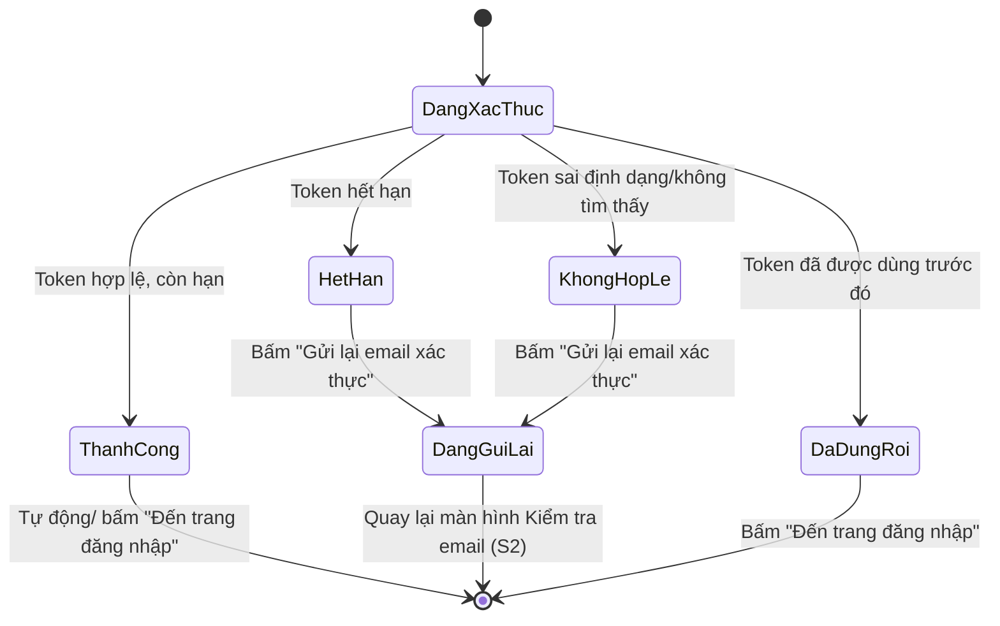
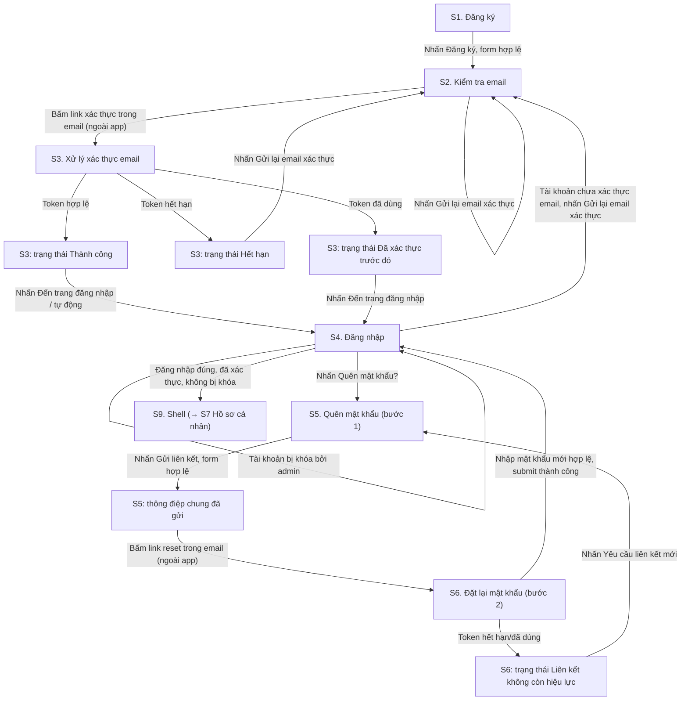
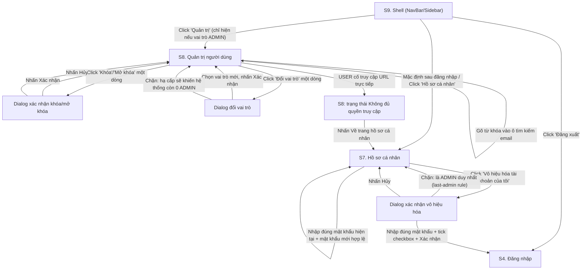

# Đặc tả UI/UX: Module nền tảng Auth + RBAC — Multi-User System

| | |
|---|---|
| **Phiên bản** | 1.0 |
| **Ngày tạo** | 2026-10-18 |
| **Nguồn yêu cầu** | `docs/requirements/srs-multi-user-system.md` (REQ-AUTH, REQ-SESSION, REQ-RBAC, REQ-ACCOUNT, REQ-ADMIN, NFR-006) |
| **Nguồn chuẩn UI** | `CLAUDE.md` — mục "UI Design Principles" |
| **Bối cảnh kỹ thuật** | Next.js frontend, auth qua session cookie httpOnly/Secure (server-side session trong PostgreSQL theo ADR `0001-session-management-strategy.md`), API do `api-designer` thiết kế riêng |

LƯU Ý: Đây là đặc tả wireframe dạng TEXT có cấu trúc (mô tả thành phần, bố
cục bằng lời/ASCII, sơ đồ luồng mermaid, bảng quy tắc validate). Đây KHÔNG
phải file ảnh/mockup trực quan, KHÔNG phải file Figma/Sketch thật, và KHÔNG
chứa code component thật (`.tsx`...). Dev tự hiện thực hóa dựa trên tài
liệu này.

---

## Bối cảnh (đã khảo sát)

- **Đối tượng dùng**: `USER` (người dùng thông thường, tự quản lý tài khoản
  của chính mình) và `ADMIN` (quản trị viên, thêm quyền quản lý người dùng
  khác). Khách vãng lai chưa đăng nhập chỉ thấy các màn hình công khai
  (đăng ký/đăng nhập/quên mật khẩu). Nguồn: SRS mục 2.2.
- **Design system/component có sẵn**: Đã khảo sát (`Glob` toàn repo) —
  **repo hiện chưa có bất kỳ source code, thư mục `components/`/`ui/`, hay
  design token nào**. Đây là dự án mới hoàn toàn (đúng như `CLAUDE.md` đã
  ghi "repository hiện trống"). Do đó, mục "Nguyên tắc thị giác dùng chung"
  dưới đây là **đề xuất mặc định** bám sát `CLAUDE.md` → cần đội dev/design
  xác nhận trước khi hiện thực hóa thành design token thật (màu hex, font
  family cụ thể...).
- **Mô hình phiên đăng nhập**: session cookie httpOnly/Secure, không phải
  JWT lộ ra client → các màn hình KHÔNG lưu/hiển thị token trong UI, mọi
  điều hướng dựa trên kết quả gọi API (ví dụ 401 → về `/login`, 403 → màn
  từ chối quyền).

### Nguyên tắc thị giác dùng chung (áp dụng nhất quán mọi màn hình, theo NFR-006 + CLAUDE.md)

| Hạng mục | Áp dụng cụ thể (đề xuất) |
|---|---|
| Nền tổng thể | Gradient tối: `linear-gradient(135deg, #05060f 0%, #0b1120 60%, #0a0f1f 100%)`. Không dùng nền phẳng một màu. |
| Card/panel chính | Glassmorphism: nền `rgba(15,23,42,0.55)` + `backdrop-filter: blur(16px)` + viền `1px solid rgba(99,102,241,0.25)` (tím/indigo mờ) + bóng đổ nhẹ hướng xuống. |
| Accent màu | Neon cyan `#22d3ee` (hành động chính/focus), neon violet `#8b5cf6` (nhấn mạnh/badge ADMIN), neon đỏ-magenta `#fb3a5d` (lỗi/cảnh báo), neon xanh lá `#34d399` (thành công), neon amber `#f5b942` (cảnh báo nhẹ/trạng thái "chưa xác thực"). |
| Typography | Sans-serif hình học: heading dùng font dạng "Space Grotesk"/"Sora" (góc cạnh, HUD-feel), nội dung dùng "Inter". Không dùng serif/script. *(Cần dev xác nhận font cụ thể khi thiết lập token.)* |
| Nút hành động chính (primary) | Nền gradient `cyan → violet`, khi hover: tăng `box-shadow` glow (halo màu cyan), khi nhấn: scale nhẹ `0.98`. Transition `180ms ease-out`. |
| Nút phụ (secondary) | Viền mờ + nền trong suốt, hover đổi viền sang neon cyan nhạt. |
| Input field | Nền tối trong suốt, viền `rgba(148,163,184,0.25)` mặc định; khi focus viền chuyển neon cyan kèm glow mỏng; label là phần tử `<label>` thật đặt phía trên ô nhập (không chỉ dựa placeholder). |
| Trạng thái lỗi (input/thông báo) | Viền input + text lỗi chuyển neon đỏ-magenta `#fb3a5d`, kèm icon cảnh báo, glow nhẹ quanh viền — không chỉ dựa vào màu đơn thuần (đi kèm icon + text) để đạt tương phản/accessibility. |
| Trạng thái thành công | Icon check + text neon xanh lá `#34d399`, toast slide-in + fade từ góc trên-phải. |
| Loading (khối nội dung lớn: bảng, hồ sơ) | Skeleton shimmer (dải gradient sáng chạy ngang) thay vì spinner trần, giữ đúng bố cục khi có dữ liệu. |
| Loading (hành động nút submit) | Nội dung nút thay bằng vòng xoay (ring spinner) nhỏ, nút chuyển `disabled`, giữ nguyên kích thước nút (tránh layout shift). |
| Modal/dialog xác nhận | Overlay làm tối thêm nền (`rgba(0,0,0,0.6)`) + backdrop-blur, panel modal là glass card nổi giữa màn hình, có hiệu ứng fade+scale-in khi mở, fade+scale-out khi đóng. |
| Badge vai trò/trạng thái (bảng admin) | Pill bo tròn: `ADMIN` = nền tím neon mờ + chữ tím sáng; `USER` = nền cyan neon mờ nhạt hơn; trạng thái dùng chấm tròn glow: xanh lá (hoạt động), đỏ-magenta (bị khóa), amber (chưa xác thực email). |
| Motion tổng thể | Chuyển màn hình dùng fade/slide nhẹ (150–250ms), tôn trọng `prefers-reduced-motion` (tắt hiệu ứng chuyển động nếu người dùng bật chế độ giảm hiệu ứng). |

---

## Danh sách màn hình

### S1. Đăng ký tài khoản (`/register`) — REQ-AUTH-001

- **Mục đích**: Cho khách vãng lai tạo tài khoản mới bằng email/mật khẩu.
- **Thành phần chính**:
  - Glass card trung tâm trên nền gradient tối, logo/tên sản phẩm phía trên card.
  - Tiêu đề "Tạo tài khoản".
  - Form: field Email, field Mật khẩu (có nút toggle hiện/ẩn mật khẩu), field Xác nhận mật khẩu. *(Cập nhật 2026-10-18: bỏ field Họ tên khỏi bước đăng ký — quyết định stakeholder là thu thập tên sau, qua màn hình Hồ sơ cá nhân S7, để khớp với `api-spec-multi-user-system.md` và `lld-phase1-auth-session.md` — `RegisterDto` chỉ có `email`/`password`.)*
  - Khối "Quy tắc mật khẩu" hiển thị tĩnh ngay dưới field Mật khẩu (ví dụ: "Tối thiểu 8 ký tự, gồm ít nhất 1 chữ cái và 1 chữ số") — luôn hiển thị trước khi nhập, không chỉ hiện khi lỗi.
  - Nút hành động chính "Đăng ký" (primary, full-width trong card).
  - Link phụ "Đã có tài khoản? Đăng nhập" dẫn sang S4.

> **CẬP NHẬT 2026-10-19 (đã xác nhận với stakeholder, thay thế lưu ý gốc bên
> dưới)**: Khi chi tiết hóa xuống LLD Frontend (`low-level-designer`,
> `docs/design/lld-frontend-phase0-1.md`, mục "Rủi ro"), phát hiện backend
> đã code (`AuthService`/`DuplicateEmailException`) trả **`409
> EMAIL_ALREADY_REGISTERED`** rõ ràng khi email đã tồn tại, khác với thiết
> kế "ẩn hoàn toàn" mô tả ban đầu dưới đây. Stakeholder đã xác nhận
> **giữ theo hành vi thật của backend** (không sửa lại backend đã hoàn
> thành/đã test) — tức là **đổi quyết định AC2 cũ**: màn hình đăng ký ở S1
> **có** hiển thị lỗi 409 dưới field Email ("Email này đã được đăng ký.
> Vui lòng đăng nhập hoặc dùng email khác.") khi email đã tồn tại, thay vì
> luôn điều hướng ẩn danh sang S2. S2 chỉ còn áp dụng cho trường hợp đăng ký
> thành công thật. Lưu ý gốc dưới đây **không còn là quyết định hiện hành**,
> giữ lại chỉ để tham chiếu lịch sử.
>
> **Lưu ý thiết kế gốc (đã thay thế, xem cập nhật trên)**: SRS quy
> định rõ khi email đã tồn tại, hệ thống **không được tiết lộ** việc đó qua
> thông báo lỗi (tránh user-enumeration). Do đó màn hình đăng ký **không**
> có một "trạng thái lỗi email đã tồn tại" hiển thị riêng cho người dùng.
> Thay vào đó: khi submit hợp lệ về mặt định dạng, hệ thống luôn điều hướng
> sang màn hình S2 ("Kiểm tra email") với **cùng một nội dung thông điệp**,
> bất kể email đó đã tồn tại hay chưa trong hệ thống. Đây là thiết kế tuân
> thủ AC2, không phải thiếu sót — cần xác nhận lại với bên nghiệp vụ nếu họ
> thực sự muốn lộ thông tin này (sẽ mâu thuẫn với AC2 đã chốt).

#### Trạng thái màn hình

| Trạng thái | Hiển thị |
|---|---|
| Loading | Khi nhấn "Đăng ký": nút chuyển sang ring-spinner nội bộ, disable toàn bộ field + nút trong lúc chờ phản hồi API. |
| Empty | Không áp dụng (đây là form nhập liệu, không có dữ liệu để tải). |
| Error | Lỗi validate client-side hiển thị ngay dưới từng field (xem bảng D1). Lỗi server-side không-định-danh (ví dụ mật khẩu yếu theo rule server, email sai định dạng theo rule server) hiển thị dưới field tương ứng cùng phong cách. **Email đã tồn tại (cập nhật 2026-10-19, xem lưu ý trên — khác AC2 gốc)**: lỗi `409 EMAIL_ALREADY_REGISTERED` hiển thị inline dưới field Email: "Email này đã được đăng ký. Vui lòng đăng nhập hoặc dùng email khác." Lỗi do bị chặn spam/rate-limit theo IP (AC5/NFR-003): banner lỗi toàn form phía trên, nội dung "Hệ thống phát hiện quá nhiều yêu cầu đăng ký từ nguồn của bạn. Vui lòng thử lại sau." — không cho thử lại ngay (không có nút retry tức thời, chỉ có thể thử lại sau một khoảng thời gian). |
| Success | Điều hướng sang màn hình S2 "Kiểm tra email" (không hiển thị trạng thái thành công tại chỗ). |

#### Quy tắc validate input (D1)

| Field | Rule | Thông báo lỗi |
|---|---|---|
| Email | Bắt buộc; đúng định dạng email (ví dụ `tên@miền.tld`) | "Vui lòng nhập email" (để trống) / "Email không đúng định dạng, ví dụ: ten@vidu.com" |
| Mật khẩu | Bắt buộc; ≥ 8 ký tự; chứa ít nhất 1 chữ cái và 1 chữ số *(quy tắc theo Assumption A-1 trong SRS — **chưa phải quyết định cuối cùng**, cần stakeholder xác nhận trước khi code)* | "Vui lòng nhập mật khẩu" (để trống) / "Mật khẩu phải có ít nhất 8 ký tự, gồm ít nhất 1 chữ cái và 1 chữ số" |
| Xác nhận mật khẩu | Bắt buộc; phải trùng khớp với Mật khẩu | "Vui lòng nhập lại mật khẩu" (để trống) / "Mật khẩu xác nhận không khớp" |

---

### S2. Kiểm tra email (`/register/check-email`) — sau khi đăng ký thành công

- **Mục đích**: Thông báo cho người dùng rằng cần kiểm tra email để hoàn tất xác thực tài khoản.
- **Thành phần chính**:
  - Glass card trung tâm, icon phong bì (envelope) với hiệu ứng glow cyan nhẹ.
  - Tiêu đề "Kiểm tra email của bạn", mô tả: "Nếu thông tin hợp lệ, chúng tôi đã gửi một email xác thực đến địa chỉ bạn vừa đăng ký. Vui lòng kiểm tra hộp thư (kể cả mục Spam) và bấm vào liên kết để kích hoạt tài khoản."
  - Nút phụ "Gửi lại email xác thực" (secondary button).
  - Link "Về trang đăng nhập" dẫn sang S4.

#### Trạng thái màn hình

| Trạng thái | Hiển thị |
|---|---|
| Loading | Riêng cho hành động "Gửi lại email xác thực": nút chuyển ring-spinner, disable tạm thời. |
| Empty | Không áp dụng. |
| Error | Nếu gửi lại thất bại do rate-limit (giả định: áp dụng cùng cơ chế chống spam NFR-003 cho hành động gửi lại — **giả định cần xác nhận**): hiển thị thông báo inline dưới nút "Bạn vừa yêu cầu gửi lại gần đây, vui lòng thử lại sau [đếm ngược giây]." Nếu lỗi hệ thống/email service: "Không thể gửi email lúc này, vui lòng thử lại sau." kèm nút thử lại. |
| Success | Toast thành công "Đã gửi lại email xác thực.", nút "Gửi lại" chuyển trạng thái disabled kèm đếm ngược (ví dụ 60s) trước khi cho phép bấm lại. |

#### Quy tắc validate input

Không áp dụng (màn hình không có input nhập liệu).

---

### S3. Xử lý xác thực email (`/verify-email?token=...`) — REQ-AUTH-002

- **Mục đích**: Xử lý kết quả khi người dùng bấm vào liên kết xác thực email từ hộp thư.
- **Thành phần chính**: Glass card trung tâm duy nhất đổi nội dung theo trạng thái xử lý token (không có form nhập liệu).

#### Trạng thái màn hình

| Trạng thái | Hiển thị |
|---|---|
| Loading | Icon vòng xoay dạng HUD (ring glow xoay) + text "Đang xác thực tài khoản của bạn..." — hiển thị ngay khi trang tải, trong lúc gọi API kiểm tra token. |
| Empty | Không áp dụng. |
| Error — hết hạn (AC2) | Icon cảnh báo amber, tiêu đề "Liên kết đã hết hạn", mô tả "Liên kết xác thực này đã hết hạn sau 24 giờ." + nút primary "Gửi lại email xác thực" (gọi lại luồng gửi, có cùng cơ chế loading/rate-limit như S2). |
| Error — đã dùng rồi (AC3) | Icon check neon xanh lá nhạt (trung tính, không phải lỗi nặng), tiêu đề "Tài khoản đã được xác thực trước đó", mô tả ngắn + nút primary "Đến trang đăng nhập" (→ S4). |
| Error — token không hợp lệ/khác | Icon lỗi đỏ-magenta, tiêu đề "Liên kết không hợp lệ", mô tả "Liên kết xác thực không đúng hoặc đã bị hỏng." + nút "Gửi lại email xác thực" + nút phụ "Về trang đăng nhập". |
| Success (AC1) | Icon check neon xanh lá + glow, tiêu đề "Xác thực thành công!", mô tả "Tài khoản của bạn đã được kích hoạt." + nút primary "Đến trang đăng nhập" (→ S4), tự động điều hướng sau 3–5 giây (có thể hủy bằng cách bấm nút ngay). |

#### Quy tắc validate input

Không áp dụng (không có input nhập liệu, token lấy từ query string).

---

### S4. Đăng nhập (`/login`) — REQ-AUTH-003

- **Mục đích**: Cho người dùng đã có tài khoản (đã xác thực email) đăng nhập vào hệ thống.
- **Thành phần chính**:
  - Glass card trung tâm, tiêu đề "Đăng nhập".
  - **Banner ngữ cảnh (tùy chọn, hiển thị khi được điều hướng tới từ nơi khác)**: ví dụ "Phiên đăng nhập đã hết hạn, vui lòng đăng nhập lại." (REQ-SESSION-001 AC2) hoặc "Tài khoản của bạn đã bị khóa, vui lòng đăng nhập lại để biết chi tiết." (REQ-SESSION-001 AC3 — phiên bị thu hồi giữa chừng do admin khóa, REQ-ADMIN-002 AC1).
  - Form: field Email, field Mật khẩu (toggle hiện/ẩn).
  - Link phụ "Quên mật khẩu?" dẫn sang S5.
  - Nút hành động chính "Đăng nhập".
  - Link phụ "Chưa có tài khoản? Đăng ký" dẫn sang S1.

#### Trạng thái màn hình

| Trạng thái | Hiển thị |
|---|---|
| Loading | Nút "Đăng nhập" chuyển ring-spinner, disable form trong lúc chờ phản hồi. |
| Empty | Không áp dụng. |
| Error — sai thông tin đăng nhập (AC2/AC3) | Banner lỗi đỏ-magenta phía trên form: "Email hoặc mật khẩu không đúng." — **dùng cùng một thông điệp** cho cả hai trường hợp (sai mật khẩu hoặc tài khoản không tồn tại), đúng theo AC2/AC3 (không tiết lộ email có tồn tại hay không). |
| Error — tài khoản bị khóa tạm do brute-force (AC4/NFR-002) | Banner cảnh báo amber/đỏ: "Tài khoản tạm thời bị khóa do nhập sai quá nhiều lần. Vui lòng thử lại sau [đếm ngược còn lại, tối đa 15 phút]." Form bị disable trong thời gian khóa; đồng hồ đếm ngược dạng HUD monospace cập nhật trực quan. |
| Error — tài khoản bị khóa bởi admin (AC5) | Banner lỗi rõ ràng: "Tài khoản của bạn đã bị khóa. Vui lòng liên hệ quản trị viên để được hỗ trợ." — không có nút thử lại (vì không tự mở khóa được), không đếm ngược (khác với trường hợp brute-force). |
| Error — tài khoản chưa xác thực email (AC6/C-1) | Banner lỗi: "Tài khoản của bạn chưa được xác thực email. Vui lòng kiểm tra hộp thư hoặc gửi lại email xác thực." kèm nút inline "Gửi lại email xác thực" (gọi lại luồng như S2, cùng cơ chế rate-limit). |
| Success (AC1) | Điều hướng sang màn hình sau đăng nhập (mặc định: S7 Hồ sơ cá nhân, trong Shell layout S9). |

#### Quy tắc validate input

| Field | Rule | Thông báo lỗi |
|---|---|---|
| Email | Bắt buộc; đúng định dạng email | "Vui lòng nhập email" / "Email không đúng định dạng" |
| Mật khẩu | Bắt buộc (không áp dụng rule độ mạnh ở màn hình đăng nhập — chỉ validate "có nhập") | "Vui lòng nhập mật khẩu" |

---

### S5. Quên mật khẩu — Bước 1: Yêu cầu đặt lại (`/forgot-password`) — REQ-AUTH-004

- **Mục đích**: Cho người dùng yêu cầu gửi email đặt lại mật khẩu.
- **Thành phần chính**: Glass card, tiêu đề "Quên mật khẩu?", mô tả ngắn, field Email, nút primary "Gửi liên kết đặt lại mật khẩu", link phụ "Quay lại đăng nhập" (→ S4).

#### Trạng thái màn hình

| Trạng thái | Hiển thị |
|---|---|
| Loading | Nút chuyển ring-spinner, disable field trong lúc chờ. |
| Empty | Không áp dụng. |
| Error | Chỉ lỗi validate định dạng email (client-side). **Không có trạng thái lỗi "email không tồn tại"** — theo AC2, kết quả luôn là cùng một thông điệp thành công bất kể email có tồn tại hay không (tránh tiết lộ thông tin), tương tự cách xử lý ở S1. Lỗi rate-limit (nếu áp dụng — giả định dùng chung NFR-003) hiển thị dạng banner như S1. |
| Success | Chuyển nội dung card sang thông điệp trung lập: "Nếu địa chỉ email tồn tại trong hệ thống, chúng tôi đã gửi hướng dẫn đặt lại mật khẩu đến email đó. Vui lòng kiểm tra hộp thư." + nút "Quay lại đăng nhập". |

#### Quy tắc validate input

| Field | Rule | Thông báo lỗi |
|---|---|---|
| Email | Bắt buộc; đúng định dạng email | "Vui lòng nhập email" / "Email không đúng định dạng" |

---

### S6. Đặt lại mật khẩu — Bước 2: Từ liên kết (`/reset-password?token=...`) — REQ-AUTH-004

- **Mục đích**: Cho người dùng đặt mật khẩu mới sau khi bấm vào liên kết reset từ email.
- **Thành phần chính**: Glass card; hiển thị form đặt mật khẩu mới ngay khi vào trang.

> **CẬP NHẬT 2026-10-19 (đã xác nhận với stakeholder)**: LLD Frontend
> (`docs/design/lld-frontend-phase0-1.md`, mục "Rủi ro") phát hiện backend
> chỉ có **một endpoint duy nhất** `POST /auth/reset-password` nhận
> `{token, newPassword}` cùng lúc — không có endpoint riêng để kiểm tra
> token *trước khi* hiển thị form như mô tả ban đầu. Stakeholder đã xác
> nhận **bỏ bước "kiểm tra liên kết trước"**: trang hiển thị form nhập mật
> khẩu mới ngay khi vào, chỉ phát hiện token hết hạn/đã dùng/không hợp lệ
> **sau khi** người dùng submit. Không thêm endpoint pre-check mới ở
> backend. Bảng trạng thái dưới đây đã được cập nhật theo quyết định này.

#### Trạng thái màn hình

| Trạng thái | Hiển thị |
|---|---|
| Loading | Khi vào trang: hiển thị form ngay (không có bước kiểm tra liên kết trước — xem cập nhật trên). Khi submit mật khẩu mới: nút primary chuyển ring-spinner, disable form. |
| Empty | Không áp dụng. |
| Error — liên kết hết hạn/đã dùng/không hợp lệ (AC4, chỉ phát hiện được sau khi submit) | Icon cảnh báo amber, tiêu đề "Liên kết đặt lại mật khẩu không còn hiệu lực", mô tả "Liên kết đã hết hạn hoặc đã được sử dụng." + nút primary "Yêu cầu liên kết mới" (→ quay lại S5). Form đặt mật khẩu **ẩn đi** sau khi phát hiện lỗi này (thay thế bằng thông điệp lỗi). |
| Error — validate mật khẩu mới (client-side, xem bảng D6) | Hiển thị inline dưới field tương ứng. |
| Error — mật khẩu mới trùng mật khẩu cũ (AC5, chỉ phát hiện được server-side) | Banner lỗi/ inline dưới field Mật khẩu mới: "Mật khẩu mới không được trùng với mật khẩu hiện tại." |
| Success (AC3) | Toast/nội dung thành công "Đặt lại mật khẩu thành công." + tự động điều hướng sang S4 (Đăng nhập) sau 2–3 giây hoặc nút "Đăng nhập ngay". |

#### Quy tắc validate input (D6)

| Field | Rule | Thông báo lỗi |
|---|---|---|
| Mật khẩu mới | Bắt buộc; ≥ 8 ký tự; chứa ít nhất 1 chữ cái và 1 chữ số *(theo Assumption A-1 — cần xác nhận)* | "Vui lòng nhập mật khẩu mới" / "Mật khẩu phải có ít nhất 8 ký tự, gồm ít nhất 1 chữ cái và 1 chữ số" |
| Xác nhận mật khẩu mới | Bắt buộc; trùng khớp Mật khẩu mới | "Vui lòng nhập lại mật khẩu mới" / "Mật khẩu xác nhận không khớp" |

---

### S7. Hồ sơ cá nhân (`/profile`) — REQ-ACCOUNT-001, 002, 003

- **Mục đích**: Cho người dùng đã đăng nhập xem/sửa tên, đổi mật khẩu, và tự vô hiệu hóa tài khoản.
- **Bố cục**: Nằm trong Shell layout (S9). Chia 3 khối (section) trong cùng một trang, mỗi khối là một glass card riêng xếp dọc, có đường phân cách rõ ràng — khối cuối (Danger zone) có viền neon đỏ-magenta mờ để phân biệt mức độ nghiêm trọng.

#### S7a — Thông tin cơ bản

- **Thành phần chính**: Tiêu đề "Thông tin cá nhân"; field Email (readonly, disabled, kèm icon khóa nhỏ + tooltip "Không thể thay đổi email tại đây" — theo AC3); field Vai trò (readonly, hiển thị dạng badge USER/ADMIN); field Họ tên (editable); nút primary "Lưu thay đổi".

| Trạng thái | Hiển thị |
|---|---|
| Loading | Khi vào trang: skeleton shimmer cho toàn bộ 3 field (dạng khối chữ nhật thay chỗ). |
| Empty | Field Họ tên có thể trống đối với tài khoản mới đăng ký (từ 2026-10-18, đăng ký không còn thu thập tên — xem S1): hiển thị placeholder "Chưa đặt tên hiển thị" thay vì để trống hoàn toàn, khuyến khích người dùng điền. |
| Error | Tải thất bại: banner lỗi "Không thể tải thông tin hồ sơ." + nút "Thử lại". Lưu thất bại do validate: inline dưới field Họ tên. Lưu thất bại do lỗi hệ thống: toast lỗi "Không thể lưu thay đổi, vui lòng thử lại." |
| Success | Hiển thị đủ 3 field với dữ liệu hiện tại; sau khi lưu thành công: toast "Đã cập nhật hồ sơ." |

> **CẬP NHẬT 2026-10-19 (đã xác nhận, thay thế rule gốc dưới đây)**: LLD
> Frontend Phase 2 (`docs/design/lld-frontend-phase2.md`, mục "Rủi ro" #1)
> phát hiện `UpdateProfileDto` thật (`@Length(1,100)`, không
> `@IsOptional()`) yêu cầu `name` **bắt buộc, 1–100 ký tự** — khác rule gốc
> "không bắt buộc... nếu nhập thì 2–100 ký tự" dưới đây. Đã xác nhận giữ
> theo hành vi backend thật (không sửa backend). Field Họ tên ở S7a vẫn
> cho phép hiển thị placeholder "Chưa đặt tên hiển thị" khi `name=null`
> (dữ liệu cũ từ trước khi có rule này), nhưng **mọi lần lưu mới đều phải
> nhập họ tên** — không còn submit được giá trị rỗng.

| Field | Rule | Thông báo lỗi |
|---|---|---|
| Họ tên | **Bắt buộc, 1–100 ký tự** (cập nhật 2026-10-19 — xem trên; rule gốc "không bắt buộc... 2–100 ký tự" không còn đúng) | "Vui lòng nhập họ tên" (rỗng) / "Họ tên phải có 1 đến 100 ký tự" |
| Email | Readonly — không cho sửa | Không áp dụng |
| Vai trò | Readonly — không cho sửa | Không áp dụng |

#### S7b — Đổi mật khẩu

- **Thành phần chính**: Tiêu đề "Đổi mật khẩu"; field Mật khẩu hiện tại; field Mật khẩu mới + khối quy tắc mật khẩu tĩnh (giống S1); field Xác nhận mật khẩu mới; nút primary "Cập nhật mật khẩu".

| Trạng thái | Hiển thị |
|---|---|
| Loading | Nút submit ring-spinner, disable form. |
| Empty | Không áp dụng. |
| Error — mật khẩu hiện tại sai (AC2) | Inline dưới field Mật khẩu hiện tại: "Mật khẩu hiện tại không đúng." |
| Error — mật khẩu mới yếu/trùng mật khẩu cũ (AC3) | Inline dưới field Mật khẩu mới: thông báo rule tương ứng (xem bảng) hoặc "Mật khẩu mới không được trùng với mật khẩu hiện tại." |
| Success (AC1) | Toast "Đổi mật khẩu thành công." Form reset về rỗng. |

| Field | Rule | Thông báo lỗi |
|---|---|---|
| Mật khẩu hiện tại | Bắt buộc | "Vui lòng nhập mật khẩu hiện tại" |
| Mật khẩu mới | Bắt buộc; ≥ 8 ký tự; ≥1 chữ cái, ≥1 chữ số | "Vui lòng nhập mật khẩu mới" / "Mật khẩu phải có ít nhất 8 ký tự, gồm ít nhất 1 chữ cái và 1 chữ số" |
| Xác nhận mật khẩu mới | Bắt buộc; trùng khớp Mật khẩu mới | "Vui lòng nhập lại mật khẩu mới" / "Mật khẩu xác nhận không khớp" |

#### S7c — Khu vực nguy hiểm (Danger zone) — tự vô hiệu hóa tài khoản (REQ-ACCOUNT-003)

- **Thành phần chính**: Card viền neon đỏ-magenta mờ, tiêu đề "Vô hiệu hóa tài khoản", mô tả cảnh báo hậu quả (không thể tự khôi phục, đây là soft-delete theo C-2), nút nguy hiểm (destructive) "Vô hiệu hóa tài khoản của tôi" → mở **Dialog xác nhận**.
- **Dialog xác nhận** (glass modal, overlay tối + blur): tiêu đề "Xác nhận vô hiệu hóa tài khoản"; field "Nhập lại mật khẩu để xác nhận"; checkbox bắt buộc "Tôi hiểu rằng tài khoản của tôi sẽ bị vô hiệu hóa và tôi sẽ bị đăng xuất ngay lập tức."; nút "Hủy" (secondary) và nút "Xác nhận vô hiệu hóa" (destructive, disabled cho đến khi tick checkbox + nhập mật khẩu).

| Trạng thái | Hiển thị |
|---|---|
| Loading | Khi xác nhận trong dialog: nút "Xác nhận vô hiệu hóa" chuyển ring-spinner, disable toàn dialog. |
| Empty | Không áp dụng. |
| Error — mật khẩu xác nhận sai | Inline trong dialog dưới field mật khẩu: "Mật khẩu không đúng." |
| Error — chặn bởi last-admin rule (AC3, ràng buộc C-3) | **CẬP NHẬT 2026-10-19 (đã xác nhận, thay thế mô tả gốc)**: `GET /account/me` không trả thông tin "có phải ADMIN duy nhất không" (LLD Frontend Phase 2, mục "Rủi ro" #4) — FE **không thể** tự `disabled` nút trước khi mở dialog như mô tả gốc. Nút "Vô hiệu hóa tài khoản của tôi" LUÔN enable; lỗi `409 LAST_ADMIN_RULE_VIOLATION` chỉ hiển thị SAU khi submit, dưới dạng bannerError NGAY TRONG dialog (dialog giữ mở, không đóng+toast): "Không thể vô hiệu hóa: bạn là ADMIN duy nhất của hệ thống. Hãy gán vai trò ADMIN cho người khác trước." *(Mô tả gốc "disabled kèm tooltip cố định trước khi mở dialog" không còn áp dụng — cần có endpoint mới trả số ADMIN active để làm được, ngoài phạm vi Phase 2.)* |
| Success (AC1) | Toast "Tài khoản đã được vô hiệu hóa." → phiên kết thúc ngay → điều hướng về S4 (Đăng nhập) kèm banner ngữ cảnh "Tài khoản của bạn đã được vô hiệu hóa." |

| Field | Rule | Thông báo lỗi |
|---|---|---|
| Mật khẩu xác nhận (trong dialog) | Bắt buộc | "Vui lòng nhập mật khẩu để xác nhận" |
| Checkbox xác nhận hiểu hậu quả | Bắt buộc phải tick trước khi nút "Xác nhận" khả dụng | "Vui lòng xác nhận bạn đã hiểu hậu quả" (hiển thị nếu cố submit khi chưa tick — phòng trường hợp submit qua bàn phím) |

---

### S8. Quản trị người dùng (`/admin/users`, chỉ ADMIN) — REQ-ADMIN-001, 002, 003

- **Mục đích**: Cho ADMIN xem/tìm kiếm danh sách người dùng, khóa/mở khóa tài khoản, và gán/đổi vai trò.
- **Thành phần chính**:
  - Tiêu đề "Quản trị người dùng".
  - Ô tìm kiếm theo email (input với icon kính lúp, debounce khi gõ).
  - Bảng danh sách: cột Email, Họ tên, Vai trò (badge), Trạng thái (chấm glow + nhãn: Hoạt động / Đã khóa / Chưa xác thực email), cột Hành động (nút "Khóa"/"Mở khóa", nút "Đổi vai trò").

> **CẬP NHẬT 2026-10-19 (đã xác nhận, 2 điểm thay thế mô tả trên)**: LLD
> Frontend Phase 2 (`docs/design/lld-frontend-phase2.md`, mục "Rủi ro" #2,
> #3) phát hiện 2 điểm lệch với contract backend thật
> (`AdminUserListItemRecord`):
> 1. **Không có cột "Họ tên"** — repository thật không SELECT field này.
>    Bảng S8 thực tế chỉ có 4 cột: Email, Vai trò, Trạng thái, Hành động.
> 2. **`status` thật có 4 giá trị, không phải 3**: `ACTIVE` (Hoạt động),
>    `LOCKED` (Đã khóa), `PENDING_VERIFICATION` (Chưa xác thực email), và
>    **`DEACTIVATED`** (Đã vô hiệu hóa — tài khoản tự soft-delete qua S7c,
>    KHÔNG bị lọc khỏi danh sách admin). Badge "Đã vô hiệu hóa" (màu
>    xám/trung tính) là nhãn mới, cần UX xác nhận màu/nhãn chính thức. Nút
>    "Khóa"/"Mở khóa" tự `disabled` kèm tooltip cho dòng `DEACTIVATED`
>    (suy luận được trước từ `status`, khác trường hợp last-admin ở dưới).
  - Phân trang ở cuối bảng *(giả định cần — số lượng người dùng có thể lớn, SRS không nói rõ chi tiết phân trang, cần xác nhận)*.
  - **Dialog xác nhận khóa/mở khóa**: tiêu đề động ("Xác nhận khóa tài khoản" / "Xác nhận mở khóa tài khoản"), mô tả hệ quả (khóa → mọi phiên hiện tại của user đó kết thúc ngay — theo AC1), nút "Hủy"/"Xác nhận".
  - **Dialog đổi vai trò**: tiêu đề "Đổi vai trò cho [email]", select vai trò (USER/ADMIN, loại trừ vai trò hiện tại khỏi lựa chọn mặc định), nút "Hủy"/"Xác nhận thay đổi".

#### Trạng thái màn hình

| Trạng thái | Hiển thị |
|---|---|
| Loading | Khi vào trang hoặc khi tìm kiếm: skeleton shimmer cho các hàng bảng (giữ nguyên số cột). |
| Empty | Không có người dùng nào khớp từ khóa tìm kiếm: icon kính lúp mờ + text "Không tìm thấy người dùng nào khớp với '[từ khóa]'." + gợi ý "Thử từ khóa khác hoặc xóa bộ lọc tìm kiếm." (nút "Xóa tìm kiếm"). |
| Error | Tải danh sách thất bại: banner lỗi giữa trang "Không thể tải danh sách người dùng." + nút "Thử lại". Hành động khóa/mở khóa/đổi vai trò thất bại (lỗi hệ thống không phải last-admin rule): toast lỗi "Thao tác thất bại, vui lòng thử lại." |
| Success | Bảng hiển thị đầy đủ dữ liệu theo trang hiện tại. |

#### Quy tắc chặn bởi last-admin rule (C-3, áp dụng cho AC3 của REQ-ADMIN-002 và AC2/AC3 của REQ-ADMIN-003)

> **CẬP NHẬT 2026-10-19 (đã xác nhận, thay thế toàn bộ mô tả "disabled
> trước" dưới đây)**: Giống điểm đã ghi ở S7c, `GET /admin/users`/
> `GET /account/me` không trả thông tin "ai là ADMIN duy nhất" — FE
> **không có cách nào biết trước** để tự `disabled` nút như 2 mục đầu bên
> dưới mô tả (LLD Frontend Phase 2, mục "Rủi ro" #4). Hành vi THẬT đã
> code: nút "Khóa" và lựa chọn "USER" trong dialog đổi vai trò LUÔN
> enable cho MỌI dòng (kể cả dòng của chính ADMIN đang đăng nhập) — lỗi
> `409 LAST_ADMIN_RULE_VIOLATION` chỉ xuất hiện SAU khi submit, dưới dạng
> bannerError NGAY TRONG dialog tương ứng (dialog giữ mở). Mục thứ 3 dưới
> đây (hạ cấp 1 trong 2 ADMIN cuối, race-condition) vẫn đúng và xử lý
> theo đúng cùng cách (bannerError sau submit), không có gì thay đổi
> ngoài việc **không còn "tooltip disabled trước" cho 2 trường hợp đầu**.

- ~~**Tự khóa chính mình khi là ADMIN duy nhất**: nút "Khóa" tại dòng chính ADMIN đang đăng nhập **disabled kèm tooltip**: "Không thể khóa: bạn là ADMIN duy nhất của hệ thống."~~ *(không còn áp dụng — xem cập nhật trên)*
- ~~**Tự hạ cấp vai trò chính mình khi là ADMIN duy nhất**: trong dialog đổi vai trò tại dòng của chính mình, lựa chọn "USER" bị disabled kèm ghi chú: "Không thể hạ cấp: bạn là ADMIN duy nhất của hệ thống."~~ *(không còn áp dụng — xem cập nhật trên)*
- **Hạ cấp một ADMIN khác khiến hệ thống còn 0 ADMIN**: nếu hệ thống chỉ còn đúng 2 ADMIN và admin đang thao tác chọn hạ cấp admin còn lại — về nguyên tắc thao tác này không tự thân vi phạm rule (đang thao tác vẫn còn là ADMIN), nên **cho phép ở UI**; nếu backend phát hiện tại thời điểm xử lý hệ thống sẽ còn 0 ADMIN (race-condition), hiển thị lỗi rõ ràng: "Không thể thực hiện: hành động này sẽ khiến hệ thống không còn ADMIN nào." (bannerError trong dialog — KHÔNG có optimistic update để rollback, vì FE chỉ cập nhật UI sau khi có response thành công, xem LLD Phase 2).
- Nguyên tắc chung (vẫn đúng): **không ẩn hoàn toàn** các hành động bị chặn — hành động luôn khả dụng để bấm, lỗi (nếu có) luôn hiển thị rõ ràng ngay sau khi submit, không biến mất khó hiểu.

#### Trạng thái truy cập bị từ chối (REQ-RBAC-002 AC1 — USER cố truy cập trang admin)

- Nếu người dùng vai trò USER điều hướng trực tiếp tới `/admin/users` (ví dụ gõ URL tay): hiển thị màn hình chặn toàn trang (không phải bảng rỗng) — icon khóa, tiêu đề "Không đủ quyền truy cập", mô tả "Bạn không có quyền truy cập trang này." + nút "Về trang hồ sơ cá nhân" (→ S7). Mục "Quản trị" cũng không xuất hiện trong Sidebar (S9) với vai trò USER, nên đây chỉ là lớp phòng vệ bổ sung khi truy cập URL trực tiếp.

#### Quy tắc validate input

| Field | Rule | Thông báo lỗi |
|---|---|---|
| Ô tìm kiếm email | Không bắt buộc; cho phép tìm theo chuỗi con của email (không yêu cầu đúng định dạng email đầy đủ) | Không áp dụng lỗi validate — chỉ có trạng thái Empty nếu không khớp kết quả nào |
| Select vai trò (dialog đổi vai trò) | Bắt buộc chọn một vai trò khác vai trò hiện tại trước khi nút "Xác nhận" khả dụng | "Vui lòng chọn một vai trò khác vai trò hiện tại" |
| Dialog khóa/mở khóa | Không có input, chỉ xác nhận | Không áp dụng |

---

### S9. Layout chung — Shell điều hướng (NavBar + Sidebar)

- **Mục đích**: Khung điều hướng dùng chung cho mọi màn hình sau đăng nhập (S7, S8), phân biệt rõ quyền hạn USER vs ADMIN.
- **Thành phần chính**:
  - **NavBar (trên cùng)**: logo/tên sản phẩm (trái); bên phải: avatar/tên người dùng kèm badge vai trò nhỏ, click mở dropdown gồm "Hồ sơ cá nhân" (→ S7) và "Đăng xuất".
  - **Sidebar (trái)**: mục "Hồ sơ cá nhân" (luôn hiện); mục **"Quản trị"** chỉ hiện thêm nếu vai trò hiện tại của phiên đăng nhập là `ADMIN` (REQ-RBAC-002 AC3 — ADMIN truy cập bình thường chức năng USER, cộng thêm quyền admin).
  - Vùng nội dung chính bên phải hiển thị màn hình tương ứng (S7/S8).

#### Trạng thái màn hình

| Trạng thái | Hiển thị |
|---|---|
| Loading | Khi app khởi tạo và đang xác minh phiên đăng nhập hiện tại: hiển thị skeleton cho khu vực avatar/tên ở NavBar, Sidebar hiển thị khung mục menu dạng shimmer. |
| Empty | Không áp dụng. |
| Error | Nếu xác minh phiên thất bại (hết hạn/không hợp lệ/tài khoản bị khóa giữa chừng — REQ-SESSION-001 AC2/AC3): không hiển thị lỗi tại chỗ trong shell — điều hướng ngay về S4 (Đăng nhập) kèm banner ngữ cảnh tương ứng (đã mô tả ở S4). |
| Success | NavBar + Sidebar hiển thị đầy đủ theo đúng vai trò của phiên hiện tại. |

#### Quy tắc validate input

Không áp dụng (không có input nhập liệu trực tiếp; hành động "Đăng xuất" là action, không phải input).

---

## Sơ đồ luồng màn hình

### Luồng 1 — Đăng ký, xác thực email, đăng nhập, quên/đặt lại mật khẩu

### Luồng 2 — Sau đăng nhập: Hồ sơ cá nhân & Quản trị người dùng

---

## Khả năng tiếp cận (Accessibility)

- **Label rõ ràng**: mọi input (S1, S4, S5, S6, S7a/b, S7c dialog, S8 search/select) dùng phần tử `<label>` thật gắn với input qua `for`/`id`, không chỉ dựa vào placeholder — placeholder chỉ dùng làm ví dụ bổ sung, không thay thế label.
- **Liên kết thông báo lỗi với input**: mỗi thông báo lỗi inline gắn với input tương ứng qua `aria-describedby` (khái niệm), và input lỗi đặt `aria-invalid="true"` để screen reader đọc được trạng thái lỗi khi focus vào field.
- **Tương phản màu cho trạng thái lỗi/cảnh báo**: màu neon đỏ-magenta/amber dùng cho lỗi phải đạt tối thiểu tỷ lệ tương phản AA (≥ 4.5:1) so với nền tối phía sau; không dựa riêng vào màu sắc — luôn kèm icon + text mô tả rõ ràng (ví dụ icon cảnh báo + "Mật khẩu hiện tại không đúng.") để người khiếm thị màu vẫn nhận biết được.
- **Thao tác bàn phím cho hành động chính**: toàn bộ nút submit, nút trong dialog (Xác nhận/Hủy), nút hành động trong bảng admin (Khóa/Mở khóa/Đổi vai trò), và link điều hướng phải `tab`-focusable và kích hoạt được bằng `Enter`/`Space`; trạng thái `:focus-visible` có viền glow rõ ràng (không ẩn outline mặc định mà không thay bằng chỉ báo tương đương).
- **Modal/dialog** (S7c xác nhận vô hiệu hóa, S8 dialog khóa/đổi vai trò): bẫy focus (focus trap) trong dialog khi mở, `Esc` đóng dialog, khi đóng trả focus về phần tử đã mở dialog; dialog có `role="dialog"` + `aria-modal="true"` + tiêu đề gắn `aria-labelledby` (khái niệm).
- **Thông báo động (toast, banner lỗi/thành công)**: đặt trong vùng `aria-live="polite"` (hoặc `assertive` cho lỗi nghiêm trọng như tài khoản bị khóa) để screen reader đọc được ngay khi xuất hiện mà không cần người dùng phải tự tìm.
- **Đếm ngược (khóa brute-force S4, cooldown gửi lại email S2/S3)**: không chỉ cập nhật trực quan — cập nhật nội dung text đi kèm (ví dụ "còn 45 giây") để screen reader có thể đọc được trạng thái, tránh chỉ dựa vào animation.
- **Bảng admin (S8)**: dùng cấu trúc bảng ngữ nghĩa thật (`<table>`/`role="table"` khái niệm) với header cột rõ ràng, mỗi nút hành động trong hàng có nhãn đầy đủ ngữ cảnh cho screen reader (ví dụ "Khóa tài khoản user@example.com" thay vì chỉ "Khóa").
- **Chuyển động**: tôn trọng `prefers-reduced-motion` — khi người dùng bật chế độ giảm hiệu ứng, tắt/giảm hiệu ứng fade-slide, glow-pulse, shimmer; chuyển trạng thái tức thời thay vì animated.

---

## Giả định đã đưa ra

- Quy tắc độ mạnh mật khẩu (≥8 ký tự, ≥1 chữ cái, ≥1 chữ số) dùng theo Assumption A-1 trong SRS — **chưa phải quyết định cuối cùng của stakeholder**, cần xác nhận trước khi hiện thực hóa UI validate thật.
- Hành động "Gửi lại email xác thực" (S2, S3, S4) được giả định áp dụng cơ chế chống spam/rate-limit tương tự NFR-003 (giới hạn tần suất gửi lại) — SRS không nêu rõ ràng buộc riêng cho hành động resend, cần xác nhận với backend/api-designer.
- Bảng danh sách người dùng ở S8 được giả định có phân trang vì số lượng người dùng có thể lớn — SRS (REQ-ADMIN-001) không nêu chi tiết UI phân trang, cần xác nhận.
- Giả định hành vi khi người dùng rời màn hình đặt lại mật khẩu/xác thực email giữa chừng (ví dụ đóng tab khi đang loading): không có xử lý đặc biệt, coi như hủy bỏ thao tác, không có trạng thái "lưu nháp".
- Font chữ cụ thể ("Space Grotesk"/"Sora" cho heading, "Inter" cho nội dung) là đề xuất mặc định theo tinh thần "geometric sans-serif" của CLAUDE.md — cần đội dev/design xác nhận font family chính thức khi thiết lập design token.
- Toast thông báo mặc định xuất hiện ở góc trên-phải màn hình, tự ẩn sau vài giây đối với thành công, giữ lâu hơn hoặc cần người dùng đóng thủ công đối với lỗi nghiêm trọng — đây là pattern mặc định đề xuất, chưa có pattern có sẵn trong dự án để đối chiếu (repo chưa có code).

## Ngoài phạm vi (nếu có)

- Không phát hiện màn hình nào khác ngoài 7 nhóm màn hình đã được giao (Đăng ký, Xác thực email, Đăng nhập, Quên/Đặt lại mật khẩu, Hồ sơ cá nhân, Quản trị người dùng, Layout chung). Màn hình "Không đủ quyền truy cập" (403) được thêm vào như một trạng thái phụ của S8 vì nó trực tiếp phục vụ REQ-RBAC-002 AC1 đã nằm trong phạm vi RBAC được giao, không phải mở rộng ngoài phạm vi.
- Các hạng mục SRS liệt kê rõ "Ngoài phạm vi giai đoạn 1" (OAuth, 2FA, đa phiên đăng nhập, audit log admin, i18n, vai trò Moderator) — không được thiết kế ở đây, đúng theo SRS mục 5.2.

## Bước tiếp theo gợi ý

- Dùng `api-designer` (nếu chưa thực hiện) để thiết kế contract REST/GraphQL cụ thể hỗ trợ đúng các trạng thái đã mô tả ở đây (ví dụ: endpoint cần phân biệt được "hết hạn" vs "đã dùng" cho token xác thực/reset, endpoint resend có trả về thông tin cooldown để UI hiển thị đếm ngược chính xác).
- Xác nhận lại với stakeholder các giả định đã liệt kê ở mục "Giả định đã đưa ra" (đặc biệt A-1 về độ mạnh mật khẩu) trước khi code UI thật.
- Khi đội dev bắt đầu hiện thực hóa, nên thiết lập design token chính thức (màu hex, font family, spacing scale) dựa trên đề xuất ở mục "Nguyên tắc thị giác dùng chung" và đóng gói thành theme dùng chung (ví dụ Tailwind config/CSS variables) để đảm bảo nhất quán giữa các màn hình — việc này là code thật, nằm ngoài phạm vi agent này.
- Dev tự code UI (Next.js) dựa trên đặc tả này; nếu cần thiết kế lại cấu trúc component/class nội bộ (ví dụ tách `AuthFormCard`, `PasswordRuleHint` tái sử dụng), dùng `low-level-designer` để thiết kế kiến trúc code tương ứng.
</content>
